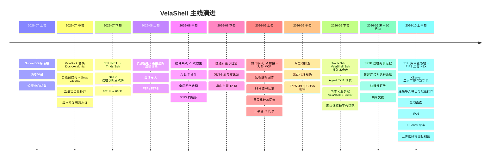
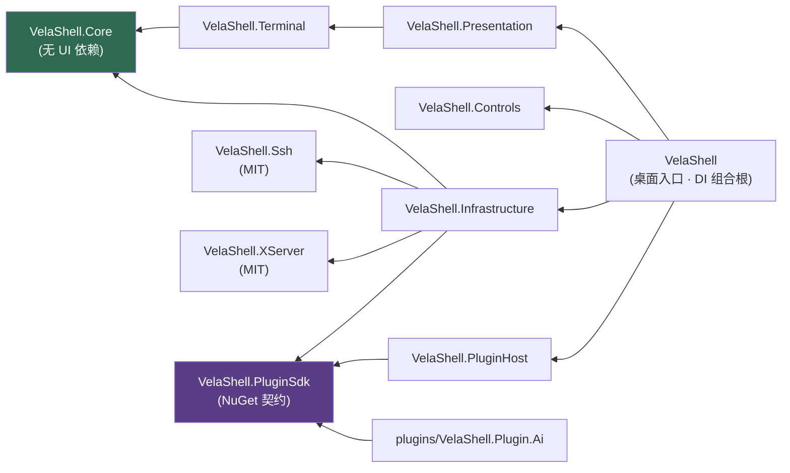

# VelaShell 项目进展与参考文档

> **这份文件记录「已经发生的事」** —— 当前架构、关键约定，以及每一次「为什么这么改」的来龙去脉。
> 它是开发跟进的事实来源。
>
> **还没发生的事在 [`feature-plan.md`](feature-plan.md)** —— 待办、候选特性、已决策不做的清单。
> 两份文件的分工是硬的：一件事做完了，就从 `feature-plan.md` 划掉、在这里补一节；
> 一件事还没做，就不要在这里留 TODO。
>
> **2026-09-26 精简**：原文 7,200 行，每节压成「做了什么 + 关键决定 + 值得记住的坑」，
> 删掉了代码对照、测试清单与逐步排查过程。完整原文在 git 历史里（本次精简之前的版本即是）。
> **2026-10-13 第二次精简**：此后新写的 §118 – §202 按同一口径压缩（全文 3,000 行 / 440 KB → 1,850 行 / 230 KB），
> 正文里的「还没做」一律摘进 `feature-plan.md`。精简前的全文：`git show eba8452d:plan.md`。
> **节号一律保持不变** —— 代码注释、CI 配置、测试、`feature-plan.md` 与 velashell-docs 都按「plan.md §NN」引用它们，
> 节内的小标签（§71-六、§162 的 Q7、§201 的一至六这类）也照原样；两个 §82、两个 §92 是历史上撞号留下的，照原样保留。

## 🏷️ 状态标识

| 标识 | 含义 |
| :---: | --- |
| ✅ | **已完成** —— 已落地、有测试、可验收 |
| 🚧 | **部分完成** —— 主线可用，剩下的缺口在 `feature-plan.md` |
| 📖 | **参考资料** —— 描述当前状态或约定，不是「一件要做的事」 |
| ⚠️ | **坑** —— 会绊到人的地方 |

## 🗺️ 全文索引

**一、当前状态与约定**（长期有效，随代码更新）：
[§1 技术栈](#-1-技术栈现状) ·
[§2 解决方案分层](#-2-解决方案分层) ·
[§3 终端引擎](#-3-终端引擎) ·
[§4 SSH / PTY](#-4-ssh--pty) ·
[§5 VelaDock](#-5-停靠--分屏veladock) ·
[§6 UI 与设置](#-6-ui--视图与设置) ·
[§7 测试](#-7-测试) ·
[§8 关键约定与已知坑](#-8-关键约定--已知坑)

**二、进展记录**（按时间顺序，最新在最下）：

| 时段 | 节 | 主线 |
| --- | :---: | --- |
| 07-08 | §9 | SonnetDB 存储层、两步登录、设置窗口 |
| 07-09 ~ 07-10 | §10 – §12 | 设置接线复盘、设计稿与竞品缺口（未完成项已迁往 `feature-plan.md`）；OSC 8 / OSC 133（§10-D / §10-E，09-08 补记） |
| 07-11 ~ 07-14 | §13 – §16 | 设置审计整改、Gist 云同步、会话录制、五语言、发布流水线、VelaDock、自绘窗口壳 |
| 07 下旬 ~ 08-14 | §17 – §18 | SSH.NET → Tmds.Ssh、SFTP 双栏、插件系统 v1 + AI 插件、资源监视、路由追踪、FTP、全局代理 |
| 08-30 ~ 08-31 | §19 – §28 | 隧道计量与自愈、消息中心与资讯源、具名主题 12 套 |
| 09-01 ~ 09-07 | §29 – §49 | 插件收据、AI 模型清单、协作接入（IM 桥接 + 对外 MCP）、插件开会话、连接体验一批修复、CI 偶发失败 |
| 09-08 ~ 09-10 | §50 – §68 | 远程编辑回传（#396 四轮）、插件发布者连续性、SSH config 导入、选区对比度、SSH 证书认证、VelaDock 窗格、防空闲、协议图标 |
| 09-11 ~ 09-15 | §69 – §77 | 插件图标与更新、符号链接、目录比较与同步、中文预编辑、Linux 走 XWayland |
| 09-17 ~ 09-21 | §78 – §90 | 冷启动与 Defender、出站代理规约、SIMD 调研、资源管理器置顶、指纹变更弹窗、Xshell 外部拉起、Ed25519 / ECDSA、AI 面板卡顿 |
| 09-22 ~ 09-23 | §91 – §103 | 换成 VelaShell.Ssh 并并入本仓库、Agent / X11 / 压缩、自动加钥、agent 转发限定、VelaShell.XServer M1 – M2 |
| 09-23 ~ 09-24 | §104 – §113 | XServer 功能完备与 M3（接入宿主）、AltGr、M4（GLX 等）、键盘布局、SSH 库三批全库审查与主机证书 |
| 09-25 ~ 09-26 | §114 – §124 | XServer 审查与渲染路径、SSH 库 API 规范、窗口外框跨平台适配、状态栏对齐、CI 行尾、软换行长行复制、XServer 审查 31 项修完 |
| 09-27 ~ 09-29 | §125 – §143 | PTY 像素贯通、CI 偶发、SFTP 双栏远程、窗口位置、快捷键可改、共享凭据 |
| 09-30 ~ 10-03 | §144 – §159 | chown、连接对话框改版、审计与快捷命令、SSH agent 修补 |
| 10-05 ~ 10-07 | §160 – §166 | SSH 库审查落地、FIPS 混合 KEX、CI SSH 红用例 |
| 10-07 ~ 10-08 | §167 – §172 | XServer 二次全库审查修复、CI 红用例、Linux 检查更新打开发布页 |
| 09-22 ~ 10-09 | §173 – §174 | AI 插件:健康检查与故障转移、同供应商多 API Key(#582) |
| 10-09 ~ 10-10 | §175 – §193 | 悬停闪烁真因(#577)、侧栏两个开关(#586)、AI 插件复审与修复、XServer 二次审查收尾与第十二节新功能(程序清单、信任级别、拖放、托盘、XIM 桥)、连接导入导出与批量操作(#571)、隧道面板一批修复、启动画面、SSH 库四处修补 |
| 10-11 ~ 10-14 | §194 – §208 | 清零编译警告、CI 偶发的两处根因、X 程序一打字就退出、上传选择框(路径输入、键入定位、图标视图)、IPv6(#611)、文件栏路径输入与键入定位、X Server 帧率、Responses 工具循环、SFTP 确认进度与续传测速、目录收藏 |

## 📈 阶段脉络



## 🧭 当前基线（2026-10-14）

| 项 | 值 |
| --- | --- |
| 发布 | 以 [GitHub Releases](https://github.com/joesdu/VelaShell/releases) 为准。仓库里 `Directory.Build.props` 的 `0.0.1-dev` 是开发期占位，发版由 Release 标签经 `-p:Version` 覆盖 |
| 测试 | 最近一次全量记录：4800 条，**4761 通过 / 1 失败 / 38 跳过**（2026-09-26，§124；失败的是 Core.Tests 的 X11 靶机用例，本机靶机镜像旧）。之后各节只按改动涉及的测试工程记数（如 2026-10-13 `VelaShell.Tests` 2078 通过 / 19 跳过）；`-warnaserror -p:EnforceCodeStyleInBuild=true` 下构建零警告（§194） |
| 测试项目 | 11 个 MSTest 项目 + 1 个 BenchmarkDotNet 项目（见 §7） |
| CI | `ci.yml` 三平台矩阵（windows / ubuntu / macos），push `main` 与全部 PR 触发 |
| 待办 | 见 [`feature-plan.md`](feature-plan.md) |

## 📖 1. 技术栈现状

> 版本以 `global.json`、`Directory.Build.props`、`src/Directory.Packages.props`、`tests/Directory.Packages.props` 为准；
> 下表是 2026-10-13 的快照。

| 项 | 版本 / 说明 |
| --- | --- |
| .NET | **net11.0**（2026-07 由 net10 切入）。`global.json` 钉 `11.0.100-rc.1.26425.128` + `rollForward: latestFeature` + `allowPrerelease`；`Directory.Build.props` 开 `EnablePreviewFeatures`、`runtime-async=on`、`LangVersion=preview` |
| UI | **Avalonia 12.1.4** · ReactiveUI 26.0.1 / ReactiveUI.Avalonia 12.1.6 |
| 停靠 | **VelaDock**（`src/VelaShell/Docking/`，零第三方停靠依赖，已替换 Dock.Avalonia） |
| SSH / SFTP | **VelaShell.Ssh**（`src/VelaShell.Ssh`，MIT，全托管 async-first；2026-09-22 替换 Tmds.Ssh，§91；09-23 并入本仓库，§92）。只有 `Infrastructure/Ssh/` 直接用它，异常经 `SshInterop` 翻译。密码学原语走 BCL 与 BouncyCastle 2.7.0 |
| X11 | **VelaShell.XServer**（`src/VelaShell.XServer`，MIT，可嵌入的 X 服务端，§101 起）；Windows 上可选改拉起 VcXsrv |
| FTP | **FluentFTP 55.0.0**。⚠️ **不要**引 FluentFTP.GnuTLS —— LGPL-2.1-only，与商业授权冲突 |
| 持久化 | **SonnetDB.Core 4.0.0**，嵌入式多模型（文档 + 时序），`~/.velashell/sonnetdb`；LiteDB 已移除 |
| IP 归属地 | MaxMind.Db 5.2.0（只是 mmdb 读取库，数据是 DB-IP Lite City，CC BY 4.0） |
| 插件契约 | **VelaShell.PluginSdk 2.0.9**（nuget.org 包，**不做工程引用**，版本 pin 在 `src/` 与 `tests/` 两份 `Directory.Packages.props`） |
| 打包 | 便携 zip / tar.gz（6 RID）+ `.AppImage` / `.deb` / `.rpm` / `.dmg` / MSIX；应用内自更新走 GitHub Releases 的 `latest.json`（Velopack、WiX MSI 均已移除） |
| 依赖管理 | 集中式包管理（`ManagePackageVersionsCentrally`）+ SourceLink。⚠️ `plugins/` 下的插件**不走**中央包管理，版本写在各自 csproj |
| 测试 | **MSTest 4.5.1**（已从 xUnit 全量迁移，FluentAssertions 已移除）· Avalonia.Headless 12.1.4 · BenchmarkDotNet 0.16.0-preview.2 |
| AI 栈 | Microsoft.Extensions.AI 10.10.0 · ModelContextProtocol.Core 2.2.0 · LiveMarkdown.Avalonia 2.4.3（含 Mermaid / Math / Svg）—— 只在 AI 插件里 |

## 📖 2. 解决方案分层

```text
src/
├── VelaShell/                桌面入口、DI 组合根、视图、App 层 ViewModel、VelaDock 停靠、X 服务端的 Avalonia 宿主
├── VelaShell.Presentation/   跨层 ViewModel、连接 / 隧道工作流服务
├── VelaShell.Controls/       自定义控件（LucideIcon 等）、设计令牌、内置 Cascadia Mono 字体
├── VelaShell.Terminal/       VT 终端引擎 + 自绘渲染控件
├── VelaShell.Core/           领域模型、抽象契约、数据存储接口、协议引擎、本地化（无 UI 依赖）
├── VelaShell.Infrastructure/ SSH / SFTP / FTP / 隧道实现、SonnetDB 持久化、插件管理与能力实现
├── VelaShell.Ssh/            SSH 库（MIT，净室规程见其 AGENTS.md）
├── VelaShell.XServer/        X11 服务端库（MIT，净室规程见其 AGENTS.md）
└── VelaShell.PluginHost/     隔离插件的宿主进程（命名管道 RPC，只依赖 SDK 契约）
plugins/VelaShell.Plugin.Ai/  第一方 AI 助手插件（同仓构建、同版发布；例外理由见 plugins/README.md）
tests/                        11 个 MSTest 项目 + 1 个 BenchmarkDotNet 项目 + cert-lab 证书靶机（见 §7）
```

**依赖方向**（Core 不依赖任何 UI 框架；两个 MIT 库不依赖宿主任何程序集）：



> 箭头指向被依赖方。`PluginHost` 与 `Plugin.Ai` **只**认 SDK 契约，不依赖宿主任何内部程序集 ——
> 这正是插件能跨进程、跨 ALC 而类型仍然同一的前提。

## ✅ 3. 终端引擎

替换掉已停维护的 `AvaloniaTerminal 1.0.0-alpha.7`，VT 引擎在 `src/VelaShell.Terminal/Emulation/` 与 `Rendering/`：

- `VtParser` —— Paul Williams 的 DEC ANSI 状态机 + 独立 VT52 语法路径，消费 Unicode 标量，派发到 `IVtActions`。
- `TerminalScreen` / `TerminalRow` / `TerminalCell` —— 网格、主 / 备屏、DECSTBM、scrollback、tab stops。
- `TerminalEmulator` —— SGR（16 / 256 / 真彩）、光标与擦除、各种模式（DECAWM、括号粘贴、鼠标跟踪…）、DEC 线绘、DA / DSR 应答。
- `TerminalType` —— vt52 → xterm-256color 十种 profile，各带 TERM 名与 DA 应答，默认 xterm-256color。
- `Utf8Sink`（可配任意编码，GBK / Big5 靠 `CodePagesEncodingProvider`）、`CharWidth`（CJK 双宽）、`InputEncoder`（按键 → 字节）。
- `Rendering/VelaTerminalControl` —— 纯自绘 Avalonia `Control`，同时实现 `ITerminalEmulator` 接回 `SshTerminalBridge`。
  `ApplyLayoutSize` 拒绝 < 2 列 / 行的早期布局（修过「横幅每字一行」）。

## ✅ 4. SSH / PTY

- `SshTerminalBridge` 只读循环，**不向 shell 预写 `\n`**（修过「末行提示符重复」）。它的 `DataReceived` 旁路是记录专用的。
- **PTY 实时改窗**：控件布局时抛 `ITerminalEmulator.PtySizeChanged`（行列 + 物理像素的 `PtySize`，§125）→ `TerminalTabViewModel` 后台转发 →
  `IShellStreamWrapper.Resize` → `Infrastructure/Ssh/ShellStreamWrapper` 发 `window-change`。
- **连接失败不崩**：`MainWindowViewModel.TryConnectProfileAsync` 捕获认证 / 网络 / 超时，映射成本地化提示；
  `Program.cs` 挂了 `UnobservedTaskException` 与 `UnhandledException` 兜底。
- **连接持久化**：`SonnetDbSessionRepository`（`session_profiles` 集合，密码 AES-256-GCM）；最近连接取 `conn_history` 时序。
- 新建连接的密码框仅限 ASCII（`Behaviors/AsciiOnlyInput`）。

## ✅ 5. 停靠 / 分屏（VelaDock）

- **模型层** `Docking/Model/`（纯 INPC，可单测）：`DockWorkspace` / `DockGroup` / `DockSplit` / `DockDocument`。
  空组自动折叠（**只有根留着**，主组先把兜底身份交给邻居再退场，§64）；单子分栏自动提升；`MaximizedGroup` 只影响渲染、不动树。
- **控件层** `Docking/Controls/`：`DockWorkspaceControl` 按树渲染 Grid + GridSplitter，**按文档缓存视图**（切标签复用同一个 `TerminalTabView`）；
  `DockGroupControl`（标签条 + 溢出三连钮）、`DockTabItem`、`DockDragController` + `DockDropOverlay`（重排、跨组并入、五区拖放分屏）。
  **浮动窗口按产品决策不做。**
- `Controls/ReparentingHost` 保证共享的终端控件任一时刻只有一个父级。方案见 velashell-docs `zh/host/dock-replacement-plan.md`。

## ✅ 6. UI / 视图与设置

- **窗口壳**：主窗与全部对话框在 Windows 上是自绘无边框（`WindowDecorations="None"`）+ 原生行为补齐 ——
  空白区 `BeginMoveDrag`、双击最大化、**Snap Layouts 经 `MainWindow` 的 WndProc 钩子处理 `HTMAXBUTTON`**（`ce71b32`）、四周自绘缩放抓取区。
  ⚠️ **为什么 Windows 不走 `ExtendClientArea`**：Avalonia 12.0.5 的托管装饰会重复画标题与按钮、`WindowDecorationsElementRole` 的输入重定向没落地（按钮点不动），
  `BorderOnly` 还丢 `WS_CAPTION`（issue #21160 / #21212）。另一个坑：`VisualRoot as Window` 恒为 null，取窗口要走 `FindLogicalAncestorOfType<Window>()`。
  **以上只管 Win32**：2026-09-26 起 macOS 与 Linux 按平台走原生机制，统一入口 `Views/WindowChrome.cs`，见 §118。
- 文字菜单栏已整体移除（与命令面板重复，用户决策）；标题栏右侧是功能图标组，全部走命令注册表。
- **命令面板**（`Ctrl+P`；`Ctrl+K` 不绑，见 §154）：模糊子序列搜索、分类分组，条目 = 最近会话 + 全局命令。
- **状态栏跟随激活标签**：连接串 / 状态 / 终端类型 / 编码 / 尺寸 / 延迟。
- **设置窗口 14 页**：常规 / 外观 / 终端 / 密钥管理 / 共享凭据（§157）/ 快捷键（全局与标签类可改键、解绑，§155）/ 文件传输 / 安全审计 / 网络代理 / X Server / 代码片段 / 云同步 / 关于 / 支持与捐赠。
  逐项审计见 velashell-docs `zh/host/settings-audit.md`。
- **终端配色跟随主题**：未自定义时随具名主题配对的终端方案实时切换（§25、§26）。

## 📖 7. 测试

| 测试项目 | 覆盖 |
| --- | --- |
| `VelaShell.Core.Tests` | 领域模型、SFTP 与传输队列、隧道、目录同步、云同步加密 |
| `VelaShell.Terminal.Tests` | VT 解析、仿真、编码、字符宽度、侧栏折叠、OSC 8 / 133 |
| `VelaShell.Terminal.RenderTests` | 字形绘制的**像素级**回归（Skia 软件后端真实光栅化） |
| `VelaShell.Presentation.Tests` | ViewModel 工作流与命令 |
| `VelaShell.Infrastructure.Tests` | SonnetDB 持久化、凭据加密、ConPTY、SSH 接线、密钥管理、插件管理与跨进程 RPC |
| `VelaShell.Controls.Tests` | 自定义控件、主题令牌与样式守门 |
| `VelaShell.Plugin.Ai.Tests` | AI 插件：审批闸门、能力桥接、机密存取、会话历史、协作接入、面板 headless 交互 |
| `VelaShell.Tests` | 窗口级视图模型、身份验证流程、插件面板、窗口外框、headless 视图与像素回归 |
| `VelaShell.ShellIntegration.Tests` | 「文件浏览器跟随终端目录」的端到端验证：真 sshd、真登录 shell、真 PTY |
| `VelaShell.Ssh.Tests` | SSH 库单测 + 对真实 OpenSSH 的互操作（`Interop` 分类）。**一律用 Debug 跑**（Release 签名会省掉 `InternalsVisibleTo`） |
| `VelaShell.XServer.Tests` | X 服务端库单测 + 真实 X 客户端用例（需 `velashell-xclients` 镜像与 `VELASHELL_XSERVER_INTEROP=1`） |
| `VelaShell.Benchmarks` | BenchmarkDotNet 基准。**不进 CI 门禁** —— 结果受机器负载影响太大，用于同一台机器上比较改动前后 |

- **CI**（`.github/workflows/ci.yml`）：Debug 构建（强名签名只在 Release 打开，fork 与 Dependabot 的 PR 拿不到 secret）+ 全量测试 + `-warnaserror`；
  排除 `DockerIntegration` / `CrossPlatform`；本仓检出到 `VelaShell/` 子目录并把 `velashell-docs` 并排检出（快捷键比对用例要找得到对方）。
- ⚠️ **早退跳过在 MSTest 里记为「通过」**。Docker、发布、X 客户端这几类前提不满足时会安静地全绿，要看 `TestContext` 里有没有 `[SKIP]` 行。
- ⚠️ **headless UI 测试要用带返回值的重载** `Dispatch(async () => { …; return true; })`；无返回值的写法拿到一个没人 await 的 `Task<Task>`，断言失败全部丢失（§70）。
- ⚠️ **别拿固定 sleep / 固定泵赌调度**，一律改成等条件（§49、§50、§71-六）。
- 写法约定：`[TestMethod]` / `[DataTestMethod]` + `[DataRow]` / `[TestCategory]`；`Assert.AreEqual(期望, 实际)`；异常用 `Assert.ThrowsExactly(Async)`；
  `long` / `uint` 期望值带后缀（`AreEqual(object, object)` 类型严格）。
- `Terminal.Tests` 与 `VelaShell.Tests` 引了 `Avalonia.Headless`（宿主 `VelaHeadlessApp`）；`VelaShell.Tests/ModuleInit.cs` 初始化 ReactiveUI 调度器，保留。

## 📖 8. 关键约定 / 已知坑

- 构建与测试都用根目录 `VelaShell.slnx`。应用运行时构建会因 DLL 被占用失败 —— 先关应用。
- 工作区一律签出成 LF（`.gitattributes` 的 `* text=auto eol=lf`），否则 Windows CI 会在注释处报 IDE0055（§121）。
- 不要用 `Read` / `Grep` 直接读 `.pen` 设计文件（加密，只能走 pencil MCP）。
- **SonnetDB**：`Tsdb.Open(new TsdbOptions { RootDirectory })`；文档 `db.Documents.Open(name)` 的 Upsert / Get / Scan / Delete；
  时序 `db.Write(Point.Create(...))` + `SqlExecutor.Execute`。`FieldType` 是 `Int64` 不是 `Long`；**时序 tag 值不许空串**；
  **`ORDER BY time` 要求 SELECT 列表含 time**；`DELETE FROM measurement` 可能不支持（录制以 drop + 回写压缩兜底，§13-F）；
  仓储加密必须写副本，不能原地改传入的 profile（内存明文还在给活动连接用，§9）。
- **Avalonia 12**：`Run.Text` 绑定会在卸载时回写（转换器 `ConvertBack` 返回 `BindingOperations.DoNothing`，绑定标 `OneWay`）；
  ComboBox 的 `SelectedItem` 在 ItemsSource 为空时会把 null 写回（先填列表再回填选中）；XML 属性值里的换行被规范化成空格；
  **`ControlTemplate` 里直接写的属性值是 `LocalValue`，压过外部样式的 `Setter`**（§90）；元素上直接写 `Background` 同理盖掉 `:pointerover`（§20-H）；
  `Button` 默认 `HorizontalAlignment` 是 `Left` 不是 `Stretch`（§23）。
- **`SessionProfile` 是逐字段手写拷贝**，新增字段要把几处拷贝都补上（名单见 §37）；`AuthMethod` 等按序号落盘的枚举只能在末尾追加。
- **跨层识别异常一律 `is` 类型匹配，绝不按类型名或消息字符串**（§17-A、§82）。

## ✅ 9. 2026-07-08 完成情况(6 次提交,514 测试全绿)

- `2a270e5` 持久化全面切到嵌入式 SonnetDB(`SonnetDbEngine`,文档集合 + 时序 `conn_history` / `audit_log`);`AesSecretProtector` = AES-256-GCM + 本地 `secret.key`(密文前缀 `enc1:`);旧 JSON 导入后改名 `.migrated.bak`,LiteDB 移除。
- `10e9e70` 最近连接改取连接历史;`1e1fa6b` 新建连接弹窗。**坑**:仓储原地加密会把内存明文密码改成密文、重连认证失败 —— 改为写副本。
- `f5405f5` 两步登录验证 + 主机密钥 **TOFU**(指纹变化拒连);`3ef6bed` 文档;`2812048` 设置窗口九页。

## 🚧 10. 历史待办清单(已迁出)

> 2026-09-07 重整:待办整体迁往 [`feature-plan.md`](feature-plan.md),这里只留做完的与确认不做的结论。

### ✅ A. 设置项接线(2026-07-09)

终端 / 外观 / 常规 / 传输 / 安全 / 密钥六组设置从「存了但不生效」变成真生效(接线点 `ApplyLiveTerminalSettings`、`InfrastructureServiceCollectionExtensions`、`SftpService`);另有上传冲突策略(编辑器回传属有意覆盖)、断点续传(尾部 64KB 核实起点)。未闭合项见 feature-plan.md 的 P0 表。

### ❌ B. 确认不做(2026-07-10)

连字、自适应标题栏色、系统 Toast、输入脱敏、自定义键位、热切终端类型;理由见 feature-plan.md「确认不做」。其中自定义键位 2026-10-03 因 #551 推翻并实现,见 §155。

### ✅ C. 顺手清掉的技术债

SonnetDB **保留全局信号量**(文档与时序共用一个 Tsdb 实例,分锁有损坏风险;设置读热点靠缓存 JSON 文本解决);**OSC 52**(只写不读,1MB)与 DECRQSS 落地,顺带修掉 ST 结尾的 OSC/DCS 被整段丢弃的解析器 bug;CJK 回退由字体链 + 逐格回退覆盖。

### ✅ D. OSC 8 显式超链接(2026-09-08)

- `HyperlinkTable` 把 `(id, URI)` 驻留成 `ushort` 句柄,4096 条上限,仅 RIS 整表回收。
- ⚠️ 句柄放在 `TerminalRow` 的平行 `ushort[]?` 而非 `TerminalCell`(单元格恰好 16 B,加字段涨 25%);代价是每条行编辑路径都要搬,**`ReflowResize` 漏搬则一拖宽度链接全没**(`Osc8HyperlinkTests`)。
- 打印路径每格都盖句柄防幽灵链接;URI 要把 `p[2..]` 拼回(`;` 在查询串合法);`SGR 0` 不关链接。
- **安全**:scheme 白名单 `http/https/ftp/ftps/mailto`;**`file:` 刻意不放行**(远端路径在本机打开既无语义又最危险)。命中走 `LinkAtCell`,OSC 8 优先、正则兜底。

### ✅ E. OSC 133 命令块 / 语义提示符(2026-09-08)

- 做了引擎 + UI,**不做自动注入**。`TerminalRow.Mark` + `ExitCode` 挂在行上随 `Timestamp` 搬运,命令块由 `CommandBlocks` 按需推导不存状态。
- ⚠️ 标记只落重排后首行;⚠️ `Resize` / 备用屏切换必须丢掉 `_promptRow`(行对象会被复用,退出码会盖到无关行)。`B` 暂不落行。
- UI:侧栏命令标记列(非 0 标红)、点标记选输出、`Ctrl+Shift+↑/↓` 跳提示符(无标记时原样下发)、折叠按命令块对齐。
- 设置页摆可复制片段。⚠️ bash **不用 `DEBUG` trap**(与 bash-preexec 抢、`C` 会被别的 `PROMPT_COMMAND` 钩子抢走),改用 `PS0`;真 bash 验证,zsh / fish 未验。

## 🚧 11. 设计稿分析已记录的问题

终端类型 / 编码选择器、bright/256 色、CJK 回退字体、终端交互四项、亮色终端底色均已解决(后两者并入 §25 具名主题);剩余两个小项已迁往 feature-plan.md。

## 🚧 12. 与主流终端工具的功能缺口(已迁出)

> 2026-07-09 对照 Xshell / MobaXterm / Tabby / WindTerm 的 20 条;未完成项已迁往 feature-plan.md。

- ✅ **1** 本地终端(ConPTY,仅 Windows,不自动重连)· **2** ProxyJump(≤5 跳,**指纹按各跳逻辑主机校验**)· **3** 会话进命令面板 · **4** 导出缓冲区 · **5** 配色预设 · **6** 克隆会话 · **7** 同步输入(只挂用户输入,不回环)· **9** SSH config 导入(§58)· **12** known_hosts 管理 · **14** SFTP 双栏 · **16** 命令补全(程序提问时闭嘴)· **17** OSC 52。❌ **19** 多窗口、**20** Mosh(同一条里的 SSH 证书认证已于 §63 落地)。
- **8** ZMODEM 协议引擎在本仓库实现(**2026-09-14 已整体移除**,理由见 feature-plan.md「确认不做」)。⚠️ 教训仍然有效:互操作期望值必须按 lrzsz 源码手工构造 —— 用被测编码器自己生成期望值,编解码同错也全绿。
- **10** 连接代理 → 2026-08-14 落地为**应用级全局代理**,唯一出口 `IProxyResolver`;**配置不完整时拒连,绝不静默直连**;ICMP 与诊断裸 TCP 有意不走代理。
- **13** 标签自定义颜色(`b9ae31f`,`TerminalOverrides.TabColor`)。⚠️ **复核订正**:09-05 复核写「用户不可选」,次日即被推翻 —— 复核结论也会过期,写现状要给证据(文件行号)。
- 清单外:Telnet / 串口 / Redis / S3 以插件落地(宿主新增 `IProtocolTerminal`);FTP / FTPS 内置(§18-N)。

## ✅ 13. 2026-07-11 ~ 07-12 批次(设置审计整改 + 四个新特性)

**A. 设置审计整改**:BellMode 合并、`ObservableOptions` 统一。**B. 主机指纹三选项**:永久 / 仅本次 / 取消 = fail-closed,补上 SFTP 通道信任任意指纹的 MITM 缺口。
**C. GitHub Gist 云同步**:设置 + 连接配置(upsert 不删本地)+ 代码片段进单个 secret Gist,版本复用 revision;可选 PBKDF2 + AES-GCM 端到端加密,未启用时凭据绝不上传;PAT 经 `ISecretProtector` 加密、永不进载荷。
**D. 会话录制与回放**(只录输出流,导出 asciicast v2)。**E. 支持与捐赠页**。
**F. 后续增量**:录制保留天数随会话日志清理,**DELETE 不可用时 drop + 回写压缩兜底**(防孤儿数据块磁盘只增不减);MIT → AGPL-3.0 + 商业双许可。遗留项已登记在 feature-plan.md。

## ✅ 14. 多语言(2026-07-12 全量补齐,C-09 一并完成)

五语言(英文默认 + `zh-Hans/zh-Hant/ja/ko` 脚本中性文化),键集平价有测试守护。实时切换两处根因:`LocalizationService` 自持目标文化(线程文化随 ExecutionContext 回卷);Avalonia 12 不响应 `Item[]` 索引器通知,改绑普通属性。

## ✅ 15. 版本与发布(2026-07-12)

版本号单一来源 `Directory.Build.props`,发版由 Release 标签 `-p:Version` 覆盖;`publish-all.ps1` / `release.yml` 产 6 个含运行时的包 + `latest.json`;08-12 起**摊开发布**(`PluginHost` 需真实可执行体)。Velopack 已移除(卸载会清空数据根),分发 = 便携 zip + 应用内自更新。

## ✅ 16. 2026-07-13 ~ 07-14 批次(VelaDock、原生窗口壳、终端侧栏、工程化)

**A.** VelaDock 替换 `Dock.Avalonia`,零第三方停靠依赖(§5)。**B.** 无边框标题栏 + WndProc `HTMAXBUTTON` 实现 Snap Layouts;坑:Avalonia 12 的 `VisualRoot` 不是 `Window`,走 `FindLogicalAncestorOfType<Window>`。**C.** 行号 / 时间侧栏。**D.** Job Object 杀本地进程树。**E.** 密码提示行不弹补全。**F.** 集中式包管理、Avalonia 12.1。

## ✅ 17. 2026-07 批次(SSH 传输层迁移、ZMODEM、SFTP 双栏)

**A. SSH.NET → Tmds.Ssh**:改动全在 `Infrastructure/Ssh/`,Core 一行没改。07-22 修:异常按旧类型名字符串匹配,认证重试静默失效 —— 测试没抓到是因为测试里定义了迎合实现的假异常。约定:**跨层识别异常一律 `is` 类型匹配,绝不用 `GetType().Name`**。
**B.** ZMODEM 见 §12-8(已于 2026-09-14 移除)。**C.** SFTP 双栏见 §12-14。**D.** 远程编辑器语法高亮。**E.** net10 → net11(依赖预览版 SDK)。
**F. 拖入文件夹异常风暴**:`AutoConnect` 默认 true 导致每次 SFTP 操作静默重连,现显式 false;续传探测改走预列举名单。**G.** 两份调研文档。

## ✅ 18. 2026-07-24 ~ 08-14 批次盘点(2026-08-14 补记)

**A. 插件系统 v1 + AI 助手插件**:进程内 / 隔离进程(`PluginHost`,命名管道 RPC)双宿主,插件源码零改动;进度以 velashell-docs `STATUS.md` 为准。
**B. 资源监控窗口**:⚠️ 只对 POSIX 远端发探针,`RemoteShellProbe` 判否即「无数据」—— Windows 远端的 cmd.exe 会回显整行命令,被解析成全 0 假指标。
**C.** 连接诊断(直连,不走代理)。**D.** 路由追踪 + 离线 IP 归属地。
**E. 远端任务管理器**:同样先判 POSIX,否则报「不可用」—— 教训同 B,否则是一张 0 进程的假空表。
**F. 文件浏览器跟随终端目录**(09-15 重构):SSH 只能往已运行的 PTY 里打字,借 VS Code 的 OSC 633 协议、投递另解决:分 shell 注入且还原 `$?`、带 nonce 哨兵扣住回显(不按回显匹配,超宽折行各 shell 不同)、对端静默后注入且超时放行。真 sshd + 五种 shell 验证。
**G.** 传输面板 · **H.** Xshell / WinSCP 导入 · **I.** UI 字体令牌 · **J.** 终端交互 · **K.** 外观 · **L.** MSIX 打包 · **M.** 小项。
**N. FTP / FTPS**:连接池上限遇 `421` / `450` 自适应下调(`AdjustableConcurrencyGate`)。**O.** 全局代理见 §12-10。

## ✅ 19. 2026-08-30 隧道功能完善(计量转发 / 流量统计 / 断线自动恢复 / 端口冲突预检)

**A.** Tmds.Ssh 不暴露字节计数,转发数据面改由宿主接管(`MeteredPortForwardHandle`,含 SOCKS5 服务端);保留**半关闭语义**;用例拿客户端侧编码当地面真值。**B.** 停止时先取最后读数再释放句柄。**C.** 自动重连退避,**用户按停的不拉起**。**D.** 端口预检的探测委托可注入(否则测试看机器)。**E.** 9 个新键。**F.** 面板字号上调一档。

## ✅ 20. 2026-08-30 消息中心(侧边栏铃铛)

**A.** 只收可回看的消息,**不收运行时告警**。**B.** 资讯源契约字段只加不改,外链只放 https,坏条目单独跳过(08-31 改默认订阅,§22)。**C.** 跳转走 `ICommandRegistry`,分区用 `SettingsSectionKey` 枚举而非下标。**D.** 修好死开关 `CheckUpdatesOnStartup`。**E.** 同 id 重投保住已读状态。**F.** 浮层锚在铃铛旁。**G.** 24 个新键。
**H.** ⚠️ 元素上直接写 `Background` 是 local value,压过样式,`:pointerover` 盖不过去。遗留项已登记在 feature-plan.md。

## ✅ 21. 2026-08-31 补全弹层关不掉(#315)

**A. Ctrl+C**:空行清空空行不算「内容变化」,事件被吞;改为 `0x03` / `0x15` 一律记为变化。**B. 点击终端**:点已聚焦终端没有 `LostFocus`,补 `PointerPressed`。已登记 `ShortcutCatalog`。

## ✅ 22. 2026-08-31 资讯源默认订阅官方源

`FeedUrl` 默认改为官方源 —— 安全资讯要「没去找也能到」。默认行为变更同步了 `PRIVACY.md` 中英、velashell-docs 中英与 §20-B;存量空串配置原样保留。

## ✅ 23. 2026-08-31 消息中心:可拖动、加大字号、动作靠右

**A.** 拖拽抽成 `PanelDragHandler`。**B.** 外层 Panel 须铺满(拖拽参考系是父容器)。**C.** 字号加大一档。**D.** 去处行两端对齐。**D-1.** ⚠️ `Button` 默认 `HorizontalAlignment` 是 `Left` 而非 `Stretch`。**E.** 右留白 16 让滚动条。**F.** ⚠️ 圆角不裁内容,内层加 `CornerRadius=5` + `ClipToBounds`(不能裁卡片自身,会裁掉阴影)。**G.** 唯一投影令牌调软,同步 `DESIGN.md` §4.5。
测试教训:headless 帧是 **RGBA**,按 BGRA 读断言永远为真。

## ✅ 24. 2026-08-31 会话树状态卡在「连接中」(#321)

根因:一个节点多个标签、状态按最后一次写入,失败 / 取消路径还绕过 `OnDocumentClosed`。改为 `RefreshSessionStatus` 按配置取优先级最高者,订阅挂在 `OnTabsCollectionChanged` 让所有移除路径共用收口。SFTP 等文档型连接当时仍是后写的赢(与既有行为等价,不是新洞),后来在 §39 收掉。

## ✅ 25. 2026-08-31 具名主题:九套配色 + 终端配色配对

三值主题改为具名主题目录(六暗三亮),Id `dark` / `light` 不变。
**一、** 只写 25 个种子色(`UiThemePalette`),其余由 `ThemeTokenApplier` 派生 —— 手抄会错且看不出(#246)。
**二、** 终端配色三层叠加;硬约束:**方案背景必须等于主题 `VelaBgTerminal`**。
**三、** `UiThemeCatalogTests` 逐主题查对比度,真拦下了几处原版配色。**四、** `IsEmpty` 恒 false 的静默 bug。
**五、** 插件侧仍只见 `dark` / `light` / `system`,具名主题不外泄;启动先验 Id(降级不崩)。

## ✅ 26. 2026-08-31 主题命名收敛 + 「跟随主题」不再是隐式状态(用户反馈)

**一、** 只有 VelaDark / VelaLight 保留品牌名,其余用调色板原名。
**二、** 「跟随主题」曾隐式编码为「颜色 == 出厂 Dracula」,明选 Dracula 无从区分。改为显式 `TerminalColorsFollowTheme`(`bool?`,**不给初值**,null 按老口径推断);⚠️ 手改单色时直接置标志,不能反问 `FollowsTheme`。

## ✅ 27. 2026-08-31 再补三套主题:One Dark / One Light / Sakura(用户反馈)

主题 9 → 12、终端方案 14 → 16;One Light 绿黄与 Sakura 错误色按对比度尺子调过。新增主题 = 填种子色 → 跑 `UiThemeCatalogTests`。出厂强调色 `#E91E63` 会盖掉各主题强调色,遗留项已登记在 feature-plan.md。

## ✅ 28. 2026-08-31 切主题发卡(用户反馈)

**一、** 逐个写 64 个令牌 → 游离字典整格换入 `ThemeDictionaries`,40~57 ms → 1.65 ms;先贴令牌再换变体。**二、** 终端字体 setter 加相等判断(否则丢字形缓存)。**三、** 跨明暗不再刷两遍。**四、** 回归用例数**通知次数**而非耗时(耗时断言在 CI 必抖)。

## ✅ 29. 2026-09-01 命令行装的插件被判「收据缺失」(用户反馈)

- **一、错在宿主**:收据存在宿主信任库,CLI 够不着;宿主却把「没收据」当成拒装载,旁装(CLI、直接放目录)的插件全被标 Invalid。
- **二、收养随用随做**(`VerifyOrAdoptInstallReceiptAsync`):管理页装的收据内容变了一律拒;旁装的记 TOFU 基线,变了重记 + 日志;基线写不进不放行。
- **三、** 启动时 `PruneReceiptsWithoutDirectory` 清掉孤儿收据,免得同 id 重装被判「被改过」。
- **四、代价**:安全没让步;但同一插件别混用管理页与命令行。文档已同步 velashell-docs。

## ✅ 30. 2026-09-02 AI 插件:自定义供应商也能自动拉模型清单(用户反馈)

- **一、** 原来只认 models.dev,没收录的(Ollama、`custom-*`)不显示按钮;按钮还藏在只有订阅登录才可见的面板里。
- **二、端点优先**(`ModelPull.RunAsync`):先问端点 `/models`(`EndpointModelCatalog`)拿实际型号,再按 id 从 models.dev 补窗口/单价;端点失败退回 models.dev。
- **三、刻意降级**:非对话模型按名字滤,宁漏勿误;中转站单价留空 —— 照抄原厂价会让花费估算静默偏低。

## ✅ 31. 2026-09-02 AI 插件:左栏模型列表可折叠(用户反馈)

- **一、** `AiProvider.ModelsExpanded` 是 `bool?`:只有没表过态才按数量自动折(`AutoCollapseFrom = 12`),用户折/展过就尊重;拉取模型后复位。
- **二、** 选中项在里面时强制展开;折起时选中上移到供应商行。
- **三、** 整行都是折叠热区;→ 展开、← 折起;左右键须挂隧道阶段(`ListBox` 冒泡前就吃掉了)。

## ✅ 32. 2026-09-02 资源管理器:会话树改成摊平的平列表(用户反馈)

- **一、** 子行前的空白是 `TreeView` 的层级缩进区,压 `PART_*` 模板部件压不干净,换版本还会复发。
- **二、** 改成绑 `SessionTreeViewModel.Rows`(由 `Nodes` 派生)的 `ListBox`;`Rows` 就地对齐而非清空重建,否则双向绑的 `SelectedNode` 被清空。
- **三、** 滚到选中项改用 `ListBox.ScrollIntoView`(虚拟化后视口外没有控件可找)。
- 教训:`ShortcutCatalogTests.Doc_ListsEveryCatalogEntry` 因文档搬家红了几个月没人管(09-03 已修)。常年红着的用例等于没有。

## ✅ 33. 2026-09-02 协作接入:IM 桥接(飞书/钉钉/Telegram/企微)+ 对外 MCP 服务端

往外:群里 @ 机器人,agent 在已连上的会话上干活;往内:外部 agent 把 VelaShell 当 MCP 服务端。代码在 AI 插件 `Bridge/`、`Interop/`,插件因此改为 `onStartup` 激活。
- **一、** 四渠道四种传输(`IMessageChannel` + `ChannelHub`):飞书长连接(pbbp2 帧手写编解码)、钉钉 Stream、Telegram 长轮询、企微回调(只绑 127.0.0.1)。
- **二、安全默认**:白名单空 = 谁都不理;默认只读;`/mode` 只能往低调;审批走文本 `y`/`n`/`a`;绑定存 `user@host:port` 而非会变的 SessionId。
- **三、** 无头回合另写 `BridgeAgentRunner`,不拆 2500 行的 `ChatPanelView.SendAsync`。
- **四、对外 MCP**(`Interop/McpEndpoint`):Streamable HTTP,只绑回环,每请求带令牌。这条路没有审批界面,「询问」模式等于一律拒绝写操作 —— 这是刻意的,要放开得由用户显式选只读放行或绕过审批。
- **五、** 当时开不了新会话,已由 SDK 2.0.2 解决(§35、§36)。
- **六、坑**:`Wrap` 的多行 TextBox + 竖滚动条 Auto = 布局死循环,窗口卡死且无异常。文档已同步(`协作接入.md` 中英)。

## ✅ 34. 2026-09-02 协作接入配置流程返工(用户反馈:"要填一堆文本框")

改后流程:填两个框 → 测试 → 扫码拉机器人进群 → 群里发 `/pair`,全程不抄 id。
- **一、** 飞书/钉钉/企微的 `app_secret` 只能从后台拿,扫码变不出来。
- **二、配对码**(`PairingService`):六位、一次性、十分钟、错五次作废;只能加白名单。
- **三、** 被挡的聊天记为 `PendingChat`,设置页一键放行。**四、** [测试] 按钮(`ChannelProbe`)只读探测,飞书多查接入点。
- **五、** 拉群链接渲染成二维码;1.4.8 起在插件内实现编码器、替换 QRCoder(`Ui/QrCode.cs`)—— 它传递依赖 `System.Drawing.Common`,还炸了 macOS `codesign`。教训:引包先看传递依赖。**六、** 待放行清单加载完即刷。
- **七、** `PostAsJsonAsync` 按 Web 默认把 `AppID` 转成 `appID`,飞书回 9499;在类型上钉 `[JsonPropertyName]`。
- **八~十一、** 这页没照 `DESIGN.md` 走(引用不存在的 `VelaBorderSubtle`、按钮不居中、代码 `new` 的按钮进树前取不到主题),改用 `Button.host` / `Button.primary` / `CheckBox.host` class;headless 证明不了主题挂上,最后用 Skia 渲染 PNG 确认。
- **十二、十三、** 渲染抓出 `Loc.Table` 重复键静默覆盖;加 `NoKeyIsDefinedTwice`、`ThemeTokenUsageTests` 等守门。
- **十四、** 整轮在落后 18 个提交的基线上做,本节与 §33 因此顺延编号。教训:先 `git fetch`。
- **十五、** 飞书 401 而面板正常:桥接用的是启动时的设置快照,改为每轮现读。

## ✅ 35. 2026-09-03 插件能按已保存配置自己连一台机器(SDK 2.0.2 宿主侧落地)

宿主实现 SDK 2.0.2 的 `ISessionsApi.ListSavedAsync` / `OpenAsync` / `CloseAsync`。
- **一、闸门在宿主侧**:只开已保存的 SSH 配置;凭据不经插件;拒绝与失败分型(`PluginPermissionDeniedException` / `PluginSessionOpenException`);`Reason` 原样进确认框;只关得掉自己开的。
- **二、** 走 `TryConnectProfileAsync`,会话有标签、凭据框与指纹确认都不漏;headless 宿主一律拒 —— 没人可问不等于可以放行。
- **三、** `PluginPermissionGate` 里开会话与终端回写分两本账。**四、** `RpcSessions.OpenAsync` 超时给 5 分钟,等人看完确认框。
- **五、** 拒绝须以原异常类型跨进程到达插件。

## ✅ 36. 2026-09-03 AgentToolbox 接上开会话

新增 `list_saved_sessions` / `open_session` / `close_session`,§33-五 真正闭合。
- **一、** `open_session` 过两道人:审批闸问这轮对话,宿主确认框问这个插件(「始终允许」让无人值守走得通)。
- **二、** `close_session` 免审批:只能关自己开的,再要点头 agent 就不收拾了。
- **三、** 默认目标:显式 id > 选中项 > 本轮自己开的,免得用户看着 A、调用打到 B。
- **四、** 三处「你先去连一台」提示改掉。**五、** `AgentToolboxTests` 新增 15 条。

## ✅ 37. 2026-09-04 每条连接各配一条「认证后执行命令」(用户反馈)

每条 SSH 配置可各配一条命令 + 延迟(0~60 秒),与全局那条并存。
- **一、字段落在 `SessionProfile`,手写拷贝一处都不能漏**:`SessionProfile` 逐字段手写拷贝,新增字段须同步 `ConnectionProfileViewModel.BuildProfile`、`SonnetDbSessionRepository.Protect`、`ConnectionWorkflowService`(不记密码时的副本)、`SessionTreeViewModel`(复制会话);漏抄 = 重开后字段悄悄没了,`SonnetDbPersistenceTests` 钉住。
- **二、** 只对 SSH 出现,切走协议时清成 null(否则切回会诈尸执行)。
- **三、** 延迟防 motd / 横幅吞命令;用 `DispatcherTimer.RunOnce`,回调复核会话身份。
- **四、** 先全局后本条,重连同样执行。**五、** 文档已同步 §13.1 中英。

## ✅ 38. 2026-09-04 FTP / FTPS 可配「默认打开路径」(用户反馈)

- **一、** 落在 `FtpSettings`(只改 `Clone()`),FTP 专属,不进 `SessionProfile`。
- **二、** 只是候选表首位,打不开就退回登录目录再退回根 —— 配错不该把人堵在报错页。
- **三、** `FtpSettings.NormalizeRemotePath` 在 setter 上归一。
- **四、** 文档已同步 §13.1 中英。

## ✅ 39. 2026-09-04 文档型连接的树状态:关掉一个,别把另一个也熄了(用户反馈)

- **一、** 与 #321 同形:节点状态应合并名下全部会话,#321 只修了终端,文档型连接关闭时仍无条件写「未连接」。
- **二、** 新账本 `_documentSessions`,`RefreshSessionStatus` 合并「终端标签 ∪ 在册文档会话」;删掉三本旧册子,迟到事件不复活圆点。
- **三、** 第一版回归用例是假绿(断言跑在异步更新之前);改为等关闭任务 + 调度器栅栏,反向验证过会红。
- **四、** 新增一条环回 FTP 端到端用例。

## ✅ 40. 2026-09-04 数字输入框删空后别再甩一句转换异常(用户反馈)

- **一、** `NumericUpDown` 删空后 null 绑不到数值属性,界面原样显示 `InvalidCastException` 并撑坏布局;全项目 20 处皆然。
- **二、** `NumericInputGuard`:错误换成「请输入 A 到 B 之间的数字」;失焦仍空则 `SetCurrentValue` 恢复(直接赋值会掐断绑定);错误改用图标 + 悬停提示。挂在全局样式上。
- **三、** 隧道面板两个 `TextBox` 端口改 `NumericUpDown`。
- **四、** 设置窗口整卷扫描,带数量下限防假绿。**五、** `NumericInputGuardUiTests` 10 条。

## ✅ 41. 2026-09-05 对外 MCP 的「允许操作的服务器」改成勾选(用户反馈)

- **一、** 名字会改会重名,复用 §34 的勾选,存 `SavedSessionId`;`AllowedTargets` → `Scope`,范围外会话当作不存在。
- **二、** 默认值刻意与 IM 相反:MCP 默认不限范围(回环 + 令牌 + 只读已是边界)。
- **三、** `NormalizeScope` 迁移:旧清单空 → 不限;对得上的勾出;一行都对不上 → 失败关闭。
- **四、** 9 条新用例;文档已同步(协作接入 2.4 节中英)。

## ✅ 42. 2026-09-06 开一下 SFTP 面板,别把设置里的开关也给拨了(#377)

- **一、** 记标签状态时顺手写回了全局 `AutoOpenFileBrowser`,把临时状态与全局默认混成一层。
- **二、** 删掉写回;设置 = 新标签初值,标签 = 此后开关,面板 = 当下这一屏。
- **三、** 用例改钉「不写回」(`SaveCount == 0`)。

## ✅ 43. 2026-09-06 滚动条:悬停别等半秒,新建连接别一进来就是粗条(#378)

- **一、** `ShowDelay` 默认 0.5s;`AllowAutoHide="False"` 在 Avalonia 里是常驻展开而非「可见」。
- **二、** 全局 `ShowDelay` 150ms(置 0 会被擦碰误触);去掉连接对话框的 `AllowAutoHide="False"`。
- **三、** 两条用例;`DESIGN.md` 5.8 已补。

## ✅ 44. 2026-09-06 exit 之后不该被自动连回来;SFTP 通道跟着 SSH 一起收(#383)

- **一、** 重连判定只认工具栏「断开」;远端 `exit` 的干净 EOF 与掉线被 `ShellStreamWrapper.ReadAsync` 一律归成「返回 0」。
- **二、** 新增 `ShellCloseReason` 传到 `TerminalTabViewModel.RemoteShellExited`;`ShouldReconnect` 加 `remoteShellExited` 且不给默认值。
- **三、** `SftpService` 订阅 `SessionDisconnected` 在服务层收口,不靠各断开入口记得调用。
- **四、** 用例反向验证过;文档已同步「断开连接状态」中英。

## ✅ 45. 2026-09-07 新开标签页时,上一个会话的 SFTP 面板要立刻收起(#385)

- **一、** `RebindFileBrowser` 遇到 `SessionId == Guid.Empty`(握手中的新标签)直接 return,继续显示旧面板。
- **二、** 三种无 SFTP 会话的标签一律换隐藏占位;旧面板留在缓存,切回照旧恢复。
- **三、** 回归用例:加回 return 即红。

## ✅ 46. 2026-09-07 连接慢的时候,屏幕上必须有东西在动(#385 反馈)

- **一、** 标签先建再握手:`ConnectingDocument` 占位,连上后 `ReplaceDocument` 原位替换;文档型四条路径共用 `DocumentConnectUi`,关标签即取消,失败落在标签内而非模态框。
- **二、** 终端补 `ShowConnectingOverlay`。
- **三、** 各连接路径登记后台活动圆环;等用户输入时不转圈。
- **四、** 含渲染用例(只在慢时才看得到的界面最容易带坏资源发版);`DESIGN.md` 补 §5.2b「等待态」。

## ✅ 47. 2026-09-07 后台任务浮层是块黑砖,跟哪套主题都不搭(用户反馈)

- **一、** 裸内容浮层吃 Fluent 写死的近黑底色,不在 `Vela*` 令牌里。
- **二、** `FlyoutPresenter` 基础样式改走令牌,`.bare` 必须排在它之后。
- **三、** 每条活动带进度环(`BackgroundActivityItem.Fraction`)。
- **四、** `FlyoutPresenterStyleTests` 两条。**五、** `VerticalOffset="-8"` 让浮层不压状态栏,纯观感数值不写用例。

## ✅ 48. 2026-09-07 关掉「连接中」的标签,连接就该停下(用户反馈)

- **一、** 终端握手只带调用方令牌:关标签后圆环照转、超时后还弹错,握手在关后成功会留下孤儿连接。
- **二、** `BeginTabConnect` / `CancelTabConnect`(只取消不释放,否则撞 `ObjectDisposedException`)/ `EndTabConnect`,在 `OnDocumentClosed` 触发;失败按令牌判而非按异常类型。
- **三、** `ConnectingTabCancellationTests` 两条,反向验证会红。

## ✅ 49. 2026-09-07 CI ubuntu 偶发失败:隔离插件"连不上"被报成"激活超时"

- **一、** 报错是错的:连管道阶段超时逸出裸 `OperationCanceledException`,被一律写成「激活超时 30s」。
- **二、** 根因:`PluginHost` 先建 Avalonia 再连管道,Linux CI 上并行抢核时撞破 10s。
- **三、** 管道先连;新增 `IsolatedStartupTimeout` 与激活时限拆开;各段超时自报家门;软件渲染补齐 X11 / macOS。
- **四、** 回归用例把预算压到 1ms,断言报 `did not connect`。

## ✅ 50. 2026-09-08 CI macOS 偶发失败:背压用例拿固定 sleep 赌线程池已经起来了

[run 34159705858](https://github.com/joesdu/VelaShell/actions/runs/34159705858) 上 `DisposeReleasesAReadLoopWaitingOnBackpressure` 报「没攒出积压」。
- **一、** 不是产品 bug,是用例前提没成立:`Start()` 后固定睡 150ms,读线程还没跑起来。
- **二、根因**:读循环 `Task.Run` 排在线程池,饱和后约 500ms 才注入一条线程;macOS 3 核却并行跑 8 个测试程序集。本机 `DOTNET_PROCESSOR_COUNT=2` 必挂、加 min worker thread 即绿。
- **三、** 断言只要求积压 > 0,读线程不在闸上也会白绿 —— 又脆又弱。
- **四、改法**:`WaitUntil` 等到越过高水位(`HighWaterBytesForTest`),超时 20 秒;`Flood()` 见到首字节才开始计空闲。
- **五、验收**:负控制要同时堵住 `ReleaseDrainGate()` 与令牌两条路才红(双保险)。
- **六、教训**:同 §49,`Thread.Sleep(常数)` 后紧跟断言时问「这个数凭什么够」,答不上就改成等条件。


## ✅ 51. 2026-09-08 双击打开的远端文件也要自动回传;编辑会话不再赌编辑器进程(#396)

用户报「第一次保存有效,后面再存就没效果」。
- **一、** 三个「打开」入口外观一样:双击那条从来没有 watcher,右键两条才回传;用户分不出来。
- **二、** 另一条路径:3 秒启发式把单实例编辑器慢退的引导进程当成「已关」,拆掉会话,此后保存无声丢失。
- **三、改法**:升为 `RemoteEditSessionManager`,入口只决定谁来打开,回传归会话;按 `(SessionId, RemotePath)` 去重;删 3 秒启发式,会话只随手动结束 / 远程会话关闭(赶在 SFTP 断开前)/ 应用退出结束。另加浮窗「正在编辑」分组(§55 撤掉)、诊断日志 `remote-edit.log` 与两个设置项(默认打开方式不变)。
- **四、两颗雷**:`CheckAccess()` 快路在测试宿主里对 watcher 线程点头 → 一律 Post;界面异常冒回 `OpenAsync` 跳过了打开 → 逐订阅者 try/catch。
- **五、回归用例**:补上连存多次、原子保存、复用不覆盖未回传草稿。
- **六、判据**:同一动词出现在多处时先问能力集合是否一致;「外观一致、行为分叉」时用户报的现象不指向真凶。


## ✅ 52. 2026-09-08 编辑器都关掉了,「正在编辑」那一行还挂着(#396 反馈)

§51 让进程退出不再拆会话,于是没了「编辑器关了」这个出口。
- **一、** 收早了 = 保存丢失,收晚了 = 多一行;旧实现错在一个阈值同时管两边。
- **二、改法**:活不到 8 秒视为引导进程,收养最早启动的同名实例,找不到也继续守;慢退出才收会话。
- **三、** 双击走的 `Launcher` 只回 `bool`;新增视图侧 `OpenLocalFileTrackedAsync` 取句柄。
- **四、回归用例**:快退仍回传、慢退收会话、收会话前先落防抖中的那次保存。
- **五、判据**:代价不对称时,阈值只管便宜的方向,昂贵的一边要硬证据。(进程跟踪已在 §54 删除。)


## ✅ 53. 2026-09-08 VS Code 关掉了那一行还挂着:别拿单个进程代表"应用还开着"(#396 反馈二)

- **一、** VS Code 是一堆同名进程,收养到谁都不代表应用还开着。
- **二、改法**:每 5 秒 `GetProcessesByName` 看名下还有没有活的,「见过又消失」才收会话。⚠️ 每轮句柄要逐个 Dispose。
- **三、** DDE / COM 复用时拿不到句柄,状态直说「用完请手动结束」。
- **四、** 用例不拿真实进程当判据(CI 上同名进程会随机干扰),改为可注入的存活探针。
- **五、判据**:桌面应用与进程早就不是一一对应,别拿某个进程当应用的代理。


## ✅ 54. 2026-09-08 「正在编辑」改成只在出问题时出现,整段进程跟踪删掉(#396 反馈三)

用户问「为什么不直接 watch 文件」—— 对,§52/§53 是弯路。
- **一、** 回传只靠 `FileSystemWatcher` + 600ms 防抖;进程跟踪只为回答「那一行何时消失」,单实例编辑器下答不出来。
- **二、改法**:改成只在失败或有未传改动时露面,标题改「待回传」,进程跟踪整段删。
- **三、回归用例**:健康会话不出现、失败必须露面。
- **四、判据**:加常驻状态前先问它靠什么信号消失;拿不到就做成「例外才出现」。


## ✅ 55. 2026-09-08 传输浮窗里那一组整块撤掉,远程编辑不再出现在界面上(#396 反馈四)

用户嫌「闪一闪」:§54 的条件 `HasPendingChange` 在每次保存的防抖窗口里都为真。
- **一、撤掉**:浮窗分组、相关 VM 与服务侧只为显示存在的读模型;失败仍靠传输行标红与草稿提示。
- **二、** 「自动上传」关掉后收尾还会偷偷补传 —— 现在关掉即不启用 watcher。
- **三、回归用例**:关掉后不上传,收尾也不补传。
- **四、判据**:显示条件要用稳态不用过程量;用户要的是自动上传,不是看见它在上传。


## ✅ 56. 2026-09-08 按下 Ctrl 那一刻手型就该出来,不该等鼠标抖一下(#397)

- **一、根因**:判定只挂在 `OnPointerMoved`;松开侧有 KeyUp 钩子,按下侧没有。
- **二、修法**:`UpdateLinkHover` 与指针事件解耦,记最后指针位置,`OnKeyDown` 认 Ctrl 就地重判;`_ctrlHeld` 在 KeyUp 与 LostFocus 都要清。
- **三、回归用例**:`LinkHoverTests` 新增三条。
- **四、边界(没修)**:焦点不在终端时按 Ctrl 仍无手型,留作已知限制。判据:成对的状态转换两侧都做。


## ✅ 57. 2026-09-08 插件的发布者,得一直是同一个人(用户反馈)

验签只证明包没被改过,不证明签的还是上次那个人 —— 复用 id 就能换掉已装插件。
- **一、** 收据里早有 `PublisherPublicKey` 却零消费者;现由 `CheckPublisherContinuityAsync` 比对。
- **二、** 闸卡在卸载旧版之前,否则拦下时旧插件已没了。
- **三、** 换钥不判死也不静默放行:抛 `PluginPublisherChangedException`,用户看过两个指纹再确认;去签名同样拦。不并进 `allowUntrustedPackage`。
- **四、** 旁装的插件钉不住发布者,这一闸闭嘴(同 §29),保证命令行装的仍能更新。
- **五、** 顺序改为先装、装成再入信任库,不在告知换人前就签下信任。
- **六、** 管理页显示完整发布者指纹,只在显示层截断。
- **七、** 仍无信任根:这是 TOFU + 连续性,不是市场认证。
- **八、验收**:新增 4 条用例;文档同步已登记在 feature-plan.md。


## ✅ 58. 2026-09-09 SSH config 导入:难的是把 OpenSSH 的取值规则照抄对

`ssh_config` 不是 INI,照 INI 写在带 `Host *` 的真实配置上全错。
- **一、** 首次取得的值获胜:`SshConfigParser` 保留块结构,按块序 `TryAdd`。
- **二、** `Include` 就地展开(位置决定优先级),相对 `~/.ssh`,防环 + 深度上限。
- **三、** 只导字面量别名;`Match` 整块跳过;无 `HostName` 时别名即主机名。
- **四、** `IdentityFile` → 私钥认证;`ProxyJump` 第二趟解析、取最后一跳、成环即断。
- **五、** 配置不存密码,预览多一态「使用密钥文件」。
- **六、验收**:17 条用例;文档 [velashell-docs#26](https://github.com/VelaShellLabs/velashell-docs/pull/26) 新开「会话导入」一篇。


## ✅ 59. 2026-09-09 选区对比度再抬一档:暗底 20 / 亮底 16,两个数不该相同(用户反馈)

顺带补记 #405(选区不透明绘制、与底差 L\* ≥ 14)。
- **一、** 14 让各配色都卡在及格线上,实测仍弱;对齐 VS Code:暗 20、亮 16。
- **二、** 亮底要压深、逼近深色文字,吃不起同一档;拆成两个阈值,由 `MinLightnessDeltaFor(background)` 按背景选档,与推的方向同一判据。
- **三、** 16 套配色仅 Tokyo Night 原生达标,其余都被推上去。
- **四、代价**:被守卫改色的 ANSI 前景 30 → 41,属必然;「保色相」守卫没做,已登记在 feature-plan.md。
- **五、验收**:像素测试地板须低于较低一档(18 → 14),否则会因 8bit 舍入变红。


## ✅ 60. 2026-09-09 下拉列表的字在亮色主题下发糊:两条假设被像素实测推翻(用户反馈)

- **一、被推翻**:弹层半透明(实测不透明)、弹层落在半像素(读错了边框)。
- **二、真因**:11px Inter Regular 笔画没有一个像素被完全覆盖,亮底上读作灰。
- **三、** 下拉是唯一没接令牌的弹层,在 `ThemeTokenApplier` 里把十个 Fluent 键别名到令牌 —— 资源键是公开契约,模板部件名会随 Avalonia 版本变。
- **四、** 落地的是字号 11 → 12;压字重的尝试已由用户撤下。
- **五、验收**:新增逐主题用例;两个 `Height=22` 的下拉未做像素复核。


## ✅ 61. 2026-09-09 回滚行数设置项早就存下来了,只是有两处不生效(用户反馈)

feature-plan.md 说「只差设置项」是错的,整条线早通了。
- **一、** 调小不当场裁,闲着的标签页内存不还;setter 里当场裁。
- **二、** 在 vim 里保存,值写到了备用屏;上提为 `TerminalEmulator.ScrollbackLines`,恒读写主屏。
- **三、** 真裁到时连带收滚动位置、折叠与选区(同 §12-13 的纪律)。
- **四、验收**:6 条用例;当时本机 SDK 与 CI 不同,结论打折。


## ✅ 62. 2026-09-09 #414 的 CI 两处红:用不到的 apt 源,与预热超时后撒了手

[run 34384262772](https://github.com/joesdu/VelaShell/actions/runs/34384262772) 两处红都与 §61 无关。
- **一、ubuntu**:Chrome 源 Hash 不符让 `apt-get update` 整体失败;改为包齐就不碰 apt,缺包时 update 失败只警告。
- **二、windows**:`StartupWarmup.Discard` 等开库超时就撒手,WAL 一直被占(排队根因同 §50);改为挂 `ContinueWith` 续延(不用 `ExecuteSynchronously`),开库完成即关;用例改为等条件。
- **三、验收**:用上了钉定的 SDK;ubuntu 那步留给 CI 验。


## ✅ 63. 2026-09-10 SSH 证书认证:上游早就备好了,缺的只是这一路接线

Tmds.Ssh 0.23 起就有 `CertificateCredential`,包版本没动;缺的只是 `AddCredential` 那一路。
- **一、** 签名始终由私钥出、证书只是 CA 背书,所以整路复用私钥那一路;选完证书按 `-cert.pub` 自动补私钥,免得错配后只得到笼统的 `publickey` 被拒。
- **二、** 证书认证下私钥与证书路径留空都是硬错。
- **三、** 修掉切到 FTP 后证书页切不回来。
- **四、** `AuthMethod` 按序号落盘,`Certificate` 只能加在末尾,有用例钉住。
- **五、** 真机验证必须有阴性对照:`tests/cert-lab/` 靶机 `authorizedkeysfile none`、关密码,否则「连上了」证明不了证书生效。
- **六、范围之外**:导入与主机证书没做,已登记在 feature-plan.md。
- **七、验收**:新增 16 条用例,靶机阳性 + 阴性两条全过。


## ✅ 64. 2026-09-10 VelaDock:关掉左半屏,右半屏该铺满(用户反馈)

- **一、** `CollapseIfEmpty` 里多余的 `IsPrimary ||` 把「永不折叠」钉到了主组实例上,该保护的是根;`TryHandOverPrimary` 把兜底身份交给接管这块地方的邻居后退场。
- **二、** `TargetGroupForNewDocument`:空窗格 > 活动窗格 > 主组。
- **三、** 空窗格加「关闭窗格」(`ClosePane`),关闭闸第七个入口,有用例守着。
- **四、** 窗格最大化 `Ctrl+Shift+X`:`MaximizedGroup` 只动渲染不动树,焦点切走即解除。
- **五、** 中键关标签、标签条滚轮、分割条双击平分;补上无样式认领的 `.dragging`。
- **六、** `:activepane` 弱化非活动窗格强调线,刻意不加过渡。
- **七、返工**:根窗格上的「关闭窗格」点了没反应;判据是有无父分栏,两种「空」分两套文案。
- **八、验收**:净增 17 条用例;快捷键文档与 `dock-replacement-plan.md` 的过期规范已同步。


## ✅ 65. 2026-09-10 防空闲断开:保活防的是链路,踢你的是 shell(用户需求)

- **一、** 保活只到 sshd;`TMOUT` 等按 tty 输入计时,两者互补。
- **二、** 发 `NUL`:被行规范丢弃却刷新 tty 活动;空格会留在命令行或被 vim 吃掉。
- **三、** 只按会话,不设全局:会踢人的只是特定几台;`AntiIdleSeconds` 的 `null` = 没开。
- **四、** `AntiIdleKeeper` 记最后一次出站写(挂在 `EnqueueOutbound`),打字时不插话;ZMODEM 期间让路。
- **五、** 接线在 `AttachTransport`,重连也覆盖。
- **六、验收**:15 条用例;文档同步已登记在 feature-plan.md。


## ✅ 66. 2026-09-10 静默注入不该留在命令历史里(用户反馈)

- **一、** 前导空格依赖默认为空的 `HISTCONTROL`,从没生效。
- **二、** 前置(保住 `$?`)`history -d`;删前先认 `__vela_hist_scrub` 记号 —— 配了 `ignorespace` 时这行没进历史,删错用户历史更糟。
- **三、** 挂在 `SendSilentCommand`,四条静默注入一视同仁;zsh 仍留痕,已登记在 feature-plan.md。
- **四、验收**:须用交互式 `bash -i` 跑(脚本模式 history 是关的),`HISTFILE` 指临时文件。


## ✅ 67. 2026-09-10 MaxMind.Db 5.2 的 4 条 MMDBSG001:private 嵌套类型,源生成器看不见

`d3422b79` 升级后多出 4 条警告,CI `-warnaserror` 下即 4 条错误。
- **一、** 5.2 新增源生成器(注册激活器以免反射),生成代码看不见 `private` 嵌套类型。
- **二、** 生成不出时静默退回反射,开裁剪 / AOT 那天才炸 —— 这才是真代价。
- **三、** 改 `internal` 仍嵌在原类里,留注释防人改回 `private`。
- **四、验收**:`EmitCompilerGeneratedFiles` 核过 `RegisterType<…>` 齐全,激活器确实接上。

## ✅ 68. 2026-09-10 标签页协议图标:颜色答「哪一台」,图标答「哪一种」(用户需求)

SSH 终端标签原本没有图标;SFTP / 工作台标签写死的 `folder-open` / `hard-drive` 也不对。
- **一、** `ConnectionAccent` 色带答「哪一台」,新 `Services/ConnectionIcon` 答「哪一种」,两者不混用。SSH `square-terminal`、SFTP/FTP `hard-drive`、插件协议 `plug`,本地终端连位置收掉。
- **二、** 插件图标不进宿主对照表(第三方进不去),契约放 SDK、传路径数据(隔离进程没有 `Icon.*` 字典)。
- **三、** `LucideIcon` 加 `Fill` / `ViewBoxSize`,只为插件的填充式品牌 logo。
- **四、** `Icon.*` 键写错不报错、静默不画,用例在真实资源字典里解析并做过反证。

## ✅ 69. 2026-09-11 插件自己的标签页图标:一个入口,以及一次当天推翻的设计

- **一、** 宿主不放「插件 id → 图标」表,口子开在 SDK。
- **二、** 第一版给三种描述符各挂三个平行属性(SDK 2.0.3),用户一句「为什么搞成 2 套了」点破,收成一个 `PluginIcon`(`Stroked` / `Filled`)发 2.0.4。敢破坏性变更是因为核过零消费者;2.0.3 如实标废弃。
- **三、** 宿主 `TabIcon` 几何、视框、填充三样一起到渲染层,少一样不是看不见就是糊。
- **四、** `FromPlugin` 刻意 `catch (Exception)`:`PathMarkupParser` 抛什么取决于错在哪,猜漏一个就连主窗口一起炸。
- **五、** AI 插件用 `PluginIcon.Filled(AiIcon.PathData, 1024)`。
- **六、七、** 遗留项已登记在 feature-plan.md;验收全绿。

## ✅ 70. 2026-09-11 插件窗口的标题栏图标,以及一组「怎么改都绿」的用例(用户反馈)

进程内 `PluginPanelWindow` 与隔离进程 `PluginHostShellWindow` 的标题栏都改读 `PanelOptions.Icon`,契约未动。
- **一、** `VelaShell.PluginHost` 刻意不依赖 `VelaShell.Controls`,自己搭 `Path`,笔画按 `2 * 视框 / 24`。
- **二、** 无返回值 async lambda 绑到不 await 的 `Dispatch` 重载,断言异常被吞;全仓 11 条假绿,机械补 `return true` 后 7 条变超时,本次未改,已登记 feature-plan.md。
- **三、** 验收全绿。

## ✅ 71. 2026-09-11 插件更新:先把「升级会毁数据」堵上,再谈检查更新

- **一、** `InstallFromVpxAsync` 覆盖安装走完整卸载,KV、机密、时序数据全删。改法照抄 CLI 的 `PluginInstaller.Swap`:`DetachForUpgradeAsync` + 旧目录原子挪进 `<插件根>/.upgrade/` + 失败回滚。必须原子换名,否则崩溃后数据会被 `PurgeUninstalledDataAsync` 当残留删掉。
- **二、** 商店新端点 `GET /api/plugins/latest?ids=…`,按 id 问、不做全量索引;`SelectLatest` 与 CLI 的 `SelectVersion` 逐条对齐;响应带 `publisherFingerprint`,下载前就知道换没换发布者。
- **三、** `HttpPluginMarketClient` 只在打开管理页时外呼一次(`PRIVACY.md` 已补)。版本比较用 `UpdateVersion` 而非丢预发布后缀的 `IsOlder`;宿主太旧给提示不给按钮;换发布者走与手动装包共用的 `InstallWithPromptsAsync`。
- **四、** velashell-docs 中英同步;遗留项已登记在 feature-plan.md。
- **五、** 验收全绿。
- **六、** CI 竞态:`ChatPanelViewUiTests` 芯片跨 await 才出现,用例却固定 `PumpAsync(10)`。**固定泵几十毫秒等于赌调度,本机赌得赢、CI 上一忙就赌输。** 同形三条改 `WaitForAsync`;压满 CPU 验证旧 3/3 挂、新 3/3 过。

## ✅ 72. 2026-09-12 远端符号链接:认得出、进得去、建得了,以及删链接会删光目标目录的洞(用户需求)

- **一、** `SftpService.DeleteAsync` 用跟随链接的 stat 判目录,删指向目录的链接会删光目标。改先 lstat,链接一律当叶子删。
- **二、** 加 `IsSymbolicLink` / `LinkTarget`;`IsDirectory` 描述指向的对象,浏览零改动。⚠️ OpenSSH 的 `SSH_FXP_SYMLINK` 参数顺序是反的,Tmds.Ssh 已处理,包装层不能再对调。
- **三、** 复制链接得到链接(`cp -P`);文件夹下载不跟进嵌套目录链接。
- **四、** 链接图标、「→ 目标」悬停、右键「新建符号链接」。
- **五、** 真实 OpenSSH 验证通过。⚠️ `localhost` 先解析到 `::1` 而 Docker Desktop 只听 IPv4,本机 Docker 用例一直在跳过。

## ✅ 73. 2026-09-12 内置编辑器:链接看得清、配色跟具名主题走、语言补一轮、窗口加大(用户反馈)

- **一、** 链接纯蓝来自 AvaloniaEdit 缺省值,改绑 `VelaInfo`,十二套主题对比度均 ≥ 3:1。
- **二、** `SyntaxPalette.From(UiTheme)` 从种子色派生、实时重着色;重着色须先置空再赋值 `SyntaxHighlighting`。
- **三、** 内置 xshd 命名颜色全部归类。
- **四、** 新增 nginx、TOML、Go、Rust 等十种 xshd,nginx 按远端目录认。
- **五、** 坑:XML 注释里不能有 `--`;AvaloniaEdit 12 内置 TeX 定义是坏的。
- **六、七、** 窗口 928×648 → 1160×820 并按工作区收缩;全绿,velashell-docs#34。

## ✅ 74. 2026-09-12 目录比较与同步:对标 WinSCP 的三件套,难的不是比较,是时间(用户需求)

比较目录、同步(预览后执行)、保持远端最新三件都做了,SFTP / FTP / FTPS 共用。
- **一、** 双栏工具条「比较目录」与 `DirectorySyncWindow`,比较 → 预览 → 同步 → 自动复查。
- **二、** 纯逻辑在 `Core/DirectorySync`;`DirectorySyncRunner` 复用传输管道,跳过冲突询问与续传探测。
- **三、** 时间是难点:传完一律回写(新增 `SetLastWriteTimeAsync`);FTP `MFMT` 按 UTC 自己拼,不用会挪时区的 FluentFTP `SetModifiedTime`;按两边较粗精度比、容差 1 秒。
- **四、** 删除最后做、取消不删;冲突不动;不跟随目录链接;远端名过 `LocalPathSafety`。
- **五、** 迟到的 `Progress<T>` 回调覆盖结论,加 `_statusEpoch` 代次作废。
- **六、** 全绿,velashell-docs#35。

## ✅ 75. 2026-09-13 同步比较:先比 SHA-256,不支持或出错再回退到大小与修改时间(用户需求)

- **一、** 只算两边都有且大小相同的文件;摘要相同不传;远端整体不支持则全部回退,单文件失败只回退它。
- **二、** SFTP 经 exec 通道 `sh -c` 跑 `sha256sum` / `shasum`;FTP 用 `HASH` / `XSHA256`;插件协议不支持。纯函数 `Core/Sftp/RemoteSha256`。
- **三、** `SyncChecksumCache` 按路径、大小、时间缓存,复查顺带成了传输后校验。
- **四、** 全绿。⚠️ NSubstitute 对接口返回值给替身而非 null,「没有客户端」须显式返回 null。

## ✅ 76. 2026-09-14 终端里打中文看不见拼音:合成串没人画(用户反馈)

- **一、** Avalonia 不画合成串,唯一出口 `SetPreeditText` 被 `SupportsPreedit` 挡住,而 `TerminalImeClient` 报 `false`。合成串属于叠画,不属于文档。
- **二、** 改报 `true`,合成串画在 `CursorOverlay`,不进缓冲不下发 PTY;列宽用 `CharWidth`,光标长相照用户配置,幽灵文本让位,报给平台的光标矩形横跨整串(否则候选窗压住拼音)。
- **三、** 失焦、关输入法、回滚态三处收尾。
- **四、** 像素级验证;macOS / Linux 未验证。

## ✅ 77. 2026-09-15 Linux 显示:改用 XWayland,修复 GNOME 下应用图标未知与鼠标指针模糊

Avalonia 12.1.2 原生 Wayland 后端不发 `set_app_id`、`SetIcon` 也没实现,图标显示未知。
经用户确认移除强制 `UseWayland()`,由 `UsePlatformDetect()` 走 X11(XWayland 承载),`WmClass` 设 `VelaShell.App`,与桌面入口的 `StartupWMClass` 一致。
本地打 deb 后用户实测图标正常、指针不再模糊;KDE、arm64 未验证。

## ✅ 78. 2026-09-17 冷启动 7 秒:瓶颈不在 JIT,在 Defender 扫未签名程序集(用户反馈)

冷 6–7.6 s、热约 1 s,各段同比例放大。实测未签名 113 MB 首次扫描 3,153 ms(27.9 ms/MB),微软签名 109 MB 仅 712 ms(6.5 ms/MB)。R2R 省的 JIT ≈ 它把未签名体积翻倍多出的扫描,净收益近零。根治是 Authenticode 签名,暂无证书。
- **一、** AI 插件 48 个未签名文件与首帧挤同一条 Defender 队列,插件激活挪到首帧之后(`FirstFrameSignal`,10 s 保险丝)。
- **二、** R2R 改 `VelaShellReadyToRun` 开关。Defender 在装载时扫,不列凭直觉的排除清单;判决实验是热态对比 `DOTNET_ReadyToRun=0`,省不到约 560 ms 即净亏。
- **三、** 补上 `AvaloniaUI.DiagnosticsSupport` 从未生效的 Release Condition(发行包里 DevTools 一直开着)。

## ✅ 79. 2026-09-18 四种出站代理按规约对齐:system 是解析器,none 必须真直连(用户反馈 #464)

实测 CONNECT 确实到了 Clash、之后无字节,而直连正常 —— 是节点出口问题,不是 VelaShell 的 bug。随后按用户给的规约对齐四种模式:
- none 真直连,不读 `HTTP_PROXY` 等环境变量;system 是解析器不是协议,作用于全部出站 TCP,按 scheme 落成 http 或 socks5,PAC 回 DIRECT 照直连;socks5 默认远程 DNS。
- 系统代理变更无需重启(每次重读 `HttpClient.DefaultProxy`)。自动重连失败标签的第一版是死代码,见 09-20 复查 §82。
- 每会话代理、「测试代理」按钮、WinHTTP 机器级代理明确没做。
- **追加(09-18 晚)**:该节点唯独 :22 被静默黑洞,在 VelaShell 之外;给报错补的说明被维护者要求回退。

## ✅ 80. 2026-09-19 网络代理页:说明文字被裁 + 补一块「四种模式的区别」(用户截图反馈)

根因是 `TextBlock.page-subtitle` 漏了 `TextWrapping`(`row-desc` 早就设了),按类修,所有设置页受益。
四种模式说明第一版做成只读文本框被嫌「太乱」,改成表格,模式名复用下拉框文案 `SetProxy_Type*`,不另造译名。
`ProxySettingsPageUiTests` 断言副标题真的折成多行,去掉 `TextWrapping` 即红。

## ✅ 81. 2026-09-19 终端核心回路:一次 SIMD 调研,五个候选三项被实测否决(性能调研)

直觉热点多已被 BCL 或缓存覆盖;收益来自换 BCL 向量化重载与少数结构体特化,两个方向都得先量。
- **A1 ✅** `TrimToContent` 按 `Vector<byte>` 判零,2.6x / 1.6x;`LastIndexOfAnyExcept<T>` 反而慢约 4 倍。
- **A2 ✅** `Fill` / `FillRange` → `Span<T>.Fill`,−26%;手写 `Vector128` 与循环持平。
- **A3 ❌** 真 Skia 满屏一帧只 54 个绘制操作,无全量重算可救,分带代价不成比例(feature-plan「确认不做」);渲染结论只在 `RenderTests` 取。
- **B5 ✅** `EchoSuppressor.IndexOf` → `Span.IndexOf`,25.6 µs → 1.5 µs,16.9x。
- **B6 ❌** `Decoder.GetChars` 纯 ASCII 已达约 26 GB/s,手写只快 24% 且被校验吃掉。

## ✅ 82. 2026-09-20 资源管理器的折叠与置顶、rm -rf 删目录、路径栏复制(用户需求 #474)

五条落地四条;3 SFTP 拖拽移动按既有决策不做(易误触,见 feature-plan.md「确认不做」)。
- **1 与 2 是一件事**:组内上浮的置顶在全折叠后看不见,所以提到整棵树最前,只改 `SyncRows` 摊平层、同一节点只出现一次;折叠设置配进程内 `_groupExpansion` 记忆,否则每次重建树都把刚展开的组折回去。
- **4** `rm -rf` 是快路径不是替换:四道闸,失败回退 SFTP 递归并带出真实原因。⚠️ NSubstitute 递归替身让 `GetClient` 非 null,「依赖不存在」须显式写 null。
- **5** 路径栏复制按钮复用既有 `CopyCurrentPathCommand`,零新增字符串。

## ✅ 82. 2026-09-20 复查 #464 的修复:自动重连那一条是死代码,另修三处(代码复查)

- **P0**:终端标签失败态是 `Disconnected` + `ConnectionError`,没有 `Error`,筛选恒跳过。判据抽进 `ReconnectPolicy.ShouldReconnectAfterProxyChange`,用真实标签测。
- **另外几处**:`IsLoopback` 注释改正;`FormatHost` 不再给 IPv6 套两层方括号;新增 `ProxyMisconfiguredException` 代替按本地化文本比对;FTP 的 `via` 记实际路由;`LoopbackProxyRelay.Error` 改 volatile。
- **一处只补文档**:探针 scheme `https` → `http` 是行为变更,注释写明。

## ✅ 83. 2026-09-20 换了台服务器、IP 没变:指纹变更从"报错"改成"弹窗裁决"(用户需求 #476)

§13 的三选项弹窗本来就有,被一个默认值挡住了。
- **一、** `BlockOnFingerprintChange` 默认改 `false`,加一次性迁移。
- **二、** 弹窗摆出旧指纹与两种可能的建议。
- **三、** 原因牌 `HostKeyPromptOutcome` 区分策略阻断与用户取消。
- **四、** 跳板一跳与终点共用 `AddHostAuthentication`。
- **五、** 弹窗期间 `ConnectTimeout` 仍在跑,认了指纹且库内超时时补连一次。

## ✅ 84. 2026-09-20 `-newtab` 的标签名被当成了 URL:先到先得改成按可信度取用(用户反馈 #475)

JumpServer Client 发 `-newtab <标签名> -url ssh://…`,`XshellLaunchParser` 的 `url ??=` 让先出现的标签名占坑,窗口开了却不连接也不报错。
「先到先得」在顺序不由我们决定的输入上必然栽。改为 `-url` > 裸参数 > `-newtab` 按可信度取,`-newtab` 须解析出主机才收。
标签名目前只被忽略,未用作标签页标题(已登记在 feature-plan.md)。velashell-docs 中英已同步。

## ✅ 85. 2026-09-20 复查 #475:同一个家族里另有三处静默失败(代码复查)

23 条探针命令行又翻出三处静默失败。
- **一、** `-url` 不挑长相。
- **二、** 三个来源逐条试,高优先级解析失败就退让。
- **三、** `-newtab` 必须带 scheme。
- **四、** `PeekValue` 按选项名判,不按破折号(口令可能以 `-` 开头)。
- **五、** IPv6 zone id 放宽,`%25` 还原。

## ✅ 86. 2026-09-20 密钥生成默认给 Ed25519(`feature-plan.md` 🔒 P2 项)

「生成密钥」原先只产 RSA 4096;改为默认 Ed25519(`ssh-keygen` 9.5 起的默认,且有些堡垒机已拒收 `ssh-rsa`),RSA 保留可选。
- **一、为什么引 BouncyCastle**:它本就是 Tmds.Ssh 的依赖,体积增量为零;BCL 没有独立 Ed25519,「种子导出公钥」的曲线运算不手写。当时中央包里它的版本必须跟着 Tmds.Ssh 走(§91 换库后不再有这层约束)。
- **二、接口**:`GenerateRsaKeyAsync` → `GenerateKeyAsync(name, algorithm, rsaBits)` + `SshKeyAlgorithm`;默认名 `velashell_ed25519`,老的 `velashell_rsa` 不动。
- **三、坑**:ed25519 私钥字段是 seed‖pub 共 64 字节;只写种子也能加载,连服务器才签名失败 —— 所以测试单独拆字节验,并用系统 `ssh-keygen -y` 逐字节对过。

## ✅ 87. 2026-09-20 密钥生成做完整:ECDSA 三条曲线 + 界面算法下拉(接 §86)

- **一、ECDSA:曲线表只留一份**:`DescribeCurve` 供生成与导入共用,拆出 `BuildEcdsaPublicBlob`;⚠️ P-521 坐标 66 字节不是 65。`bits` 为 0 按算法取默认,ECDSA 只收三条 NIST 曲线。
- **二、下拉的唯一来源在视图模型**:`SshKeyManagerViewModel.AlgorithmChoices`;axaml 靠 `SelectedIndex` 按顺序对齐 —— 错位不报错、选 Ed25519 拿到 RSA,所以 `SshKeyChoiceCatalogTests` 直接读 axaml 比对。RSA 只给 4096。
- 五种钥均经 `ssh-keygen -y` / `-lf` 交叉验证。

## ✅ 88. 2026-09-20 SFTP 路径栏:编辑 / 复制钮改用工具栏图标钮规格(用户反馈)

两颗钮原挂面包屑的 `crumb`(命中区不到 15×13、零间距),改为 `toolbar-btn` 24×24 / 13px、间距 2px,补读屏名。`crumb` 不动 —— 面包屑是文字链,不是图标钮。
- **补:跟随终端目录 map-pin → terminal**:`LucideIcon` 不做外接框归一化,map-pin 重心偏上对不齐;pin 的语义也恰是反义。
- **补:清孤儿图标键**:本仓库零引用 ≠ 可删 —— 进程内第一方插件按键名取字形,取不到静默不画。只删 `map-pin` / `folder-up`;`gauge` 与 `arrow-*-half` 留下,删除前提写进 `Icons.axaml` 头部。

## ✅ 89. 2026-09-21 打开 AI 面板把主窗口冻住:三处压在 UI 线程上(用户反馈)

- **一、异步签名、同步实现**:`SonnetDbEngine` 闸不争用时 `action` 原地跑在调用方(UI 线程)。加 `InLockAsync`,闸内活进 `Task.Run`。
- **二、初始化跑在构造函数里**:`ChatPanelView.InitAsync` 先 `Task.Yield()` 并记 `_initTask`;读整份设置的入口先等它,否则设置窗口回写默认值会冲掉全部接入与登录态。
- **三、首开在 UI 线程上读三十多兆程序集**:冷缓存约 17 秒,全是磁盘 IO。后台 `PrewarmPanelAssemblies` 预装 —— 只装程序集不碰类型、走本插件的 ALC、不在插件 ALC 里就跳过。
- **顺带说明**:`plugin_data` 不回收、输入历史全表扫,都不是本次原因。

## ✅ 90. 2026-09-21 隧道面板:下拉混进 FTP/SFTP,自动重连那行被模板撑远(用户反馈)

- **一、只列 SSH**:端口转发只有 SSH 给得出通道;过滤补在 `TunnelPanelViewModel` —— 前提由持有它的那层保证。
- **二、⚠️ Fluent CheckBox 模板 12px 死高**:模板 XAML 里的直接赋值是 `LocalValue`,优先级高于外部样式 Setter,`MinHeight` / `Padding` 压不动。用 `Margin="0,-6"` 吃掉,间距回到设计的 8px,UI 测试钉住。

## ✅ 91. 2026-09-22 Tmds.Ssh → VelaShell.Ssh:换底层 SSH 库,释放全面异步化(用户需求)

分支 `feat/velashell-ssh`,当时走跨仓库工程引用。删掉的近 1200 行都是为绕开旧库,换回一层薄适配。
- **一、先补库的缺口**:**A.** 加密私钥的 `bcrypt_pbkdf` —— 「不手写密码学原语」唯一破例,Blowfish 常数现算 π 不抄表。**B.** OpenSSH 用户证书,签名委托私钥,CA 签名不在客户端验。⚠️ AEAD tag 在私钥 string 外面,放错时 checkint 照对、测试全绿。
- **二、删掉的 ~1200 行**:计量转发句柄、算法探测、本机代理接力、按消息字符串分派异常、PEM 转换 —— 新库都原生给了。
- **三、⚠️ 两条纪律**(用户定):不许用 `Task.Run` 假异步,库不支持就改库;释放也走异步。四个契约改 `IAsyncDisposable`,`Disconnect()` / `Stop()` 删掉,等待预算用 `Task.WaitAsync`。
- **四、⚠️ 证书靶机撞端口**:占了 `ssh-shells` 的 2223,harness 连错靶机、32 条用例全红;挪到 2224,Dockerfile 加 `sshd -T` 硬自检。
- **五、验证**:3604 通过 / 0 失败,证书端到端真跑。
- **六、文档漂移**:「当前用 Tmds.Ssh」全部改掉,历史陈述保留。
- **七、合并前审查**:改回六处行为漂移,最要紧的是指纹带 `SHA256:` 前缀让已存主机全判「已变更」(`SameFingerprint`)、rename 回退到原子 `posix-rename` 会静默覆盖。

## ✅ 92. 2026-09-23 SSH Agent 认证与转发、X11 转发、压缩开关(用户需求)

§91 之后的宿主接线,存 `SessionProfile.Ssh`(全关存 `null`,老配置零迁移)。
- **一、四样东西**:`AuthMethod.Agent`(枚举按序号落盘,只能加在末尾)、压缩 `zlib@openssh.com`、agent 转发(-A)、X11 转发(-Y)。
- **二、取舍**:压缩在 KEXINIT 就定了,不做「按延迟自动开」;转发被拒不连累会话,写进 `IShellStreamWrapper.Notices`;X11 默认受信任(Windows 的 X 服务器没有 SECURITY 扩展);连 agent 3 秒上限。
- **三、验证**:端到端 6/6(压缩真协商、假 X 服务器、假 agent)。遗留项已登记在 feature-plan.md。

## ✅ 92. 2026-09-23 把 VelaShell.Ssh 并进本仓库,不单独发 NuGet(用户需求)

库只有宿主一个使用者,单独维护发版流水线得不偿失;直接拷进来,不保留 git 历史。
- **一、搬到哪**:`src/VelaShell.Ssh/`(仍按 MIT,`LICENSE` / `NOTICE.md` 随目录)、`tests/VelaShell.Ssh.Tests/`、`eng/` → `scripts/ssh/`、文档 → velashell-docs `zh|en/ssh/`。
- **二、构建对齐**:严格规则只收进本工程 csproj;随 Release 签名,`InternalsVisibleTo` 只给非签名构建(所以测试用 Debug);测试运行器改 VSTest;BouncyCastle 只剩一条版本。
- **三、CI**:加 `ssh-checks` / `ssh-interop`;主作业过滤 `TestCategory!=Interop`;相似度门禁按用户决定整体移除。
- **四、引用**:链接与注释改指本仓库与 `velashell-docs/zh/ssh/`;§91 记的库侧三条已随代码修好进来。

## ✅ 93. 2026-09-23 CI 去掉 `ssh-interop` 作业,解决方案补齐 `.github` 文件(用户需求)

`ssh-interop` 在 PR 上永远显示 Skipped、像没跑的门禁,删掉;互操作用例改为本地用 `scripts/ssh/interop/Start-TestServer.ps1` 起靶机按需跑。`VelaShell.slnx` 补上 `.github/ISSUE_TEMPLATE/` 三个文件。

## ✅ 94. 2026-09-23 关通道时 stdin 泵撞上「reader 完成后不许再读」(用户反馈)

`SshChannel.FinishClose` 从外面完成了归 `PumpStandardInputAsync` 所有的 reader。改为 reader 只由泵自己完成,泵没起来时才由 `FinishClose` 代劳。断开时的取消异常是正常的首次机会异常,不改。

## ✅ 95. 2026-09-23 宿主接上 SSH 库的 X11 尽力而为(`BestEffort`)(用户需求)

X11 选项一律 `BestEffort = true`,失败原因取自 `SshShell.X11SetupFailure`、写一行黄字;`OpenShellWithFallbackAsync` 的多轮重试删掉,只剩 agent 被拒时重开一次。靶机给 `vela-dash` 关掉 X11 做端到端用例。

## ✅ 96. 2026-09-23 标签页协议图标的绑定错误(用户反馈)

本地终端的 `TabIcon` 为 null,绑 `Terminal.TabIcon.Xxx` 每开一个刷三条绑定错误,会淹掉真错误。四个标签模板把图标 `DataContext` 收窄到 `TabIcon`,null 时静默;回归 `SessionTabIconUiTests`。

## ✅ 97. 2026-09-23 CI 在 Linux / macOS 上随机红:请求账本「入队后才登记」的竞态(#492)

`SshConnectionSend.EnqueueAsync` 先入队后登记:发送泵可能先把帧发出、应答先到,接收循环 FIFO 失步判死连接,挂着的请求全被结算成「拒绝」。改为**先登记、再入队**(仍在同一把锁里)。教训:`FifoRequestLedger` 的注释早写着「登记必须在发送之前」,实现没兑现;竞态靠在回调里睡 300ms 撑大窗口才稳定复现。

## ✅ 98. 2026-09-23 自动加载密钥到 Agent(设置审计 R-06,`feature-plan.md` 🔴 P0 项)

- **一、SSH 库**:先写规格 spec/07 §7.3 再实现 `SshAgentClient.AddIdentityAsync`(无约束 `17`、有约束 `25`),明文私钥缓冲用完清零。私钥字段错位 agent 照回 SUCCESS,只有验签抓得出。
- **二、宿主**:认证成功后才在后台 `SshAgentKeyLoader.AddAsync` —— 配错的钥不进 agent,3 秒上限不落在连接路径上;已有同钥不再加,失败只记 Trace。
- **三、改字段名、默认关**:旧 `AutoLoadToAgent` 默认 true 且被整份序列化,不是用户选的;Windows 的 agent 会把钥存进注册表跨重启保留。新字段 `AddKeysToAgent` 默认关,旧键被忽略。
- **四、界面**:设置 → 密钥管理新增「SSH Agent」一节。
- **五、验证**:单测 + 对真实 OpenSSH agent 的互操作通过(⚠️ `ssh-test` 2222 禁了 TCP 转发,要用 ssh-shells)。

## ✅ 99. 2026-09-23 CI 随机红三处:重协商测试桩、X11 单连接放行两条、AI 插话用例赌调度(CI 反馈)

- **一、重协商测试桩**:与 §97 同类,KEXINIT 发出之后才赋值;改为在发送回调里、上线前记下。库无改动。
- **二、X11 单连接放行两条(库缺陷)**:「先看计数再加」不原子;改 `Interlocked.Exchange` 认领名额,没转发出去就退回。
- **三、AI 插话用例**:回车赶在第一次请求前被并进去;先等 `stub.Requests.Count >= 1` 再按。产品代码无改动。

## ✅ 100. 2026-09-23 本机 X Server:设置页 + 标题栏开关 + 拉起 VcXsrv(用户需求)

仍不捆绑 X 服务端,而是拉起用户装好的 VcXsrv;只在 Windows 上启用。
- **一、分层**:Core 放 `XServerOptions` / `ILocalXServer` / `XServerCommandLine`,Infrastructure 放 `VcXsrvLocator` / `VcXsrvLocalXServer`,App 放设置页、帮助对话框、标题栏按钮。
- **二、取舍**:「运行中」以 `6000+N` 端口能连为准;显示解析「配置 → 本机 X Server → `DISPLAY` → `localhost:0.0`」;已有别的 X 服务端或没装 VcXsrv 时静默不插手;开关显式写两态;只管自己拉起的进程。
- **三、验证**:单测覆盖;没在装了 VcXsrv 的机器上真跑过。

## ✅ 101. 2026-09-23 X11 服务端库 VelaShell.XServer:M1 核心协议(用户需求)

.NET 生态没有可用的 X 服务端库,照 VelaShell.Ssh 的做法新建 MIT 库 `src/VelaShell.XServer/`;本节只有库,宿主未接。
- **一、定位与纪律**:可嵌入、rootless、零原生依赖,宿主即窗口管理器。净室规程同 VelaShell.Ssh,依据只能是 X.Org 规范 / ICCCM / EWMH / BDF。
- **二、M1 做了什么**:全部 119 个核心请求 + BIG-REQUESTS + XC-MISC,单线程串行执行,软件光栅化,内置 misc-misc 字体。
- **三、验证**:单测 40 条;xterm / xeyes / xclock 等 5 个真实客户端零协议错误。

## ✅ 102. 2026-09-23 agent 转发:只转发选中的密钥、每次签名前询问(`feature-plan.md` D 组)

- **一、配置与界面**:`AgentForwardKeys`(存公钥行)+ `AgentForwardConfirm`;存过的钥即使别处没了也保持勾选,否则保存一次就悄悄少一把。
- **二、fail-closed**:限定的钥全解析失败就不转发(库把空列表当「全可见」);确认 60 秒无人应答按拒绝。
- **三、确认框**:`AgentSignPromptView`,「拒绝」是默认键与取消键并获焦点 —— 弹窗时用户可能正在打字。
- **四、验证**:单测 + 真实 OpenSSH 端到端(确认无 `[SKIP]`)。

## ✅ 103. 2026-09-23 VelaShell.XServer M2:现代工具包要的扩展(用户需求)

- **一、做了什么**:SHAPE、XFIXES、RANDR(只读)、RENDER、剪贴板互通、XSETTINGS 管理器,协议错误附上最近 8 条请求。
- **二、取舍**:XKB / XInput2 不能只做一半(一出现在 `QueryExtension` 里客户端就改走它),推迟;RENDER 浮点逐像素,正确性优先。
- **三、验证**:单测 73 条;gedit / zenity / Qt5 零协议错误,xclip 双向互通。

## ✅ 104. 2026-09-23 VelaShell.XServer:功能完备一轮与全库性能复查(用户需求)

按「以后可能作为开源库给别人用」的标准,对照 X.Org 规范与 GTK3 / Qt5 / 常用工具实际会碰的扩展补缺口,再按热路径全库复查。宿主此时未接入(M3)。

**一、补了什么**:GE、XTEST、XINERAMA、SCREEN-SAVER / DPMS、X-Resource、SYNC、DAMAGE、Composite、DBE、Present、XI 2.2、XKB;窗口管理器角色(EWMH / ICCCM,根窗口请求翻成 `XWindowManagerRequest` 交宿主,`IXServerHost` 用默认实现方法扩展、不破坏已有宿主);Unix 套接字,运行中换布局 / DPI / 键盘。

**二、全库复查:性能与异步**:损伤合并封顶 8 块矩形、可见区域缓存、RENDER 整数内核;宿主回调曾在 `PixelLock` 内同步调、与 UI 线程死锁,改由 `DeferredHost` 放锁后按序调;输出积压 64 MB 断开、未执行请求每客户端 1024 条;执行线程按 4 ms 预算放锁;大请求先校验再分配。⚠️ 基准(`scripts/xserver/bench/bench.cs`)复查后是预热值、复查前是冷启动,冷热本身约差 1.4 倍。

**三、顺手修掉的协议细节**:SYNC、PointerMotionHint、Enter/Leave 等边界;初始焦点须为 PointerRoot,否则 xdotool 打不进字。

**四、验证**:单测 121 条,`VELASHELL_XSERVER_INTEROP=1` 零协议错误,gedit / qt5ct 手测。遗留项已登记在 feature-plan.md(M3 见 §105,设备拓扑与 XKB 改表见 §108)。

## ✅ 105. 2026-09-24 VelaShell.XServer M3:接入宿主(用户需求)

「X Server」默认启动内置的 `VelaShell.XServer`,每个 X 顶层窗口一个 Avalonia 原生窗口,SSH 的 X11 转发直接接进它;VcXsrv 退成 Windows 上的可选引擎(`XServerOptions.Engine`)。

**一、结构**:`BuiltInLocalXServer`(连接器 = 内存双工流)、`LocalXServerSelector`、`IEmbeddedXServerHost`、`AvaloniaXServerHost`(回调全 Post 到 UI 线程)、`XNativeWindow`;SSH 库加 `X11ForwardOptions.LocalConnector`(只支持受信模式,spec 07 §7.5.9)。

**二、几处取舍**:SSH 不绕本机 TCP,但环回 TCP 与 Unix 套接字照样开;本机已有 X 就不自动启动;输入法(XIM)不做,中日韩走远端输入法。

**三、真实窗口验证中修掉的**:FreePixmap 不再连带销毁 Damage;Unix 监听先试连,有人应答就不删套接字(否则会删掉桌面 Xorg 的);显示后改尺寸要设 `Width` / `Height` 而非 `ClientSize`。

**四、验证**:单测 +21,interop 8/8;`scripts/xserver/host-demo` 实测 xterm / gedit / qt5ct 几何一致。遗留项已登记在 feature-plan.md。

## ✅ 106. 2026-09-24 内置 X 服务端:AltGr 层(§105 的后续)

§105 后 Windows 上只推两层,德语 `@` / `€` 这类 AltGr 字符打不出来。

**一、做了什么**:XKB 加四级键类型(按 XKB 规范 §17 列序,三、四级由 Mod5 选)、`X11Server.SetModifierMapping`;有 AltGr 的布局把右 Alt 设成 `ISO_Level3_Shift`。坑:Windows 按 AltGr 会先补一个假左 Ctrl,`XNativeWindow` 在 50 ms 内认出并撤掉,否则 X 程序看到的是 Ctrl+AltGr 快捷键。

**二、顺手修掉的**:窄的 ChangeKeyboardMapping(xmodmap 每键码 1 列)曾把整张表收成 1 列;现在列数只放宽不收窄。

**三、验证**:单测 +2,容器里打出 `@`;Windows 德语布局没实测(会改用户的输入语言列表)。

## ✅ 107. 2026-09-23 VelaShell.Ssh:压缩只保留 zlib@openssh.com(用户需求)

去掉裸 `zlib`:它从首次 NEWKEYS 起就压,认证报文也进压缩流,未认证方可做 CRIME 类旁路。

**一、做了什么**:`SshCompressorFactory.EnsureSupported` 只认 `none` / `zlib@openssh.com`,协商完当场校验 —— 谈成未实现的算法就在协商处失败,不悄悄按不压缩处理。

**二、验证**:Ssh.Tests 574 通过;文档 spec 00 §6.5、01 §六。

## ✅ 108. 2026-09-24 VelaShell.XServer M4:同步抓取、设备拓扑、XKB 改表、MIT-SHM、GLX

架构文档 §8 里 M4 剩下的五项一轮做完。

**一、做了什么**:同步抓取(冻结设备、AllowEvents / XIAllowEvents 放行重放);XIChangeHierarchy 动态设备表;XKB SetMap(`setxkbmap | xkbcomp` 可用);MIT-SHM 1.1(只在 Linux、只对 Unix 套接字客户端可见,SO_PEERCRED 校验属主);GLX 1.4:直接上下文只登记,Mesa 在客户端用 llvmpipe 渲染后 PutImage,间接上下文由新目录 `Gl/` 的软件 GL 执行固定功能子集。

**二、几处取舍**:GL 如实报 1.1(没 3D 纹理);间接渲染不做求值器、累积缓冲、选择 / 反馈、mipmap LOD;GLX 表面封顶 4096²,显示列表展开上限 400 万条(嵌套可到 2^64);MIT-SHM 只给本机;多指针只到拓扑,不是完整 MPX。

**三、真实客户端验证中修掉的**:`xinput remove-master` 的返回设备 0 表示挂回核心设备;`xwd -root` 按堆叠次序拼顶层。

**四、验证**:单测 +17、真实客户端用例 +3,glxgears 两条路径一致、零协议错误。遗留项已登记在 feature-plan.md。

## ✅ 109. 2026-09-24 内置 X 服务端:键盘布局可选,「自动」三平台跟随系统(§105、§106 的后续)

此前只有 Windows 跟随系统布局,macOS / Linux 一律 US。

**一、做了什么**:「键盘布局」两种引擎共用;`BundledKeymaps.cs` 由 `scripts/xserver/keymaps/generate.cs` 生成 27 个布局;抽出共用 `HostKeymap`;`MacKeymap` 用 TIS + `UCKeyTranslate`;`LinuxKeymap` 经 libxkbcommon-x11 读桌面 `$DISPLAY`,只认右 Alt 为 Level3(表里总有虚拟 `<LVL3>`,扫全表会把美式误判成有 AltGr)。

**二、验证**:单测 +6,Linux 在容器实测。坑:TIS 只能在主线程调;**macOS「自动」没在真 Mac 上跑过**;CI 补装 libxkbcommon(PR #503)。遗留项已登记在 feature-plan.md。

## ✅ 110. 2026-09-24 内置 X 服务端:SSH 转发两处缺陷与 GTK4 经 SSH 慢 / 卡排查(用户反馈)

**一、宿主的两处缺陷(ccd6c90f)**:连接器捕获了旧 `X11Server`,重启 X Server 后接进已释放实例 —— 改为每条通道取当前在运行的;连接器路径没传远端 EOF,窗口不关 —— 改 `CompleteWrites()`。

**二、慢与卡:远端环境,不是 X 服务端**:慢是 portal 两次 25 s 超时(只经 SSH 登录时用户会话无 `DISPLAY`,`import-environment` 后约 3 s);卡是 GTK4 默认 GL 退到 llvmpipe、整窗 PutImage,`GSK_RENDERER=cairo` 可解。写进 velashell-docs `xserver/troubleshooting.md`。

**三、验证**:单测 +3;宿主替用户改远端环境属越界,没做。

## ✅ 111. 2026-09-24 VelaShell.Ssh：全库审查，修掉第一批（用户需求）

按八个子系统通读 `src/VelaShell.Ssh`(守净室规程)。规则:每项配用例,先撤修复确认失败再确认通过。

**一、直接伤到使用者的**:agent 身份解析接错异常;认证只把凭据回调与签名器的异常算「跳过」;释放时挂住的调用方、取消开通道泄漏的通道;CLOSE 时序;严格 KEX 改为首次交换时定下(测试桩错在同处,所以一直绿);SFTP 顺序读预读。

**二、DoS 上限与窗口预算**:256 MiB 会话窗口预算真正生效;`MaxQueuedReplyBytes` 等队列上限;重协商 2 分钟超时;交换进行中不再发第二个 KEXINIT。

**三、验证**:626 条,新增 30 条;没对真实 OpenSSH 跑(§113 补上)。

## ✅ 112. 2026-09-24 VelaShell.Ssh：全库审查，修掉第二批（用户需求）

修完审查报告第二节(安全)剩下的七项,做法同 §111。

**一、做了什么**:重协商钉住首次的主机密钥、不再问策略;`AgentForwarder` 释放即停签;`DISPLAY=localhost:N` 只走 TCP(抽象套接字可被同机用户抢绑);KDF 参数设上限;命名管道 agent 校验属主;对端文本经 `PeerText.Sanitize` 清洗;`KnownHostsPolicy` 加 `OtherKeyTypesKnown`,`ProxyCommand` 拒 shell 元字符。

**二、顺带发现并修掉的**:测试服务端收 CLOSE 不给处理器结尾,新用例「通过」接的其实是超时 —— 断言要收紧。

**三、验证**:655 条,满跑 25 轮全绿;别的用户抢注管道没法在本机测。

## ✅ 113. 2026-09-25 VelaShell.Ssh：全库审查，修掉第三批，并补上主机证书（用户需求）

修完审查报告第三到第五节。用户说「太旧的不安全的算法先不考虑」:旧式加密 PEM 改回明确报错,gssapi-with-mic 只做评估。

**一、正确性**:报文中途断开归为 `ClosedByPeer`;连接前 `SshAlgorithmSet.Validate()`;异常断开时通道流以失败结束而非 EOF,relay 另一侧中止;拨号改 Happy Eyeballs(RFC 8305)。

**二、性能**:AES-CTR + HMAC 零分配(~800 → ~1100+ MB/s);WINDOW_ADJUST 走优先通道;自适应窗口按「读者是否饿着」扩窗。

**三、设计**:开通道决定移出接收循环;`NormalizeFault` 统一异常体系;`ssh_config` 的 `Include` / `Match` 修正;`DelayedStream` 改流水线。两套 `ssh_config` 解析器并存没动。

**四、主机证书与算法清单**:实现 `*-cert-v01` 与 `@cert-authority`(spec 03 §5.5),CA 担保的不合格即拒、不退回 TOFU;宿主侧与 gssapi 记入 feature-plan.md E 组。清单外的算法用户确认保留,不必再提议删。

**五、同步文档时顺带核出来的**:规格一批早与代码不符,已改正;对端 CLOSE 前不发 EOF 仍按正常结束(互操作风险大于收益)。

**六、验证**:761 条全过,22 条互操作对真实 OpenSSH 跑过。遗留项已登记在 feature-plan.md。

## ✅ 114. 2026-09-25 VelaShell.XServer:全库审查,并优化渲染路径(用户需求)

按五个子系统通读全库(守 `src/VelaShell.XServer/AGENTS.md` 净室规程),这一轮**只改渲染路径**。

**一、渲染路径**:宿主取像素改走新增的 `XTopLevelWindow.ReadPixels`(锁内回调、宽高取自此刻的缓冲,顺带修掉客户端改大窗口时 UI 线程越界的崩溃),只取损伤矩形、按帧取(`RequestAnimationFrame`)、切 256×256 小块只重传被改的块;新增 `PixelGate`,防 `lock` 不公平时宿主读像素被饿住、整个界面跟着卡;PutImage 32 位直贴(`Rasterizer.Blit`),其余格式只解码画得到的部分(`X11Server.PutImageRegion`)。

**二、基准**:`scripts/xserver/bench/bench.cs` 新增三个场景;整窗 PutImage 的 CPU 时间降约一成,宿主那一半没有量化数字。

**三、其余发现**:去重后 32 项,本节未修,分 A–E 五组整体登记在 `feature-plan.md`「内置 X 服务端（VelaShell.XServer）全库审查的待修项」。其中 `XTopLevelWindow` 跨线程读到撕裂几何那一项随 §116 的 `XTopLevelSnapshot` 修掉(09-26 复核),其余 31 项在 §124 逐项修掉。

**四、验证**:XServer.Tests 在 Windows 与 Linux 容器全绿(新增 `ImageTests`,此前 PutImage 没有像素用例),真实客户端零协议错误;分数缩放下小块有无接缝没实机看过。文档:`xserver/design/architecture.md` §5、§6、§10。

## ✅ 115. 2026-09-25 VelaShell.Ssh：对照 Tmds.Ssh 维护者对 X11 转发的改动，加固四处（用户需求）

**一、怎么做的**：净室规程不许看别的 SSH 实现源码，于是两阶段隔离 —— 不带本库上下文的独立代理读对方 PR、只交回行为描述（零代码、零对方标识符），实现侧对照 RFC 4254 §6.3、SECURITY 扩展规格与 `xauth(1)` 先改规格（`spec/07`、`spec/09`）再实现；过程记在 `architecture.md` §11.2.23。

**二、对照结论**：多数行为本库已有或更稳妥，不跟（如 `localhost:N` 按 TCP 原样交给 `xauth`；对方改写成 `unix:N`，嵌套 `ssh -X` 会连不上）。

**三、做了的四处**：授权字段上限降到 256 字节、读到头就判（`X11SetupMessage.MaxFieldLength`）；`xauth` 的 timeout 比有效期多 60 秒、有效期 0 时传 0（`X11Forwarder.XAuthTimeoutSeconds`）；临时目录失败报 `SshForwardException`，不再让尽力而为的会话起不来；支持 `ForwardX11Timeout`。有意与 OpenSSH 不同：有效期对受信模式也生效。

**四、验证**：`VelaShell.Ssh.Tests` 全绿（含真实 OpenSSH 互操作），两项修复先撤掉确认用例会红。

## ✅ 116. 2026-09-25 VelaShell.XServer:宿主 API 与代码组织整理(用户需求)

评审出九条 API 问题全部修掉,协议行为不变;顺带修了两处真缺陷:键盘布局名从没传到服务端、位图 / ARGB 光标一律显示成箭头。

**一、公开 API**:公开类型并进根命名空间 `VelaShell.XServer`、公开成员集中到 `X11Server.cs`;命名分 `Inject*` / `*TopLevel` / `Set*`,回调「主语 + 过去分词」,窗口一律用 `XTopLevelWindow` 句柄;属性移进不可变的 `XTopLevelSnapshot` 整份替换(原先跨线程逐个读写会撕裂);新增 `CursorChanged(window, XCursor)`、`SetKeymap(XKeymap)`(一次提交、只发一轮通知);`XServerOptions` → `X11ServerOptions`(构造时校验,消掉与宿主同名)。

**二、内部组织**:扩展操作码收进 `X11Server.Extensions.cs` 一张表并挂清理钩子;GLX 拆成独立的 `GlxExtension`;文件名与内容对上;处理器与协议请求同名、内部操作换动词。

**三、小项**:指向同一宿主的两个字段合一;响铃按协议公式换算成 0–100。

**四、验证**:XServer.Tests 全绿、真实客户端零协议错误;Core.Tests 那条 X11 靶机用例失败是本机靶机镜像早于 `ccc72015`。文档 `xserver/design/architecture.md` 与本仓库 `src/VelaShell.XServer/README.md`、`AGENTS.md` 同步。

## ✅ 117. 2026-09-25 VelaShell.Ssh：API 设计审查，定下规范并整改（用户需求）

SSH 库此前没有成文的 API 规范，这次写进 `src/VelaShell.Ssh/AGENTS.md` 第四节（4.1–4.8），再按它整改。

**一、审查结论**：191 个公开类型约 125 个宿主从未引用、协议管道全 public；同一功能多个入口；5 个类型与宿主撞名；异常 `Reason` 写死，宿主只能透传中文 `Message`；安全默认值不安全（`SshHostKeyDecision.Accept` 是枚举零值等）。

**二、改了什么**：
- 公开面 191 → 130，协议管道与拨号器具体类型降 internal（入口是 `DialerChain`）；建连只剩 `SshConnection.ConnectAsync`，跑命令只剩 `RunAsync` → `SshCommandResult`。
- 命名统一；枚举零值一律取安全值（`Reject` / `Failure` / `Unknown`）；`SessionId` 改 `ReadOnlyMemory<byte>`。
- `SshFailureReason` 新增私钥、agent、通道请求、转发等原因码并按实情报 —— 宿主这才能按码本地化。
- 一个类型一个文件；直接完成 `StandardInput` 也发 `CHANNEL_EOF`（原先远端 `cat` 会一直等）。

**三、宿主这一侧**：删掉库里已有的重复实现（`SshChannelStream`、`SshJumpDialer`、`SshConfigParser`、代理握手），只留适配层；`SshInterop.Localize` 按原因码本地化。

**四、有意没做的**：两个上帝类（`SshConnection`、`SshChannel`）没拆等遗留项已登记在 `feature-plan.md`。

**五、验证**：`VelaShell.Ssh.Tests` 全绿、互操作无跳过。文档在 velashell-docs `fix/ssh-api-cleanup` 分支，与本仓库 PR 互引后一起合。

## 🚧 118. 2026-09-26 窗口外框跨平台适配：全部窗口按平台走原生机制（用户需求）

弹窗原是无装饰透明窗 + 卡片 16px 边距里画阴影：Linux 合成器沿整个窗口矩形描边、模糊，边距成了一圈磨砂空白；macOS 上成了没阴影的直角矩形（Windows 的 DWM 什么都不加，所以正常）。
- **做法**：统一入口 `Views/WindowChrome.cs`（构造时 `WindowChrome.Apply(window, Main / Dialog / Tool)`，按平台设装饰并挂样式类）+ `Themes/WindowChrome.axaml`。Windows 不变；macOS 用 `Full` / `BorderOnly` + 扩展客户区拿原生红绿灯、圆角与阴影；原生 Wayland 用 `BorderOnly` + `VelaWaylandWindowDecorations`，经 `set_window_geometry` 告诉合成器真实范围；X11 一律不透明直角。XAML 里写死的外框属性全删（本地值压过样式）；标题栏统一 28（设置窗口与消息框例外）。
- Windows 不用扩展客户区：`75800523` 试过失败（托管装饰重复画标题与按钮、按钮点不动、`BorderOnly` 丢 `WS_CAPTION`）。⚠️ 试点在 WSLg（实为 X11、无透明）看似无效而撤回，macOS 实机测可以才推广到全部窗口，定为新窗口的默认做法。剩余实机验收见 feature-plan.md。

## ✅ 119. 2026-09-26 状态栏：一排条目对齐到同一条中线（用户反馈）

**根因**：`TextBlock` 居中的是行框，行框留白取整行字体的最大值，混进中文（回退到 CJK 字体）整行基线就沉下去；内容区高 23 而控件是偶数高，居中落在半像素上。新增 `Controls/CapCenteredTextBlock`：按主字体「H」的高度把基线对到中线并对齐物理像素（走 `RenderTransform`，不影响布局），与字体回退无关；尺寸一律取奇数。

## ✅ 120. 2026-09-26 标题栏：X Server 按钮挪到功能按钮组最后（用户需求）

按用户要求把 X Server 按钮挪到标题栏功能按钮组最后（紧挨最小化）；只改 `TitleBarView.axaml` 的顺序。文档：velashell-docs `host/交互与界面规格.md` §4A.2。

## ✅ 121. 2026-09-26 CI：Windows 上反复出现的 IDE0055 —— 工作区一律签出成 LF（用户反馈）

PR #516 的 windows-latest 报 4 条 IDE0055，ubuntu 通过，本地不报。**根因**：`.gitattributes` 只有 `* text=auto`，Git for Windows 默认 `core.autocrlf=true` 签出 CRLF，而 `.editorconfig` 是 `end_of_line = lf`；Roslyn 在要重建空白的位置（`=>` 与表达式体之间夹注释）按 `end_of_line` 写换行，CRLF 就报。本地不报是 IDE 早把那几行「修」成了 LF。
**做法**：`.gitattributes` 改 `* text=auto eol=lf`；`*.ps1` 等写 `!eol`（带 shebang 的脚本在 Linux 上 CRLF 跑不了），`*.cmd` / `*.bat` 定 CRLF；`CONTRIBUTING*.md` 补一句旧工作区要重新签出。

## ✅ 122. 2026-09-26 CI：修掉 PR #516 上剩下的两条红用例（用户反馈）

都与行尾无关，只改测试：macOS 上 `TunnelPanelUiTests` 写死了 §118 之前的 `WindowDecorations.None`，改按 `WindowChrome.PlatformOf(dialog)` 取期望值；Windows 上 `StatusBarViewModelTests` 的运行时长用例靠真实时钟、runner 忙就红，改注入 `ISequencer`、用 `VirtualClock` 手动推进。

## ✅ 123. 2026-09-26 复制被自动换行折开的长行，粘出来成了好几行（#517）

**根因**：引擎自动换行时本就给行打了 `TerminalRow.Wrapped`（改列宽重排靠它），但 `VelaTerminalControl.AppendSpanText` 不看，每个物理行后都补 `\n`；双击选词、「保存输出到文件」（`GetBufferText`）同样只按物理行走。
**做法**：三处都按逻辑行走：线性选区遇 `Wrapped` 行接着拼；折行处显式写入的空格是行中间的内容，不受「去除尾部空格」影响；宽字符挪到下一行后留下的末列空位不当成空格；块选照旧逐行断开；双击选词沿软换行向上 / 向下找。

## ✅ 124. 2026-09-26 VelaShell.XServer:全库审查的 31 项逐项修掉(用户需求)

§114 登记的 31 项(A–E 五组)全部修掉,一项一提交,每项配用例、先撤修复确认用例会红;守净室规程。
- **A 卡死与打垮进程**:窗口嵌套限 256 层、每客户端 32768 个,销毁与重画改显式栈;映射只从那棵子树重画(原先 O(d²),256 层的链逐个映射要 8 秒);`DestroyPointerBarrier` 只认指针屏障(原先一个请求就能删掉根窗口);`Region` 按 y 分带线性归并并设块数上限;GLX 的 CallList 计入执行预算、几类绘制参数封顶或裁剪。
- **B 内存**:未执行请求按字节计(每客户端 32 MB),像素缓冲、属性值、原子、NotifyMSC、GLX 资源全部封顶;XTEST 的 FakeInput 延迟期间挂起该客户端(协议语义,原先每条一个 `Task.Delay`、按下与松开还会乱序)。
- **C 访问控制**:内置服务端每次启动生成 MIT-MAGIC-COOKIE-1 写进 `.Xauthority`(`XAuthorityFile`,按 xauth 的锁文件约定,停止时只撤自己那一条);Unix 套接字 listen 前设 0600、按 SO_PEERCRED 认本用户;MIT-SHM 重核权限、SendEvent 只放行已登记的事件、日志限速封顶。⚠️ 本机 X 程序经环回 TCP 连进来现在要带 cookie(Xlib 从 `.Xauthority` 自动带,读不到的连不进来)。
- **D 正确性**:抓取 / 焦点 / crossing 事件按协议补齐;宿主按按钮逐个记按下状态,失去捕获 / 失活时替 X 松开;`FocusTopLevel` 按 ICCCM 输入模型、实现 WM_TAKE_FOCUS;冻结期间设备事件进有上限的队列按序回放。⚠️ XFIXES 多了一个错误码,之后各扩展的错误码顺延一位(客户端经 QueryExtension 取号不受影响,测试里写死的号要跟着改)。
- **E 性能**:RENDER 在 8888 目标上整数合成(ARGB + a8 遮罩 3.8k → 19.3k 次 / 秒);GLX 单缓冲只拷画过的外接矩形(也不再盖掉窗口里别处 X 画的内容);请求缓冲池化、回复按线程复用写入器(整窗 PutImage CPU 少四成)。⚠️ 这台机器上进程内基准是双峰的(同一份代码能差 1.5 倍,像是线程落在大小核上),前后比较各跑两遍以上。
- 当时全量 4800 条:4761 通过 / 1 失败 / 38 跳过,失败的是 X11 靶机用例 `X11_RefusedByServer_KeepsAgentForwardingAndWarnsOnce`(本机靶机镜像旧,`main` 上同样失败,同 §116)。⚠️ 改测试前先按 CI 的 `dotnet build VelaShell.slnx -c Debug -warnaserror` 构建,否则测试工程的警告到 CI 上才报成错误。

文档:velashell-docs#71(`xserver/design/architecture.md` §4、§5、§7、§10,补上 §114 欠的「所有 SSH 会话共享一个受信的显示」提醒)。

## ✅ 125. 2026-09-27 SSH PTY 像素尺寸贯通到 `window-change`（`feature-plan.md` 🟢 P3 项）

`window-change` 的像素字段恒为 0：库早就照发 `SshTerminalSize` 四个字段，卡在宿主的 `PtySizeChanged` / `Resize` 只带行列；sixel / kitty 图形与按像素排版的 TUI 靠 `ws_xpixel / ws_ypixel` 换算单元格尺寸。
- **做法**：`VelaShell.Core.Ssh` 新增 `PtySize`（行列 + 物理像素，0 = 不知道），`ITerminalEmulator` 加 `CurrentPtySize`；SSH 实现带上像素（负数按 0 发：库在构造时会拒绝负数，而这条路即发即忘），ConPTY 与插件流只取行列。
- **口径**：像素 = 单元格尺寸（DIP）× 行列 × 显示缩放，只算网格本身，不含内边距、侧栏与滚动条（远端拿它除以行列，多算的边就成了误差）。只有像素变了也补报一次（改字号而行列不变、拖到缩放不同的显示器），没变不重复报；`pty-req` 时还没布局、像素为 0，挂流时补推一次覆盖。
- **不动插件 SDK**：插件视图的 `Resized` 仍是 `Action<int, int>`，经一个具名方法转一道。⚠️ 每次现包 lambda 的话 `-=` 永远摘不掉。

文档：velashell-docs#72（中英镜像的 `host/architecture.md` §9）。

## ✅ 126. 2026-09-27 CI：修掉 PR #522 上两条随调度红的用例（CI 反馈）

两条都与 §125 无关，只改测试：Linux 上 `FtpSessionStatusTests` 在圆点变绿后立刻拆服务器再刷新，首次列目录常常还没做完，刷新先取消上一次导航（被取消的那次不报错），红不红看调度，改为先等 `InitialLoadTask`；macOS 上 `MiscExtensionTests` 的 XTEST 延迟用例只留 100 毫秒余量，延迟改为 1 秒。

## ✅ 127. 2026-09-27 标签条：自动宽度、固定标签页、多行显示（#521）

标签一多只能靠 `◀ ▶` 与下拉翻找，宽度钉死在标题原宽上；用户要求参考 Visual Studio。
- **自动宽度**：排版面板换成 `DockTabPanel`：放不下先把**最宽的那几个**削到同一宽度（VS Code 的 `tabSizing: shrink`，短标签不动），下限 120px，到下限仍放不下才溢出滚动。⚠️ 单排时外层 ScrollViewer 给的是无穷宽，面板改盯视口宽度；封顶宽度取整到整像素，免得小数累加超出半像素把溢出按钮闪出来。
- **多行显示**：`DockWorkspace.MultiRowTabs`，整个工作区一个开关，只对顶置标签条生效；入口是标签右键菜单与 设置 → 外观 → 窗口（`AppearanceOptions.MultiRowTabs`，默认关）。⚠️ 菜单开在弹出层里、数据上下文是文档，绑不到工作区，改由 `DockTabItemBase` 打开菜单时按名字找到这一项填状态。
- **固定标签页**：`DockDocument.IsPinned`（改顺序归 `DockWorkspace.SetPinned`），固定的永远排在组最前，移动落点由 `ClampInsertIndex` 收进合法区间，「连接中」占位换真标签时交接固定状态。批量关闭绕开它、中键关不掉，冲着它本人的「关闭」与 `Ctrl+W` 照常；× 换成图钉。与原 Dock 的 Pin（钉到侧边自动隐藏，产品红线）不是一回事，那一条仍不做。固定状态与分屏布局一样不落盘，只活在本次运行里（剩余项见 feature-plan.md）。
- 五种标签的右键菜单补齐「关闭其他 / 所有 / 左侧 / 右侧」；`DESIGN.md` 早写着「`ScrollIntoView` on activation」却没实现，现在激活标签在下一次布局回调里 `BringIntoView`。

文档：velashell-docs#73（中英镜像的 交互与界面规格 §4B、dock-replacement-plan、settings-audit、快捷键参考）。

## ✅ 128. 2026-09-28 SFTP 双栏支持两侧都是远程(#524)

两台服务器之间搬文件原先要先落一次本机盘;同会话「复制到」也经临时文件。
- **入口**:资源管理器 Ctrl(macOS ⌘)单击组成「双选」,恰好两条、先选的在左,第三条顶掉最早那条;列表控件仍是单选,双选由 `SessionTreeViewModel.DualSelection` 自己记,Ctrl 单击在行的 `PointerPressed` 里置 `Handled`。右键双选里的行在**按下**时换成双选菜单,原菜单一项没改。
- **连接与文档**:`OpenDualSftpDocumentAsync` 依次连两条,**任一条没连上就整体回滚**;`DualSftpDocument` 两栏各一个 `FileBrowserViewModel`(基类 `SftpDocumentBase`),两条连接归文档所有、关闭一起断,状态灯取较差的一条;启动恢复会话不恢复双栏。
- **中转**:`ISftpService.UploadStreamAsync` + `Core/Sftp/RemoteRelay`(先 stat 源再开读流喂给目标),`TransferType.Relay` 走原有传输管线,冲突检查同上传。⚠️ **源在开始写之前就读不到时不清理目标** —— 否则「清理半截文件」会删掉用户原有的同名文件。
- **取消不再被报成「中断,可续传」**:`VelaSftpClientWrapper.UploadAsync` 用 `await using` 包远端流,取消时在途 WRITE 被记成写入失败、关流异常把真正的取消顶掉;改为照发 CLOSE、吞掉关流异常、如实抛 `OperationCanceledException`。⚠️ 这条路径没有自动化用例。
- **中转断点续传**:口径同上传,源须可 Seek(源是 SFTP 才传续传点),尾部对不上抛 `VelaSftpResumeMismatchException`;FTP 目标交给 FluentFTP 的 Resume。半截文件与上传一致(开着续传就保留)。
- **比较目录**:两栏当前层按大小与修改时间比较(FTP 按推断出的时间精度);不做 SHA-256,也不提供同步窗口(那套按「本地 ↔ 远端」设计,剩余项见 feature-plan.md)。
- **否决在 A 上 `scp` / `rsync` 直连 B**:要在 A 上持有 B 的凭据或转发 agent、A 要能直连 B、B 的指纹要在 A 上被信任,失败原因多在第三台机器上,用户无从排查。
- 插件协议这次挡在外;SDK 新增可选接口 `IProtocolStreamUpload`(只增不改,`apiLevel` 不变,velashell-plugin-sdk#28),宿主接入见 §129。

文档:velashell-docs#74(中英镜像的 交互与界面规格 §3 / §6.2 / §12、SFTP 双栏与 WinSCP 差距分析第八节、sdk-reference 版本表)。

## ✅ 129. 2026-09-28 插件的文件协议进双栏远程、插件流式上传接线(#524 后续,用户需求)

SDK 2.0.6 发布了 `IProtocolStreamUpload`,S3 这类对象存储与 SFTP 服务器之间互相倒文件是正经场景。
- **插件流式上传**:`PluginProtocolFileService.UploadStreamAsync` 在协议兼实现了该接口时转调,否则照旧报不支持;流式下载本来就有(`OpenReadAsync`)。
- **进双栏**:树只认得连接类型,宿主经 `SessionTreeViewModel.DualSftpFilter` 补判(排掉工作台,不装载插件);终端协议(Telnet…)要激活后才认得出,打开时报「不是文件协议」并回滚另一条。没实现流式上传的插件栏只能作源:往它那边的复制按钮置灰、拖放不接,代码调用报「不能接收」而不是静默。
- **修 §128 留下的静默覆盖**:续传探测看到「目标比源短」就跳过同名冲突询问,源回不了头(FTP 的数据连接)时 `RemoteRelay` 又悄悄整份重传 —— 那个短文件若是用户自己的另一个同名文件就被覆盖了。改为源不可 Seek 时抛 `VelaSftpResumeMismatchException` 交回同名冲突策略;插件目标被要求续传时(SDK 的流式上传不续传)同样处理。

文档:velashell-docs#75(中英镜像的 交互与界面规格 §3 / §6.2、差距分析 8.2、sdk-reference 填上 2.0.6)。

## ✅ 130. 2026-09-29 启动时窗口状态「记住上次」也记住窗口位置(#529)

原先只记宽高与是否最大化,位置交给 `CenterScreen`。
- `AppearanceOptions.LastWindowX` / `LastWindowY`(`int?`,屏幕物理像素,`null` = 没记过);与宽高一样是设备本地字段(Gist 同步推送前清空、拉取时保留本机值)。
- `Services/MainWindowPlacement` 启动时先核实位置还在某块屏幕的工作区里(标题栏顶边在内、下面留得出 32、横向至少重叠 120 逻辑像素),核实不了照旧居中 —— 拔掉副屏后不会开在屏幕外拖不回来。位置先于最大化摆好,于是最大化到上次那块屏。
- ⚠️ 关闭那一刻常不在普通态(最大化时 `Position` 是最大化后的左上角,最小化时 Win32 报 (-32000, -32000))。Windows 上位置 / 尺寸 / 状态一变就**投递**一次快照、回调里仍是普通态才记 —— 最大化那次的移动事件到达时状态可能还没改,同步读会记错。X11 与 macOS 保证不了这个顺序,只在普通态下关闭时读当下的值。顺手修:从最小化关闭原先把「最大化」记成 false,现按最小化之前的状态记。

macOS / Linux 没实机跑过(剩余项见 feature-plan.md)。

## ✅ 131. 2026-09-29 出厂强调色改为跟随主题(`feature-plan.md` 🟡 P2 项)

`AppSettings.AccentColor` 出厂是 `#E91E63`,而强调色覆盖优先于主题令牌,全新安装下十二套主题各自的强调色都被同一个粉色盖住(§27 记过)。出厂值改为空串(空 = 不覆盖、跟随主题),运行时一行不用动;**存量配置不迁移**(已落盘的 `#E91E63` 分不清是用户选的还是旧出厂值)。设置 → 外观 → 主题色加「跟随主题」按钮,输入框占位也写「跟随主题」。

## ✅ 132. 2026-09-29 快捷命令支持变量占位(用户需求)

`kubectl logs -f <pod>` 这类每次只差一两个参数的命令,原先只能存半截或每个参数各存一条。
- **写法**:`{{名字}}` 或 `{{名字=默认值}}` 写在命令正文里,`QuickCommand` 结构不动(同步与导入导出照旧);解析在 `Core/Models/QuickCommandTemplate`。
- ⚠️ **别误伤现有的双花括号**(`docker inspect -f '{{.State.Status}}'`、go-template、Ansible 的 `{{ inventory_hostname }}`):名字只能是字母 / 下划线开头的字母数字下划线连字符,**花括号里不许有空白**,Go 模板的 `end` / `else` / `break` / `continue` 不算;不是占位的一律原样发出。
- 同名只问一次、取第一个非空默认值。**值里的换行换成空格** —— 快捷命令不带回车,值里夹换行就等于替用户按了回车。弹框取消则一个字节都不发;弹框期间目标可能断开,发送时按当下的标签再挑一遍。
- 命令补全插入的仍是含占位的原文 —— 补全按前缀续写,换成替换后的文本会与已键入的前缀对不上。

## ✅ 133. 2026-09-29 keyboard-interactive 动态码弹框(`feature-plan.md` 🟠 P1 项)

只放行 keyboard-interactive 的 2FA 服务器(PAM + Google Authenticator、Duo、堡垒机 MFA)原先完全登不上,宿主没有弹框流程。⚠️ 库自带的兼答只看形状(一条不回显提示)不看内容,PAM 的 `Verification code:` 也是这个形状 —— 密码会被填进验证码那一轮。
- **结构**:Core 新增 `IKeyboardInteractivePrompt`(与 `IHostKeyPrompt` 同一模式),界面层 `Views/KeyboardInteractivePromptDialog` 弹框(一次只弹一个,第一行是连接目标);应答在 `Infrastructure/Ssh/KeyboardInteractiveResponder`(每次连接尝试一个)。有界面时每种凭据后面都跟一条 keyboard-interactive、密码凭据的 `AlsoAnswerKeyboardInteractive` 关掉;没有界面时与原先一样。
- **应答规则**:单条不回显、看起来是口令(含「密码」字样且不带验证码 / OTP / token —— 那要的往往是「口令 + 动态码」拼起来的串)用已有密码**代答一次**,再问就交给用户;其余一律弹框。**私钥 / 证书 / agent 不回退到口令**:口令提示答空串让服务端拒掉,只有验证码才弹框(钥 + 动态码的第二步)。纯展示轮不弹框;对端文字先清洗、限长。
- **取消** = 「不连了」:库会把它记成「凭据取不到材料」或「认证超时」,所以不改库,应答器记下 `Cancelled`,由装配器改抛 `VelaSshAuthenticationCancelledException`(刻意不派生自 `OperationCanceledException`,否则会被改判成超时)。首连撤标签不报错,重连按用户主动断开(不然自动重连几秒后又弹同一个框)。
- ⚠️ `SshAgentKeyLoader.TryGetKeyToAdd` 原先按「凭据恰好一条」匹配,多一条后「自动加钥到 agent」会静默失效,改为只看第一条。
- 测试靶机 `ssh-2fa`(端口 2224,PAM 先口令后 TOTP)。⚠️ 宽松的服务器上兼答没关也看不出来(先失败一次再由应答器连上),要靠 `MaxAuthTries 1` 的 `vela-strict` 账户。

没在真实的 Duo / RSA SecurID 服务器上试过(剩余项见 feature-plan.md)。

## ✅ 134. 2026-09-29 算法协商可配:老算法开关 + 自定义算法清单(`feature-plan.md` 🟡 P2 项)

连老设备(只剩 `diffie-hellman-group14-sha1`、`ssh-rsa`、`hmac-sha1`)谈不成,库早有 `SshAlgorithmSet.WithLegacyInterop()`,宿主却无处放开;要精确控制的(关掉 chacha20-poly1305 / EtM 缓解 Terrapin)也没入口。
- `SshSessionOptions` 新增 `LegacyAlgorithms` 与 `KexAlgorithms` / `HostKeyAlgorithms` / `Ciphers` / `Macs`(空 = 默认),跳板链每一跳各带各的。连接对话框「SSH 连接选项」里一个开关 + 四个输入框,写错时字段下报错、保存 / 连接 / 测试灰掉。
- **写法沿用 OpenSSH `ssh_config`**:`+` 追加、`-` 删除(可带通配)、`^` 提前,不带前缀整个替换;「默认」指放开老算法之后的那一份。照 `~/.ssh/config` 抄过来就能用。
- **`Infrastructure/Ssh/SshAlgorithmPreferences`**:能写哪些名字以库实际实现的为准,不在宿主另抄一份;OpenSSH 认得、本版没实现的(CBC、3des、group1、ssh-dss…)报「本版没有实现」而不是「不认识」—— 抄来的配置里最常见的就是 CBC,用户要知道的是放开也没用。⚠️ 不带通配的删除项也要认得(拼错的删除项什么都删不掉,用户却以为关了)。
- 协商失败的诊断多一行下一步:对端有本版实现了、只是没放开的就点名并指到连接配置。测试靶机 `ssh-legacy`(端口 2225)。CBC 本库没实现,只剩 CBC 的设备仍连不上;`~/.ssh/config` 导入(§58)不映射算法清单(剩余项见 feature-plan.md)。

## ✅ 135. 2026-09-29 审计日志查看界面与保留策略(`feature-plan.md` 🟠 P1 两项)

`audit_log` 一直在写,`IAuditLogService.QueryAsync` 在界面层却零调用;它和 `conn_history` 两张时序表又只增不减。
- **查看**:设置 → 安全审计 →「查看」打开 `Views/AuditLogView`(非模态)。一次取最近 2000 条,类别、「只看异常」、关键字三者叠加在本地筛;动作翻成人话,连接失败、拒绝与接受了变更的指纹算「异常」标红;读库失败写进摘要不抛。
- **保留**:`SecurityOptions.AuditLogRetentionDays`(默认 180 天,1–3650),审计日志与连接历史共用 —— 连接历史是「最近连接」的底账,比审计留得久没有意义,留得短又会让审计里的会话在侧栏对不上。启动时 `AuditRetention.PruneAsync` 删掉更早的记录。
- **没照搬录制那套「暂存 → drop 重建 → 回灌」**:实测 SonnetDB 的 `DELETE … WHERE time < @cutoff` 按时间删成立;审计是逐条短文本,墓碑不值得搬一遍数据,而重建在进程死在中途时会丢掉保留期内的记录,审计最不该冒这个险。方言不支持时原样保留。
- 导出、按时间段筛与更多事件类型还没做(剩余项见 feature-plan.md)。

## ✅ 136. 2026-09-29 回放中心与资源监视的动作收进标题栏(用户需求)

回放中心与资源监视原先在标题栏下另起一行放文字按钮 —— 标题栏图标按钮的主题定义在 `TitleBarView` 内部,别的窗口取不到。
- 主题挪进 `Themes/ButtonThemes.axaml`,改名 `VelaTitleActionButtonTheme`。回放中心四个动作(导出 / 刷新 / 清理 / 自动录制)改纯图标进标题栏动作组,悬停提示两行(动作名 + 说明),自动录制开着时图标转强调色;资源监视的主机标识(限宽 260 截断)与暂停 / 继续收进标题栏。窗口键换 27×27 图标方块贴右上角。
- ⚠️ 标题栏的 `DoubleTapped` 不管按钮有没有处理按下都会冒泡上来,连点两下刷新就把窗口最大化;改为落在按钮上的双击不算(审计日志窗口一并改)。
- `DESIGN.md` §4.2 改为「窗口级动作放标题栏的动作图标组,状态标识可以排在它前面,只有副标题放下一行」,§5.1 补标题栏图标按钮这第三种角色。

## ✅ 137. 2026-09-29 远程编辑与连接诊断的动作也收进标题栏(用户需求,§136 后续)

远程编辑的保存、连接诊断的导出报告 / 重新检测收进标题栏动作组,窗口键换 27×27 方块(连接诊断是对话框,不挂 `window-caption`,macOS 上照常显示 ×)。保存原是常亮的强调色实心按钮,变成灰图标后没人提醒该存 —— **有未保存的改动时图标转强调色**(按 `IsDirty` 挂 / 摘 `dirty` 类);`DESIGN.md` §4.2 记为通则。⚠️ 图标上不能写本地 `Foreground`:本地值压过样式,`dirty` 那条就再也亮不起来。

## ✅ 138. 2026-09-29 导入会话、新建连接两个对话框的标题栏按 28 高重排;X11「受信任」对齐(用户需求)

- 标题栏统一 28 高(§118)后这两个对话框还是 48 高那套;改成连接诊断(§137)同一规格:15px Lucide 线条图标、13px 标题、27×27 关闭键贴右上角(`DialogTitleBarAssert` 守着)。
- X11「受信任(-Y)」原先靠「贴底 + 底边距 8」凑输入框中线,高了一截;改两行网格、同行各自垂直居中。
- 导入会话的空行:空文字的 `TextBlock` 照样占一行高;路径行改为只在「自定义模式 **且** 路径非空」时显示。
- ⚠️ 一条新用例写成 `Dispatch(async () => …)`,拿到没人等的 `Task<Task>`,变异下照样绿才发现是假绿;整套跑下来又卡死,由此引出 §139。

## ✅ 139. 2026-09-29 headless UI 测试:await 写法把整套卡死;13 处假绿转真(§138 收尾时发现)

**卡死**:**只要 `async Task` 用例里直接 `await _session.Dispatch(…)` 排在 `Dispatch(…).GetAwaiter().GetResult()` 同步写法前面就必卡** —— 会话在 UI 线程上 `TrySetResult`,await 的续体就地跑在 UI 线程上,MSTest 顺势在 UI 线程上开跑下一条;下一条同步写法在 UI 线程上等 UI 线程,整套卡死。此前跑得完只是执行顺序恰好没让两种写法相邻。
**假绿**:无返回值的 async lambda 绑到 `Dispatch<Task>`,拿到没人 await 的 `Task<Task>`,第一个 await 之后的断言全丢(`AGENTS.md` 写过但没拦住)。这次查出 7 个文件 13 处;§70 起登记的 11 处这样写的用例,直到这里才改完(复核见 §148)。
- 新增 `tests/VelaShell.Tests/TestSupport/HeadlessUi.cs` 的 `RunOnUiAsync`(`Func<Task>` / `Action` 两个重载):内部走带返回值的重载真正等完用例体,再经 `ContinueWith(…, TaskScheduler.Default)` 转到线程池,续体不落在 UI 线程。21 处 `await _session.Dispatch(…)` 改用它,6 处无返回值 lambda 补 `return true;`。⚠️ `ConfigureAwait(ConfigureAwaitOptions.ForceYielding)` 治不了:它只管「任务已经完成」的情形,第一版就这么写,照样卡死。
- ⚠️ 转真后暴露两条 7 月 20 日起没真跑过的用例:b9d73914 把 `CloseSftpDocumentAsync` 改名为 `CloseSftpDocumentCoreAsync`,`StandaloneSftpDocumentBehaviorTests` 还靠反射取旧名、拿到 null 后卡在 `closeStarted` 上,被假绿盖住。改为取不到当场抛 `MissingMethodException`、`closeStarted` 加 10 秒上限;「回到 UI 线程更新」那条按 §39 之后的会话账本设计先 `TrackDocumentSession` 登记,并临时把 `RxSchedulers.MainThreadScheduler` 换成 `AvaloniaScheduler` —— 本程序集 ModuleInit 设的是就地执行,验不出「回到 UI 线程」。
- ⚠️ 用户的 VelaShell 开着会锁住 `bin/Debug`,编译与测试改输出到 `artifacts/qa-testout`。

## ✅ 140. 2026-09-29 新建连接、导入会话标题栏与回放中心同一个样子;关闭键悬停的红底不再伸出圆角(用户反馈)

§137 / §138 换成 27×27 贴角关闭键后,方形悬停红底伸出卡片的圆角 8;原先的 × 碰不到圆角,这三张卡片一直没写 `ClipToBounds`。补 `ClipToBounds="True"`,`DESIGN.md` §4.2 写明「窗口键贴角的窗口,卡片要 `ClipToBounds`」,`WindowChromeCoverageTests` 扫 XAML 守着。两个对话框标题栏照回放中心(标题靠左,**保留标题前 15px 线条图标**);问过用户只要外观一致,仍是模态、固定尺寸,外框仍是 `Dialog`。⚠️ 第一版把图标也去掉了(没单独确认),用户指出后加回。

## ✅ 141. 2026-09-29 界面语言出厂跟随系统,对不上用英文(AppImage 目录收录要求)

出厂 `zh-CN` 让非中文环境全新安装也是中文,卡住 AppImage 目录收录 PR([AppImage/appimage.github.io#8573](https://github.com/AppImage/appimage.github.io/pull/8573))。
- `AppSettings.Language` 出厂改空串(= 跟随系统):`LocalizationService` 沿父文化链在五种界面语言里找,中文按书写体系归简 / 繁(zh-SG → 简体,zh-HK / zh-MO → 繁体),对不上(德语、法语、`LANG=C` 的不变文化……)用英文。系统语言由 .NET 取:Windows 是显示语言,Linux 依次看 `LC_ALL` / `LC_MESSAGES` / `LANG`。
- ⚠️ 系统界面文化在服务构造时快照 —— `SetLanguage` 会改写环境文化,现读 `CurrentUICulture` 的话从「日本語」切回「跟随系统」就停在日语。
- 用户选过的优先;**存量配置不迁移**(已落盘的 `zh-CN` 分不清是用户选的还是旧出厂值,同 §131 的强调色)。语言下拉首项加「跟随系统」。

## ✅ 142. 2026-09-29 切换界面语言后仍是中文的几处跟着换(用户反馈,§141 后续)

两类根因:**XAML 用 `{x:Static res:Strings.X}`**,加载时取一次就定住(主窗口只加载一次)—— 9 个视图 40 处改成 `{loc:Localize 键名}`,`LocalizedKeyUsageTests` 扫 XAML 拦 `x:Static`;**C# 侧拼好存着的文案**(命令标题 / 分类、X Server 提示、会话树计算属性、「未分组」、状态栏)—— `MainWindowViewModel` 换语言时 `RefreshLocalizedText()` 重新注册命令(按 id 替换、顺序不变)并刷新各处。按需打开的窗口每次现取文案,不在此列。

## ✅ 143. 2026-09-29 排查其余不随语言变的文案(用户要求,§142 后续)

全库排查又找出写死的中文(连接诊断步骤与整份报告、捐赠页、云同步、路由追踪等)与拼好不重算的文案(托盘、终端行号栏菜单、消息中心、隧道面板等),新增 19 个键补齐。云同步设备名改走 `DeviceNameConverter`(绑定属性里套不了 {loc:Localize});⚠️ 捐赠页「已复制」要用 `SetCurrentValue`,否则会把按钮上 {loc:Localize} 的绑定顶掉。
- ⚠️ 终端行号栏右键菜单永远慢一拍:它在设置保存时下发,而保存先于换语言 —— `SettingsViewModel.SaveAsync` 改为先换语言再落盘。
- ⚠️ 换语言重建下拉条目时 ComboBox 会把选中项清成 -1 推回来,主题被当成「回到默认」、X Server 显示号被改回「自动」;两处下拉索引忽略 -1。
- 不在此列:调试日志、匹配远端输出的中文关键词、调用方会捕获的内部异常;SSH / X 服务端库的中文诊断文本(剩余项见 feature-plan.md)。守门:`Xaml_HasNoHardcodedChineseText` / `Code_HasNoHardcodedChineseText`(匹配远端输出的文件列白名单附理由)。
- ⚠️ 往 resx 按字母序插键时,zh-Hans / zh-Hant 文件头样例注释里有 `<data name="Name1">`,16 个键被插进了注释 —— 编译不报错,靠 `AllCultures_HaveIdenticalKeySets` 才发现。

## ✅ 144. 2026-09-30 远端文件改属主 / 属组(chown)(`feature-plan.md` 🟢 P3 项)

属性弹窗的属主 / 属组可改,**只有 SFTP 支持**;不递归、不批量(与 chmod 一致),符号链接改的是指向的对象。
- `ISftpService.SetOwnerAsync`(名称或十进制 id,null = 不改)与 `GetOwnerChoicesAsync`(null = 改不了,弹窗照旧只读)。名称翻 id 复用 `RemoteIdentityResolver` 的 `getent` 查表(同 id 的别名如 BSD 的 `toor` 也认),顺序与 `chown` 命令一致:先当名称、再当数字,都不是就不发请求;纯 SFTP 账号查不到表时候选为空,仍可填数字。FTP 没有标准命令、插件 `IProtocolFileSystem` 没这一面,`SetOwnerAsync` 抛 `NotSupportedException`。
- ⚠️ SFTP v3 的 uid 与 gid 共用一个标志位:只改一项时先 stat 取回另一项一并 setstat;服务端没报 uid/gid 就不写 —— 拿不到的一项会被当成 0,等于把文件交给 root。只用库的公开 `SetAttributesAsync`,`src/VelaShell.Ssh` 没动。
- **先 chown 再 chmod**:属主最容易被拒(非 root 只能把属组改成自己所在的组),放前面,被拒时什么都还没改;chmod 被拒时照样刷新,错误在刷新之后再写。

## ✅ 145. 2026-09-30 新建连接对话框改为「左侧协议栏 + 右侧分页表单」(用户需求,设计稿 `VelaShell-zh.pen`「新建连接 v2」)

原先 508 宽一列到底,「高级选项」开关管着其余一切:SSH 展开三十来行,跳板主机这种决定连不连得上的项也藏在折叠区;横排协议页签装不下插件协议。
- 卡片 760×664 定高,左 188 宽协议栏(「内置」SSH / SFTP / FTP +「插件」一组,取插件清单声明的协议、不装载程序集;底部「获取更多协议…」打开插件管理器,启用的协议当场补进),右侧分页 `ConnectionProfileSection`(常规 / 终端 / SSH 选项 / 转发 / 高级),只有表单区滚动;矮屏照旧按 `min(768, 工作区 − 48)` 钳高。
- 终端与转发只对 SSH,SSH 选项对 SSH 与 SFTP,高级对 FTP 与声明了 `IsAdvanced` 字段的插件协议。换协议后当前页不存在就落回常规(`RefreshSectionAvailability`);⚠️ 切到插件协议那条路不清字段,只能靠 `ConnectionType` 变化那一处触发。
- 「高级选项」开关删除,「有非默认值就自动展开」改为页签旁的圆点。认证方式改分段按钮;页脚左边 `EndpointPreview`(`user@host:port`,IPv6 加方括号),连接改用半透明强调药丸(DESIGN.md §5.1)。说明文字换 `TextTertiary`(`TextMuted` 在 `VelaBgSurface` 上对比度不够读整段)。
- **与设计稿的出入**:FTP 加密方式沿用原位置(用户名旁);插件字段仍一行一个 —— 字段是插件声明的,宿主不知道哪两项适合并排,没压成双栏 + ⓘ。

## ✅ 146. 2026-10-01 取色器:设置页与连接对话框里挑颜色不再手敲色值(用户需求)

强调色、终端四色与连接标签颜色六处原是手敲 `#RRGGBB`,敲错时终端四色整套落回出厂色(`TerminalAppearanceMapper` 只认六位)。
- `VelaShell.Controls` 加 `ColorSpectrumPad` / `HueStrip` 与 `ColorHex`(认 `#RGB` / `#RRGGBB` / `#AARRGGBB`,不认颜色名,输出大写 `#RRGGBB`);宿主 `Controls/ColorPickerField` 是像输入框的字段 + 浮层(面板、色相条、十六进制框、色板)。色板:终端四色给当前配色方案的 ANSI 16 色,其余用主题色板;清除只给值允许为空的。
- **松手才写回**(拖动中只刷浮层预览):强调色一改要重派生全套主题令牌,终端颜色一改要重刷所有终端。十六进制框认不出的值不写进设置,框里退回当前颜色。
- ⚠️ 状态按 H / S / V 三个数保存而不是 `HsvColor`:后者把色相 360 折回 0,色相条拖到最右一松手就跳回最左。面板里的白与黑是色彩空间本身,不走令牌。

## ✅ 147. 2026-10-01 审计日志窗口的筛选条高度与别的工具窗口对齐(用户反馈)

下拉与关键字框没写尺寸,吃 Fluent 默认(最小高 32),比其它工具窗口的 28 高筛选框高。定为 28 高(下拉 12 号字 —— 11 号比例字体在亮色主题下发糊),刷新按钮换 `VelaOutlineButtonTheme`(DESIGN.md §5.1)。

## ✅ 148. 2026-10-01 「怎么改都绿」的 UI 用例:复核已修,加守门测试(`feature-plan.md` 🔴 P0 项)

`feature-plan.md` 还挂着 §70 登记的「11 条『怎么改都绿』的 UI 用例」,实际 §139 已全部改完,只是条目没删。更要紧的是 AGENTS.md 早写着这条约束却没拦住它长出 11 处 —— 没有东西在机器上守着。
- 复核:32 处 `Dispatch(async` 全部带返回值;点名的四个文件逐条在末尾插 `Assert.Fail("PROBE")`,12 条全红,用例体确实跑到底。
- **守门** `Design/HeadlessDispatchUsageTests` 扫 `tests/` 下全部 `.cs`:`Dispatch(async …)` 的用例体必须有顶层带值 `return`,不许出现 `await …Dispatch(…)`。扫描前把注释与字符串字面量抹成空白;扫描器自带 9 条正反样例,免得守门测试自己也「怎么改都绿」。`feature-plan.md` 删掉这一条。

## ✅ 149. 2026-10-01 zsh 上的注入行不再写进历史文件(`feature-plan.md` 🟡 P2 项)

条目原写「非 bash 的 shell 别注入目录上报钩子」,前提已被 `0c5ef1aa`(09-16,按 shell 分派「跟随终端目录」)推翻:zsh / dash 上钩子真在工作,多出的提示符也已由 #448 收回;**「认出 zsh 就跳过注入」等于关掉 zsh 的目录跟随,不做**。还成立的只剩历史:zsh 上注入行接的仍是 bash 的 `history -d` 前缀,整行写进 `~/.zsh_history`。
- zsh 5.9 实测:本会话历史表里那一条摘不掉(没有 `history -d`,`HIST_IGNORE_SPACE` / `zshaddhistory` 在执行前就判完)。但 `HISTORY_IGNORE` 是**写盘时**逐行比对:`ShellHistoryScrub.ZshCommand` 把 `*__vela_hist_scrub*` 追加进去(保留用户原有模式),每条注入行被自己写着的记号拦住。退出时写盘(macOS 出厂 `/etc/zshrc`)、`APPEND_HISTORY`、`INC_APPEND_HISTORY_TIME` 下注入行都不进文件;⚠️ `INC_APPEND_HISTORY` / `SHARE_HISTORY` 读完一行就写,只漏第一条注入行。配了 `HIST_IGNORE_SPACE`(oh-my-zsh 默认开)的,靠前导空格内存与文件都不留。
- `ShellHistoryScrub.For` 按种类挑前缀:zsh → zsh 那段;bash / dash / ash / 探不出 → 原 bash 那段(登录 shell 是 sh、`.profile` 里 `exec bash` 时探针只看得到 sh,只在正面认出非 bash 时才跳);fish / 非 POSIX 不接。velashell-docs 没写到注入行与命令历史,不涉及文档同步。

## ✅ 150. 2026-10-01 侧栏底部的身份名称不再压到右侧按钮(#545)

根因:那一行是横向 `StackPanel`,沿排列方向给子元素无限宽,`TextTrimming` 永远等不到触发。四种处理里用户定为尾部省略:改成 `Grid`(`Auto,*`),名称与按钮间留 8px,完整名称在悬停提示里。文档:velashell-docs 中英镜像的交互与界面规格 §4 底部用户栏。

## ✅ 151. 2026-10-03 连接对话框只让有焦点的文本框滚动表单(插件连接表单那次改动撤回后保留的两处修复)

编辑存了口令的连接时,口令框在首屏以下的话表单一打开就被拽下去。根因:文本框被程序赋值时 `TextPresenter` 发 BringIntoView,不管有没有焦点。`ConnectionProfileView` 吞掉没有键盘焦点的文本框的请求;⚠️ 要挂在表单内容上,挂在 `ScrollViewer` 本身就拦晚了(请求先到 `ScrollContentPresenter`)。另一处是 `CopyToClipboard` 的分析器抑制。两处原属 `7769181d`(PR #548,插件工作台的连接表单);MongoDB 插件改为自己管理连接后,那次改动连同 SDK 2.0.7 的连接对话框契约一并撤回(`f4e6b470`;SDK 侧 velashell-plugin-sdk `06f5800`),`VelaShell.PluginSdk*` 回到 2.0.6。

## ✅ 152. 2026-10-03 连接配置加备注,资源管理器悬停显示(#549)

- `SessionProfile.Notes`(null = 没有备注),**明文、不经 `ISecretProtector`**:不是凭据,且要在悬停提示里直接显示;也随云同步上传,框下提示口令放在身份验证里。导入器只新建配置、插件 `sessions` 能力只读,都不会冲掉已有备注。
- 连接对话框「常规」页加多行备注框(64–96 高,对话框无默认按钮,回车只换行;只剩空白的存 null);资源管理器会话行悬停显示,没备注不弹空浮层。超过 12 行或 500 字截断,不在代理对中间切 —— 提示框只限宽不限高,大段备注会弹出比侧栏还高的浮层。

## ✅ 153. 2026-10-03 编辑连接不再把置顶与最近连接时间清掉

`BuildProfile` 按界面字段**新建**一条配置再整条覆盖落盘,对话框里没有的 `IsPinned`(#474)、`LastConnectedAt`、`AutoStartTunnelIds` 没带回 —— 改个端口置顶就没了、最近连接里也掉到最后,不报任何错(做 §152 时发现)。编辑模式下这三项原样带回(隧道 id 列表存副本);至此 `SessionProfile` 每个属性在 `BuildProfile` 里都有着落。属缺陷修复,不涉及文档同步。

## ✅ 154. 2026-10-03 命令面板不再占 `Ctrl+K`(#551)

#551:nano 里按 `Ctrl+K` 剪切行,弹出的却是命令面板。⚠️ 根因:Avalonia 的 `KeyboardDevice` 在分发路由事件**之前**就匹配 KeyBindings,命中即 Handled,终端控件收不到,`^K` 永远到不了远端(nano 剪切行、shell 删到行尾一并失灵)。`Ctrl+K` 只是 `Ctrl+P` 的多余别名,所以删掉不绑,命令面板只留 `Ctrl+P`。同样被占的 `Ctrl+T` / `N` / `W` / `P` / `B` / `-` 与 `Ctrl+F` 是正经功能键位,改默认值要动用户的肌肉记忆,这次不动,交给 §155。
- 守门 `ShortcutCatalogTests.MainWindowKeyBindings_DoNotTakeNewControlCharacters`:直接问 `InputEncoder`(与真发往远端的字节同源),只按 Ctrl 就编码成单个 C0 控制字节、且不是键本身就会发的(`Ctrl+Tab` 的 `^I`)一律报红;带 Shift 的不算 —— 不带 Shift 的那一按还在。历史遗留名单**只减不增**。文档:velashell-docs#83。

## ✅ 155. 2026-10-03 快捷键可自定义:改键、解绑、恢复默认(#551,推翻「确认不做」)

§154 只删了 `Ctrl+K` 这个多余的别名,其余出厂键位照样各抢一个控制字符,而 07-10 定下的「不做自定义键位」(§10-B)让用户撞上了也无计可施;任何一套出厂键位都会撞上某个远端程序,说得通的只有让用户自己改、自己解绑。
- 目录 `ShortcutCatalog` 仍是唯一事实来源;出厂表 `Services/ShortcutKeymap.cs` 的 `ShortcutBindings`(30 条,稳定 id + 命令 id + 出厂手势 + 生效范围),每条在目录里恰好一次。跳标签拆成 8 条各自可解绑(欧洲键盘布局上 AltGr 就是 Ctrl+Alt)。
- `AppSettings.Shortcuts.Overrides` 只存改过的(**空串 = 解绑**),出厂键位日后调整时没改过的人自动跟上;同一手势只归一条:改过的压过出厂的,两条改动撞车按表序先到先得。
- `MainWindow.axaml` 写死的 29 条 `KeyBinding` 全删,由 `ApplyKeymap` 按键位表整表登记;**`MainWindow.axaml` 不许再写死 `KeyBinding`**,出厂键位也不许新占 `Ctrl+字母` 这类终端控制字符,两条都由 `ShortcutCatalogTests` 拦着。
- 改键规则(`ShortcutGestures.Check`):要带修饰键(否则只能 F1–F24),不能占复制粘贴、`^C` 等固定键位;撞车先问。会抢终端按键的行提示替代按法(如「要把 ^P 发给远端,请按 Ctrl+Shift+P」)。
- ⚠️ `KeyboardShortcutService` 不再映射 Ctrl 版全局键位,否则解绑 `Ctrl+W` 后它照样关标签。⚠️ 带类名的样式(`TextBlock.row-desc`)会压过数据模板里直接写的 `Foreground`,提示行颜色必须走样式类。
- 设置页「快捷键参考」改名「快捷键」,可改键 / 解绑 / 恢复默认;`feature-plan.md`「确认不做」删掉自定义键位那一条。文档:velashell-docs#83(与 §154 同一个 PR)。

## ✅ 156. 2026-10-03 CI:文档仓库检出 PR 正文里引用的那个文档 PR(#554 的 CI 红)

#554 只红在 `Doc_ListsEveryCatalogEntry`:CI 检出的是 velashell-docs 默认分支,而代码 PR 按 AGENTS.md 要与文档 PR(这次是 velashell-docs#83)一起合,合并之前比对用例必然红。`ci.yml` 在检出文档仓库前加「定位文档分支」:只在 `pull_request` 上跑,从 PR 正文找 `velashell-docs#NN` / `velashell-docs/pull/NN`,第一个**开着且来自文档仓库本身**(不检出 fork)的 PR 就检出它的 head 分支,否则用默认分支(这一步 `continue-on-error`,失败也退回默认分支)。⚠️ 正文是任意文本:经环境变量传入、只抽数字、不拼进脚本。推送到 `main` 没有 PR 正文、用默认分支,所以**先合文档、再合代码**(写进 `CONTRIBUTING.md` / `CONTRIBUTING.en.md`)。

## ✅ 157. 2026-10-03 共享凭据:多条连接共用一套账号与密码 / 密钥(#550)

#550:一百台设备同一套账号,改一次密码要改一百条连接配置(对标 WindTerm 的 OneKey)。按 velashell-docs《凭据管理器集成设计》「配置存引用、连接那一刻才解析」的契约,把**本机共享凭据**做成第一个凭据来源(外部密码管理器见 feature-plan.md)。

- **契约**:`Core/Credentials/` 的 `CredentialReference`(来源 id + 条目 id,本机为 `shared`)、`ICredentialProvider` / `ICredentialResolver` / `CredentialProviderException`(消息面向用户);`SessionProfile.CredentialSource` 为 null 即在本配置中填写(老数据零迁移);新集合 `shared_credentials`,密码与口令经 `ISecretProtector` 加密。用户名:连接填了以连接为准、留空跟着凭据走(设计里的 `OverrideUsername` 开关不要了)。
- **仓储不变量**:带引用的配置,`SonnetDbSessionRepository.Protect` 落盘前一律清掉认证材料,七八条保存路径一处管住。由此**内存里带引用的配置若有材料,只可能是本次在登录框里手输的**,解析时以手输为准(否则刚输的新密码会被凭据里的旧值盖掉)。
- **解析**:`CredentialResolver` 交回填好凭据的副本、不回写原配置 —— 明文不进会话树缓存与 `tab.Profile`。FTP / 插件协议只认密码类凭据。五个构建点:SSH 的 `BuildChainAsync` **每一跳**各自解析(跳板取不到凭据报普通连接错误「跳板 X:…」—— 退回登录框问的是目标机的凭据),FTP 与插件协议在 `MainWindowViewModel` 里解析。
- **连接流程**:带引用的配置不先弹登录框;**解析失败的 `CredentialProviderException` 与认证被拒同等对待 —— 退回登录框**。框里说明原因,「记住密码」换成「同时更新共享凭据「X」(N 条连接在用)」,被拒时默认不勾(可能只是这一台密码不同)、不完整时默认勾。
- **顺带修掉设计 §3 的 D1 / D3**:登录框原先就地改会话树缓存里那份实例,手输、没让记住的密码会跟着拖动分组之类的保存落盘 —— 改为返回副本;证书信任后的保存按「记住密码」剥密码。D2 / D4 未动(剩余项见 feature-plan.md)。
- **界面**:设置 → 共享凭据(**删除时把凭据拷回每条引用它的连接**)、编辑框「勾选凭据相同的连接」(迁移用)、连接配置页「凭据来源」。⚠️ `FileBrowserView` 里写死的设置页下标 5 改为 `SelectSection(Transfer)` —— 中间插一页,写死的下标就静默错位。
- **云同步**:载荷加 `sharedCredentials`(先于连接落库;没设端到端口令时剥掉密码与口令)。**用到共享凭据时载荷版本写 3,否则仍写 2** —— 旧客户端会把不认识的引用丢掉、推回来就从云端抹了,写 3 让它照章拒收,没用这个功能的人照旧与旧版本互通。文档:velashell-docs#85。

## ✅ 158. 2026-10-03 快捷命令:内置命令可改可删、多行命令、拖动排序(#555)

#555 四条:① 28 条内置命令写死在 `QuickCommandCatalog`、不落盘,改不了也删不了;② 输入框单行,且 ⚠️ `TrySendCommandText` 只去末尾换行 —— **中间每个换行都等于按一次回车**,多行命令的前几行当场执行(云同步来的数据本就可能带换行);③ **点击后自动执行:维护者决定不做**(feature-plan.md「确认不做」);④ 没法排序。

- **覆盖层,不改目录**:删掉的内置命令记进 `QuickCommandData.HiddenBuiltInIds`,改过的存成**同标识**的自定义命令、显示时顶替目录那条(`QuickCommandCatalog.VisibleBuiltIns`,与命令补全共用);没动过的仍随界面语言换描述,新版本新增的照常出现。⚠️ 隐藏清单里不认识的标识原样留着,否则同步回去会把新版本删掉的命令放出来。有逐行「恢复默认」与整体「恢复内置命令」。
- **排序**:内置命令没有可存的 `SortOrder`,组内顺序记在分组上(`QuickCommandGroup.CommandOrder`,空表 = 默认顺序,表外的按默认顺序接在后面);「未分组」固定垫底;拖完顺手重写自定义命令的 `SortOrder` 给旧版本看。⚠️ `Normalize` 的分组比较改为按标识比、算上顺序表 —— 多报一次「有变化」就是每次启动都触发一次云同步。
- **云同步只加字段、不抬版本**:旧客户端推一次只丢偏好(删掉的内置命令重现、顺序回到默认,用户写的命令一条不丢);§157 丢了引用就连不上所以抬了版本,这里抬版本反而会让没升级的设备整次同步失败。
- **多行**:输入框改多行,`QuickCommandText.Normalize` 把换行统一成 `\n`、去首尾空白;侧栏只显示首行加「+N 行」。含换行的走括号粘贴(`WritePasteInput`);目标里有没开 ?2004 的(`ITerminalEmulator.IsBracketedPasteEnabled`,那边仍会逐行执行)先弹确认,沿用「粘贴时确认多行内容」开关。只有末尾带换行的不算多行;多行命令不进补全(接受一条多行候选等于替用户敲回车);变量占位先问,替换后整段再粘贴。
- **拖动排序**(设置 → 代码片段):六点手柄,超过 5px 才算拖,拖出列表 40px 外松手即取消。用页内指针捕获、不走系统拖放 —— 不会把内部标识拖进终端或别的程序。侧栏不加手柄(点一下就是发送)。**没有键盘替代**(剩余项见 feature-plan.md)。
- ⚠️ 删除图标用的 `VelaStatusError` 是个**不存在的令牌**,删除按钮一直透明,改成 `VelaError`。文档:velashell-docs#86。

## ✅ 159. 2026-10-03 SSH 库:agent 转发的几处修补(会话声明、连不上不挂死、没开成就不开)

把 agent 转发、压缩、端口转发搬运、X11、终端尺寸按规范与实测重过一遍,只有 agent 转发要改。

- **连不上不挂死**:Windows 上本机 agent 没跑时,连命名管道只带取消令牌、会一直重试,远端 `ssh` / `git` 挂到 shell 关掉、还占着 8 个名额之一。时限进库:`SshAgentClient` 连管道带 3 秒(`PipeConnectTimeout`),到点报新的 `SshFailureReason.AgentNotRunning`(`SSH_AUTH_SOCK` 没设、套接字不在或没人监听同样归它);宿主删掉自己那层 3 秒。
- **会话声明(`session-bind@openssh.com`)**:不做则 `ssh-add -h` 的目的地约束不成立 —— 真 OpenSSH agent(9.9p2 实测)拒绝替没声明的连接用受约束的钥签名。`CreateSessionProof()` 取首次交换的证明;认证经 `ISessionAwareSigner` 在首次签名前声明一次,转发时每条 agent 通道先声明再转发、远端那一跳自己的声明照转。`is_forwarding` 用 `SshAgentConnectionPurpose` 表达,零值是认证(填错落在「约束钥用不了」一侧)。`publickey-hostbound` 不做:本库永远是第一跳。
- **没开成就不开**:以前 agent 被拒时宿主去掉它把整个 shell 重开(`x11-req` 与 `xauth` 也重跑)。现在先试连本机 agent,连不上不发 `auth-agent-req`;服务端开回通道时在确认之前连好,连不上回 `CHANNEL_OPEN_FAILURE`(不外送本机路径)。失败策略换成 X11 与 agent 共用的 `ForwardFailureMode { Fail, Continue }`,不加「关」这一档 —— `null` 已表示不请求,再加就是两种矛盾的写法(spec/07 §7.5.8)。宿主用 `Continue`,删掉 `OpenShellWithFallbackAsync`,shell 一次开成。
- 小的两处:`ForwardAgent` 照 `ssh_config(5)` 认套接字路径与 `$环境变量`;`.Xauthority` 跳过空 cookie。
- ⚠️ `Core.Tests` 的 X11 靶机用例失败与改动无关:跑着的 `velashell-test-shells` 容器早于 Dockerfile 给 `vela-dash` 加 `X11Forwarding no` 的那次提交(§161、§164 同)。
- 文档:velashell-docs 中英 spec/07 / 04 / 05 / 08 / 09、architecture.md §5.10 与 §11.2.25。

## ✅ 160. 2026-10-05 SSH 库:连接计时器停表时预算已经用完,当场判超时,不再去问

净室对照(做法同 architecture.md §11.2.23)建连等人时的计时与重协商的主机密钥验法,多数本库已有。**根因**只有一处:`SshConnectDeadline` 借 `CancelAfter` 计时,停表时只看令牌取消没有;到点回调还排在线程池里时停表,计时器按剩 0 冻住,指纹照样拿去问用户,点完「信任」一续表就报密钥交换超时。改用自己的 `ITimer`(经 `TimeProvider`):停表按实际用时结账,用完(含刚好用完)当场判超时,停表期间才跑到的回调不作数;`ApplyHostKeyPolicyAsync` 停表后先看令牌,到点就不再去问。考虑过不做:「能不能交互」标志、认证期间停表、重协商换另一把受信任的钥。文档:velashell-docs spec/03 §5.3、spec/09 §2.4、architecture.md §11.2.26。

## ✅ 161. 2026-10-05 ~ 10-06 SSH 库:按全库审查的结论逐条修复与补齐(`ssh_plan.md`)

2026-10-05 对 `src/VelaShell.Ssh` 做分领域的全库审查(六个只读会话分头读、主会话逐条复核,守净室规程),结论写成仓库根未入库的 `ssh_plan.md`:164 条发现、第七节宿主绕路 W1–W10、第八节质疑决策 Q1–Q12、第九节测试缺口 T1–T14、第十节功能 F1–F42。一条一个本地提交(`dev` 上 253 个),文档在 velashell-docs `fix/ssh-review-fixes`。

- **会打断宿主连接的**:迟到的请求应答不再判成协议错误(CH-E1);跳板上等人时外层停表(FW-E1);取消与应答同时到达不泄漏 SFTP 句柄(SF-E1);入站通道先设好对端号再发确认(CH-E2);信任库按密钥类型分开记(API-H4);「允许老算法」放开 SHA-1 RSA 用户签名并补降级重试(API-H5)。
- **安全加固**:报文序号回绕成硬线;退出状态 / 信号 / EOF 只收第一份;私钥、口令用完清零;配置里的 `ProxyCommand` 要调用方批准、`%h` 以 `-` 开头不代入;命令失败消息只带清洗过的 stderr 末尾;重协商失败不放出暂存数据;`Include` 总量与 PKCS#8 KDF 迭代设上限。
- **SFTP 健壮性**:握手与关闭有时限、按 `max-open-handles` 排队、文件名编码无损往返、sftp-server 没起来时报出退出码与 stderr(SF-M3)。
- **原因码说真话**:内部异常不漏出公开 API;失败归到对的那一跳;连不上代理有了自己的 `ProxyUnreachable`(W6);取消与超时分清;宿主按原因码本地化、不解析句子。
- **公开面**(API-P*,纯重构单独成提交):一个功能一个入口、矛盾参数构造时就抛、结构化的 `LastRekey`、没理由公开的降为 internal、命名规矩(API-P15)。宿主的绕路(W1–W10)换成库的能力。
- **可观测性**:报文旁路(`IPacketTap`)、Meter、往返时间(PING / 保活)、always_display 的 `SSH_MSG_DEBUG`、谈成的算法 / 对端版本 / 认证方法 / 各阶段耗时、重协商事件(`Rekeyed`)与耗时、开着的通道的快照。
- **第十节的功能**:GEX、agent 管理与 Pageant、FIDO 安全密钥经 agent(sk-* 钥,第一阶段)、Windows CNG 签名器、主机密钥轮换、PING 与按键时序混淆(`ObscureKeystrokeTiming`)、远程动态转发与放行名单、Unix 域套接字转发、转发的实时吞吐 / 连接快照 / 限速、TLS 拨号器、SFTP 扩展(statvfs / expand-path / fsync / copy-data 等)、改密码、私钥生成与写出、FIPS 清单,以及 ssh_config 的算法清单、转发项、`CertificateFile`、`HostKeyAlias`、`IdentityAgent` 等。
- **测试缺口**(T1–T14):KEX / MAC 互操作矩阵、AEAD 独立参照、真 puttygen 样本、畸形输入与恶意对端、收尾竞态等。大多数修复做过变异检验、对真工具黑盒核对过。

**没做的**:Q1、Q4、Q5、Q7、Q8、Q9、Q11、Q12 拍板后见 §162,Q2 维持不做,Q3、Q6、Q10 已随相关条目解决。有意不做:SF-P3 小文件并发 FSTAT(Seek(End) 与下载中变长的文件);SF-P4 省掉 DATA 应答那次复制(取消后迟到的应答会写进已还回去的内存);F16 宿主处理 xon-xoff(真 OpenSSH 不发);`RequestTTY`(shell 总带伪终端)与 `%i`(没有取 uid 的托管接口)。缺环境或硬件的 F7 gssapi-with-mic、F2 第二阶段(直驱 FIDO 硬件)、F3 的 PKCS#11 与 Secure Enclave 记入 feature-plan.md;F12、F4 后来在 §164、§163 落地。**库里落地、宿主还没接**:连接信息面板(O7)、CNG 签名器、按键时序混淆、报文旁路、转发吞吐与限速、TLS 拨号器、远程动态转发、Unix 套接字转发、ssh_config 转发项的导入、成功建连时经过的每一跳(剩余项见 feature-plan.md)。`SshConnection` / `SshChannel` 两个上帝类体量超标,拆分单独排期为纯重构(CH-D8 列了不能断的耦合点)。

## ✅ 162. 2026-10-06 SSH 库:第八节的质疑决策拍板落地(Q1 / Q4 / Q5 / Q7 / Q8 / Q9 / Q11 / Q12;Q2 维持不做)

§161 留下的第八节决策,维护者 2026-10-06 拍板「除了 Q2 不支持旧的 legacy 外,其他按照推荐内容调整」;规格先行,每条做过变异检验。

- **Q12** SYMLINK 建完对 linkPath 回读 READLINK;发现服务端按相反参数顺序建了,就删掉建错的那条、报错(不支持 READLINK 的服务端照旧信它)。
- **Q9** 服务端回的 SFTP 版本高于 3 时不连(按 v3 解析会把属性读错),报 `SftpUnavailableException`,不再「降到 3 继续」。
- **Q8** SFTP 时间按无符号 32 位(`uint`),2038 年之后照常(到 2106 年)。
- **Q1** `SshRekeyPolicy.Default` 只剩 1 GiB / 2³¹ 个报文、不按时长:黑盒核对 OpenSSH 两端默认都不按时长(`rekeylimit 0 0` / `RekeyLimit default none`);⚠️ 文档里「OpenSSH 默认 1 GiB 或 1 小时」的说法已更正。
- **Q5** 本地与动态转发默认同时听 `127.0.0.1` 与 `::1`(同一端口,`BoundEndPoints`);没有 IPv6 时只听 IPv4,`[::1]` 那个端口被占则整个转发不起;宿主写 `localhost` 同一口径,隧道端口预检两个环回都查。
- **Q4** known_hosts 平时只追加;只有「密钥变了」确认后删旧记录与主机密钥轮换删旧钥(`IHostKeyRotationPolicy.ForgetHostKeysAsync`,默认不删)两处改写,都落到 `KnownHostsFile.RemoveHostKeysAsync`:只动专属于这台主机的记录(`@revoked` / `@cert-authority` / 通配行不动),临时文件 + 原子替换 + 冲突重试;轮换只在宣告完整、证明全过时才删。
- **Q11** SFTP 顺序读遇到短读只补缺口(插到队首,已发的预读照用、窗口不动),并学到服务端实际给的读长度(不低于 4 KiB);曾经整队作废,对每块都短读的服务端吞吐塌到一块 / RTT。
- **Q7 终端走交互道**:先核对了每条通道同一时刻至多一帧在发送队列里 —— 积压来自很多条通道各排一帧,按通道轮询对单条 FIFO 没有改进。改为交互式通道(`SshChannelOptions.IsInteractive`,`OpenShellAsync` 开的自动是)的报文进交互道 `_interactive`,**发送泵在窗口回补之后让它与普通队列轮流出队**:按键至多等一帧,粘贴大段也不饿死别的通道。一条通道的报文(含接收循环替它回的 CLOSE 与请求应答)全走开通道时定下的那条道,自身顺序不变。
- **Q2 维持不做**:CBC 不实现(feature-plan.md「确认不做」)。

## ✅ 163. 2026-10-07 SSH 库:agent 加钥可以带目的地约束(restrict-destination,`ssh-add -h`)

`ssh_plan.md` 第十节 F4 的最后一块:会话声明早已照发(§159),但本库往 agent 里加钥时给不出「这把钥只许登这几台」。原来卡在 velashell-docs 没有规格(净室规程要求实现依据先成文);两阶段走:独立的分析会话读 `PROTOCOL.agent`、RFC 9987 并黑盒核对真 `ssh-agent`,写出 spec/07 §7.3.2,实现只照那一节。

- `SshAgentKeyConstraints.AllowedHops`(`null` 为不限,空表不当「不限」,1–64 跳)+ `SshAgentHop` / `SshAgentHopHost`;`SshAgentHopHost.FromKnownHosts` 照 known_hosts 拼主机,对得上的 `@revoked` 剔掉(故意与 `ssh-add` 不同)。
- ⚠️ **有约束一定发 25** —— 接在 17 后面会被 agent 静默丢掉,钥就成了哪儿都能登。被拒报 `AgentRefused`,**绝不去掉约束重试**。
- 一条 agent 连接只替一个会话做认证:为另一个会话声明之前重开连接(按 `ProxyJump` 连时跳板与目标用同一份 agent 凭据)。
- ⚠️ 反向互操作用例要配口令兜底:认证整个失败会触发 sshd 的 `PerSourcePenalties`,把来源地址拒掉一阵、连累后面的用例。宿主还没接(剩余项见 feature-plan.md)。

## ✅ 164. 2026-10-07 SSH 库:面向 FIPS 的后量子混合密钥交换 `mlkem768nistp256-sha256` / `mlkem1024nistp384-sha384`

`ssh_plan.md` 第十节 F12,原来卡在验证 —— 交换哈希错一个字节,表现也只是「签名验不过」。靶机:AlmaLinux 10.2 的 OpenSSH 9.9p1 带 RHEL 下游补丁、两种都有(上游到 10.6p1 才有 768 那种、默认不开);草案已定稿为 RFC 10042,先写出 velashell-docs spec/03 §3.7,实现只照那一节。

- `HybridKeyExchange` 拆成「KEM + 经典 ECDH」两半。⚠️ `K_CL` 是定长的 X 坐标、**前导零保留**(每种连续交换 1200 次,碰上前导零的概率约 99%);⚠️ 哈希三支各写各的(SHA-384 落进 SHA-512 不报任何错,只是每次都签名失败)。ML-KEM 768 / 1024 平台支持时走 BCL、否则 BouncyCastle。
- 默认清单排在 `mlkem768x25519-sha256` 之后、sntrup761 之前 —— 开了 FIPS 策略的服务端不给 X25519,以前只能谈成不带后量子的 `ecdh-sha2-nistp256`;`FipsApprovedOnly` 里排最前。对端公开值不合格时所有交换方法一律以 `KEY_EXCHANGE_FAILED`(3)断开(曾发 2)。
- 靶机 `docker-compose.test.yml` 的 `ssh-pq`:三个 sshd(FIPS 清单 2226、只给 1024 的 2227、RHEL DEFAULT 2228)。
- ⚠️ `Rekeyed` 事件改在「可以再发起」之后才报 —— 以前订阅者收到事件就再发起会被当成空操作吞掉。(剩余项见 feature-plan.md)

## ✅ 165. 2026-10-07 CI:去掉「VelaShell.Ssh · 压缩严格校验」作业

维护者决定这一项现在不需要在 CI 里跑,删掉 `ci.yml` 的 `ssh-checks` 作业:它只单开一个进程跑 `scripts/ssh/compression/verify-strict-validation.cs`,验 `System.IO.Compression.UseStrictValidation` 打开时 `zlib@openssh.com` 照常往返(那个 AppContext 开关只能在进程启动时设一次,进不了常规用例)。脚本留着,改动压缩代码时手动跑。文档:velashell-docs#92。

## ✅ 166. 2026-10-07 CI:一直红着的几条 SSH 用例

#563 合并前后 CI 在三个系统上都红、本机全绿,都是 CI 环境才摆得出的情形:

- **`ppk截断到任意位置只报私钥异常`**:每截断一次都先跑一遍 Argon2 才在 MAC 上发现不完整,CI 上超过 30 秒被掐。修在库里:派生口令之前先核结构(`Private-MAC` 在且长度对、各段行数够、加密私钥区是 16 的倍数),不满足当场报 `KeyFormatInvalid`。
- ⚠️ **macOS 的 lo0 默认只有 127.0.0.1**:「整个 127/8 都是环回」只在 Linux 与 Windows 上成立,绑 127.0.0.2 报 `AddressNotAvailable`;macOS 上改从 127.0.0.1 发起。
- **DISCONNECT 原因的两条(Ubuntu,偶发)**:客户端发完 DISCONNECT 就关连接,机器忙时早于测试服务端发 NEWKEYS,服务端写失败直接退出、没读到原因;改为测试服务端写失败时先尽力再读一个报文。
- **`服务端拒绝隧道时单条连接失败而转发器继续跑`(Ubuntu,偶发)**:转发器的 RST 可能在 `ConnectAsync` 交回之前就到,Linux 上 connect 本身报 `ConnectionReset`;改成「连上并读到被重置为止」两种都认。

「Code scanning AI findings」是 GitHub 托管的 Copilot 任务、不在仓库的 CI 里,没有动。文档:velashell-docs#92(规格 04 的 `.ppk` 决策)。

## ✅ 167. 2026-10-07 内置 X 服务端:按第二次全库审查的结论逐条修复(`xs_plan.md`)

第二次全库审查(第一次见 §124,守净室规程)的结论写成仓库根未入库的草案 `xs_plan.md`:184 条问题(🔴 9 / 🟠 43 / 🟡 132,分八组)、可支持的功能 F1–F30、待拍板的决策 Q1–Q11、测试缺口 T1–T16。184 条全部修完,一条一个本地提交;前 50 条在主会话修,其余分给六个并行会话,各在自己的 git worktree 里做完再 cherry-pick 回 `dev`。产品取舍按决策表里保守的建议走。
- **资源与拒绝服务**:每项工作 2²⁸ 单位的工作量预算,持锁超 250 ms 记日志;每客户端 1 GiB / 全局 2 GiB 的内存账;GetImage 回复超 256 MB 回 BadAlloc。
- **安全**:剪贴板跟着键盘焦点所在的会话,PRIMARY 同步默认关(Q3);`RestrictForwardedClients` 可限制经 SSH 转发来的程序用 XTEST、原始按键与设备层级(默认关,Q5);`_NET_ACTIVE_WINDOW` 防焦点窃取;Unix 套接字按对端 uid 授权,MIT-SHM 只给同一 IPC 命名空间的对端;`ListenTcp` 默认只在配了 cookie 时开(Q4)。
- **按协议改对的**:整数坐标采样,宽线与弧的接头、端帽;SYNC、Present、DAMAGE、DBE、Composite 的语义;XInput2 抓取;XKB 自动重复按 X 的语义(Q10);剪贴板双向 INCR;颜色名换成 X.Org 的 `rgb.txt`。
- **宿主当窗口管理器**:补齐 ICCCM / Motif / EWMH 提示;`_NET_WM_PING` 没有回应时可强制结束;停 X Server 前说清会断开几个程序;客户端清单与 `BreakGrabs` 等卡住时的恢复手段。
- **Java**:OpenJDK 17 在 `WM_S0` 被占、名字又不认得时当成会套外框,最大化与改尺寸后不重排 —— `WindowManagerName` 默认改为 `LG3D`(CP-9)。
- F1–F30 整体不在这一批;DR-M1、DR-M4、DR-P3、WN-M5、WN-S11 只做了一部分,另发现间接 GLX 选不到单缓冲视觉 —— 后来补齐,见 §178(剩余项见 feature-plan.md)。合并六个分支时 SYNC / Present 的清理钩子拆成「连接断开」与「资源销毁」。文档:velashell-docs#93(`zh/` 与 `en/` 一起改)。

## ✅ 168. 2026-10-07 CI:#565 上的两处红

- **macOS 上套接字目录不可信的用例**:§167 起配置了要监听、却一种传输都没开起来时 `StartAsync` 抛 `IOException`;macOS 没有抽象名,按约定就该抛 —— 改用例,库不用改;没写成按平台的 `if` 分支,免得打断分析器的平台守卫推断(CA1416)。
- **SSH 库真竞态**(`输出读够了告诉OpenSSH_之后的输出丢弃且不会停住` 偶发 30 秒被掐):`WindowedPipeReader` 收尾时先清点未读字节报成已消费、再完成读端,两步之间到的包随读端丢掉、没人回补,回补够不到阈值,对端停在零窗口。改为先在通道状态锁里标记 `IsAbandoned`,`TryDeliver` 在同一把锁里看它,之后的数据走「丢弃并立刻回补」。

「GitHub Advanced Security」失败是 Copilot 月度额度用完(HTTP 402),不在仓库的 CI 里。

## ✅ 169. 2026-10-07 CI:输出队列记帐的飞行窗口把连接判死;ppk 截断用例撞上自己的超时

- **输出队列记帐(真 bug,生产上同样受害)**:`PumpOutputAsync` 整批写完才 `NoteWritten`,71 MB 的 GetImage 回复在飞行期间把计数顶在 `XClient.MaxQueuedOutputBytes`(64 MB)之上,紧接着的请求被 `Send` 判成「客户端不读了」而 `Abort()`。改为写出端**一取走就减**,客户端真不读时照样累积到 64 MB 才断。回归用例让客户端故意不读完,把「还在写」撑成稳态,不赌调度。
- **ppk 截断用例撞上 30 秒全局超时**:不是挂死 —— 只有截断点 492(只差结尾换行,即完整文件)走到 Argon2id 口令派生,3 核 runner 上内存带宽被瓜分时超 30 秒。最后一点不扫(完整文件另有用例覆盖);`test.runsettings` 的「30 秒还没完就一定是挂了」补上「CPU 密集的除外」。
- macOS 上 `EADDRNOTAVAIL` 不是偶发:lo0 只配了 127.0.0.1,`b36eaa8d` 已改从 127.0.0.1 发起,不用改。

## ✅ 170. 2026-10-07 CI:主机密钥轮换的用例等宣告靠轮询,机器忙时就红

- **现象**:合并 #566 后 main 的 ubuntu 作业连着两次红,**两次不是同一条**;同一提交的 PR run 全绿,是单点抖动,不是合并引出的回归。
- **根因**:`HostKeyRotationTests` 用「100 × 10 毫秒」轮询 `LastHostKeyUpdate`,固定 1 秒预算;宣告(`hostkeys-00@openssh.com`)在认证之后才发出、客户端还要再走一轮证明,机器忙时(3 核 runner 上)就赌输(§71「固定泵几十毫秒等于赌调度」)。
- **改法**:`TestChannelScript` 加 `HostKeysAnnouncementSent`,用例等这个确定事件、再给客户端 20 秒走完;「不会有更新」那条没有信号可等,给 2 秒,赌输只是断言变弱(漏判)。让宣告迟到 3 秒:旧写法 5/5 红、新写法 5/5 绿。
- 共同的放大器(3 核 runner + 线程池下限 = 核数)在 §171 压下去:测试设置里并行度固定成 2、不再把 3 核挤满,线程池下限抬高。

## ✅ 171. 2026-10-07 CI:把「3 核 + 线程池下限 = 核数」这个放大器压下去

- **为什么不再逐个修**:§169 / §170 修掉四处时序依赖后,长尾里仍冒出别的(如 macOS 上 `sftp_server起不来时报出退出码与它的stderr`)—— 逐个修是打地鼠。**放大器**:macOS runner 3 核,线程池下限默认就是核数,多出的线程靠「爬坡」每秒注入一两条,而每条连接要占读端、写出端、执行循环好几个续延,谁先排上队全看运气,红法不固定。
- **改法**:`VelaShell.Ssh.Tests` 与 `VelaShell.XServer.Tests` 各加 `TestSession`(`[AssemblyInitialize]`),`ThreadPool.SetMinThreads(max(16, 核数 × 4))` —— 只管线程到得快不快,**不管并发度、不改断言**,该等信号的照等(§170);`VelaShell.Ssh.Tests` 的 `Workers` 从 0(= 核数)压到 **2**。
- ⚠️ **代价**:本机这套 10 秒变 60 秒(CI 预计 55 → 80 秒左右);`test.runsettings` 是 IDE 与 CI 共用的(剩余项见 feature-plan.md)。

## ✅ 172. 2026-10-08 Linux:检查更新后打开发布页面供用户下载

Linux 关于页原先沿用便携式原地更新,系统安装目录不可写时只显示「目录不可写」。现在 Linux 的 `CanSelfUpdate` 固定为 false,发现新版本后在目录可写判断之前转入手动下载:经 Avalonia 的系统浏览器入口打开 GitHub Releases 发布列表,由用户选 deb、rpm 或便携包;提示保留版本号与下载地址,浏览器打不开时仍能手动访问。Windows、macOS 与 Microsoft Store 的更新分支不变。中英文规格已同步到 velashell-docs。

## ✅ 173. 2026-09-22 AI 插件:provider 健康检查 + 请求故障转移(用户定稿)

回答不上来时按用户排好的有序链自动换一家继续说,UI 落在全局设置窗口新一节;口径全部由用户定。

**一、口径(用户确认的五条)**:
1. **候选来源**:`AiSettings.FailoverChain` 非空按链序(可跨供应商跨模型);空则自动发现(同 `CatalogId` + 同 `Model`,排除失败者)。
2. **健康 = 被动冷却 + 主动探测**:失败记内存冷却 60s;切换前逐个探(15s 超时,极小真请求),探不通的跳过。
3. **粘住**:成功切换改写 `ActiveModelId` 并落盘,直到手动切回或它也失败。
4. **触发**:内层 `StreamRetries=1` 耗尽或 401/403(`IsWorthSwitching`)才切,400 等永久错不切;已有可见正文、思考或工具副作用(`HasMeaningfulOutput`)就不切。
5. **不加总开关**(YAGNI):平时一次都触发不了,摆开关是让人多背一个不知道开不开的选项。

**二、落法**:`FailoverChain.cs`、`ProviderHealth.cs`(只在内存)、`HealthProbe.cs`,`ChatPanelView.SendAsync` 外层加 hop 循环。设置页「测试」只在表单值与落库一致(`sameAsSaved`)时才记健康 —— 草稿测出来的成败不能污染共享健康记录。

**三、两个坑**:⚠️ `ReloadProviderCombo` 换 `ItemsSource` 会回放旧下标的 `SelectionChanged`,把刚程序化切过去的那家悄悄顶回原状 —— 加 `_syncingProviders` 护罩,回声只刷界面、不回写设置。⚠️ 401 抛的是 `System.ClientModel.ClientResultException`,按类型匹配,不能按字符串猜。

## ✅ 174. 2026-10-07 AI 插件:同供应商多 API Key、逐 Key 检测与可选轮流首发

- **存储**:同实例「添加 API Key」(OAuth 第二账号仍是独立实例);主槽沿用 `apikey:<provider.Id>`,补充槽按 Guid 加密,JSON 只存 `AdditionalApiKeyIds`、`ActiveApiKeyId` 与默认关闭的 `BalanceApiKeys`;旧配置不迁移。
- **设置页**:逐 Key 行检测只测已保存的槽与端点,选模型前零 HTTP、选后真实 SSE 探活;未保存的地址 / 协议或该行 Key 不发探活。⚠️ 水平减号用固定 24×24 图标坐标,否则退化为点。
- **聊天**:只有未开口且未取消的 401/403/429 才先试同模型下一把 Key(429 保留一次原地重试);多槽请求关 SDK 隐式重试免得次数相乘(§177 收窄);Key 专属冷却用健康表的 `key:` 前缀,全池失败才冷却模型;非 Key 专属的探活失败直接走原模型链(§173);成功后粘住槽。轮流首发开启时每轮首发轮转非冷却槽、不改持久 active,不承诺 HTTP/token/费用均摊。
- **安全**:补充 Key 不送往模型跨 origin 覆盖的地址;模型自有 Key 与 OAuth 不入池;换值 / 删除 / 出境端点变化后不发送会话历史。

## ✅ 175. 2026-10-09 新建连接对话框的悬停闪烁(#577):真因是从 Transparent 起步的画刷过渡

#581 去掉协议栏与分区页签的画刷过渡时,把闪烁解释成「高 DPI 下按钮与图标同时动画,命中区域反复重采样」(#587 又改称「各种缩放比例」)—— 代码改对了,解释是错的。**真因**:常态 `Background` / `BorderBrush` 是 `Transparent` 即 `#00FFFFFF`(全透明的**白**),Avalonia 12.1.3 的 `ColorAnimator` 逐通道插值、不预乘,过渡到 `#363948` 途中是半透明的白,叠在卡片上峰值约 `#7E7E86`,进出各闪一次。跟缩放、命中测试无关 —— **100% 缩放下一样复现**(修复前实测峰值 `#77787E` / `#7D7E86`,issue 动图逐帧量色也落在插值曲线上)。

**改动**:两处继续不挂过渡、注释改成真因;DESIGN.md §6.1 新增「Brush transitions never start or end at `Transparent`」,由 `Design/BrushTransitionFromTransparentTests` 扫 axaml 守住。⚠️ 真要淡入,常态得用目标色的全透明版(同一 RGB、alpha 为 0)。停靠标签的文字前景淡变恢复(两头都是不透明令牌、插值单调,与 #577 无关)。

## ✅ 176. 2026-10-09 侧栏分隔线与折叠拆成两个开关,折叠方框加大(#586)

**原因**:开着折叠时从左往右拖选整行容易误折 —— 竖线由折叠列画,想要线就得开折叠;折叠点击区还借用了紧贴正文的空白间隔(`GutterLayout.IsFoldColumnHit` 一直算到 `TotalWidth`)。**改动**:新增 `TerminalBehavior.ShowFoldGuideLine`(设置「侧栏分隔线」/ 右键菜单「分隔线」),与 `ShowFoldMarker` 各自独立、共用折叠列与列宽,只开分隔线时点击不折叠;一次性迁移 `FoldGuideLineMigrated` 让老配置的线跟着折叠走一次;命中区只认折叠列,列宽 1.6 → 2 格,方框 7–11px → 9–13px;关掉折叠时展开已有折叠,否则那段输出再也找不回来。文档:velashell-docs `{zh,en}/host/architecture.md`。

## ✅ 177. 2026-10-09 AI 插件:#582 复审,修掉九处隐藏问题

#582(多 API Key、故障转移与健康检查)合入后分四块复审,修了下面这些,各有先红后绿的回归用例。
- **规格匹配退回默认窗口(影响最大)**:`ModelsDevCatalog.FindAnywhere` 要求同优先级候选全体一致,否则判歧义、退回 128000 —— 真实 models.dev 缓存里跨供应商重名的 967 个 id 有 670 个被判歧义(含 `gpt-5`、`gpt-4o`)。改为按多数,并列才算歧义。
- **设备码登录**:Google「还没批」回的是 **428 + `authorization_pending`**,#582 只放过 400/401/403 与 429 + `slow_down`,首次轮询就中断;428 同样按配对的协议态放行。
- **「检测全部」**:`HttpClient.Timeout` 抛的 `TaskCanceledException` 被当成批次取消;单行旧结果过期会掐掉整批 —— 改为只认本批次令牌的取消,过期只作废那一行。
- **设置页**:补充槽的草稿 Key 被发往首模型 `BaseUrlOverride` 指向的别家地址;逐 Key 检测丢了槽 id;测通不解 Key 槽冷却;⚠️ `PersistAsync` 丢了 try/catch,`_ = PersistAsync(…)` 的冲突异常无人观察,「添加模型」下次重载悄悄消失。
- **SDK 重试**:两把以上 Key 就关 SDK 隐式重试,而 IM 桥接等没有换槽重试 —— 加第二把 Key 反而一次 429/5xx 就失败;改为 `callerCountsRetries`,只有聊天回路与逐槽探活传 true。
- **Anthropic 流内 `overloaded_error`** 抛不带状态码的 `AnthropicSseException`,故障转移接不住;改按 `ErrorType` 判瞬时。

另:本文件索引表里 #582 写的 §167 – §179 七行与实际节号对不上,已按实际内容改正。复审提出、这次没改的七条留给维护者定(剩余项见 feature-plan.md)。

## ✅ 178. 2026-10-09 内置 X 服务端:第二次审查只做了一部分的几项补齐(`xs_plan.md`)

§167 只做了一部分的几项里,WN-S11、DR-M4 与间接 GLX 的单缓冲视觉已在 `dev` 上补齐;这一批补其余四项(分支 `fix/xserver-review-leftovers`),净室依据为 X.Org 协议与 RENDER 规范、BDF 规范、PDF Reference 的混合公式。
- **核心字体(CP-16 / F21,用户选方案 A:随库带位图)**(8167b38c):原先只有 5 个裁剪过的 misc-fixed,Motif / Xaw / 不带 Xft 的 Tk 请求 `-adobe-helvetica-*` 一律 BadName,xterm 显示不了中文。现在随库带 X.Org 的 misc-fixed 全套、Adobe 75 / 100 dpi 字族与 GNU Unifont(取 OFL)。方案 A 原文是栅格化 Liberation,改用 X.Org 自己的位图:字体名与度量与真实 X 服务端一致,也不用写栅格化器。由 `scripts/xserver/fonts/build-fonts.cs` 从固定的上游提交生成,233 份字体、压缩后约 5 MB。B&H 的 Lucida 因许可要求附特定声明而没带。
- **cursor 字体的字形光标有真实位图**(WN-M5):GetCursorImage 给出它(x11vnc、ffmpeg x11grab 原先录到空指针),没有对应系统光标的字形不再一律显示成箭头。
- **字体在线程池上建、请求暂存**:`xlsfonts -l "*"` 曾在执行线程上持像素锁解析 1.5 秒;现在这个客户端的请求按 SYNC Await 那一套暂存、建好后按序放回。
- **PolyArc 相接的弧按 join-style 接**(DR-M1):一串宽弧当一条路径,GXxor 下接缝不画两次;单独的弧与原来逐像素相同(20 万组随机对拍)。
- **RENDER 在 a1 / a8 / 8888 目标上全部 53 种运算走整数**(DR-P3):穷举核对与浮点版最多差 1,原先走浮点的组合快约 2–12 倍。

文档:velashell-docs 同名分支(`zh/` 与 `en/` 一起改)。没改的两处(宽或高为 0 的宽弧、RENDER 在低位深目标上的浮点路径)见 feature-plan.md H。

## ✅ 179. 2026-10-09 CI:AI 插件的 UI 用例把每次 CI 拖到 25 分钟以上;顺带逮到 SFTP 握手的一个竞态

- **原因**:`VelaShell.Plugin.Ai.Tests` 从 587 条加到 1415 条,多是只能串行的 headless UI 用例;`PumpAsync` 按拍数等(`Task.Delay(5)`),时长看计时器粒度 —— 同样 60 拍 Linux 0.36 秒、macOS 1.55 秒,macOS 上这一个工程要 22 分 36 秒。
- **改法**(f48954df):`HeadlessPump.RunAsync` 保证 `rounds × 5 ms` 的真实时间过去;`scripts/ci/run-tests.sh` 把三组 UI 用例各起一个 `dotnet test` 进程并行跑。macOS 降到 8 分 18 秒。试过加 `timeout-minutes` 兜底又撤了:真卡住时照样烧满时限。
- **顺带的真 bug**(080da3ba):`SftpRequestPipeline` 收包循环先看到通道关了而 `Fault`,`Fault` 只结算已经有人在等的 VERSION,握手晚一步调 `WaitForVersionAsync` 就等满 30 秒,退出码与 stderr 都丢了(§171 记过这条用例在 macOS 上也红过)。现在建任务时流水线已收工就当场以原因结算。

## ✅ 180. 2026-10-09 连接的导入导出、多选批量操作与分组排序(#571)

#571 的用户手上两百多台设备;原先连接存在 SonnetDB 里,没有导入导出,资源管理器只能单选(外加 #524 的 Ctrl 双选)。
- **两种格式**(规则在 `Core/Import/` 的纯函数里,`SessionArchiveService` 只管读写仓储):**JSON**(`SessionArchive`)完整保真,带分组、被引用的共享凭据与隧道,缩进、中文不转义,给人改;**CSV**(`SessionCsv`)固定 15 列、导出即模板,`id` 列导回时精确对上原来那条。导出自动带上选中连接的**跳板主机**(逐级往上),否则到另一台电脑上全是直连。
- **敏感信息**默认不导;勾上必须设至少 8 个字符的导出口令,机密用 `SyncCrypto`(PBKDF2-SHA256 20 万次 + AES-256-GCM)加密进 `secrets`;没有明文导出密码的选项,CSV 永远不带。⚠️ `SessionArchiveFieldTests` 用反射检查每个属性都已归类(配置 / 机密 / 本机状态),新字段没归类直接红。
- **CSV 读得宽容**:分隔符与表头别名(含中日韩写法)自动认;编码依次试 BOM → 严格 UTF-8 → 本地 ANSI 代码页(中文 Windows 上 Excel 默认存 GBK);`= + - @` 开头的单元格导出时补单引号防公式注入。
- **导入规则**(`SessionImportPlanner`):先按 Id、再按「协议 + 主机 + 端口 + 用户名」判重复,跳过(默认)/ 覆盖 / 两条都留;覆盖时 CSV 只改文件里有的列(`password` 空着 = 不改)——「导出 CSV → Excel 改用户名 → 导回去」靠这一条;文件 Id 不冲突就沿用(开着云同步的两台电脑之间仍是同一条);跳板找不到改直连、成环断一环,妥协逐条报出来。
- **多选**:Ctrl 单击加减、不设上限,Shift 选区间;多选菜单:打开 N 个连接 / 在双栏 SFTP 中打开(恰好两条时)/ 移动到分组 / 批量修改 / 导出所选 / 删除。**整组 / 多选打开**(分组菜单「打开全部连接」、多选菜单「打开 N 个连接」)走 `MainWindowViewModel.OpenProfilesAsync`,最多 6 条同时握手,超过 10 条先确认。
- **批量修改**:用户名 / 端口 / 认证 / 跳板,勾了才改;协议不支持的跳过并计数(规则抽成 `CredentialCompatibility`),会成环的跳板整批跳过。分组不放进来 —— 多选的「移动到分组」就是改分组。
- **分组排序**:拖动分组行、「上移 / 下移」、按名称排序(`CompareOptions.NumericOrdering`,「机房 2」在「机房 10」前面);落库时重编 `SortOrder`,顺手修了新建分组按「当前个数」取号会撞号(改为最大值 + 1)。快捷键总表加「资源管理器」一组 —— 列表本身是单选的,这些手势不写进来就没人知道。
- ⚠️ **评审后补**:导入 / 批量修改的写库异常一律留在对话框里(只接 `IOException` 时别的异常会逃出 `ReactiveCommand` 带走整个应用),失败后关掉时资源管理器重读 —— 否则树里缓存的旧对象会在下次置顶 / 移动分组时把旧值整条写回;覆盖时同 Id 的行优先于按主机撞上的行。

文档:velashell-docs#103(中英镜像的 `会话导入.md` 第七节、`交互与界面规格.md` §3 / §12、`快捷键参考.md`「资源管理器」一节)。

## ✅ 181. 2026-10-09 内置 X 服务端:合并本地遗留的草稿 —— alpha-map 长链会把进程带崩、字体就近匹配看平均宽度

§178 开工前两个并行会话留在本地、没提交的草稿(DR-M1 / DR-M4 / DR-P3、WN-M5 / CP-16)逐文件对过:§178 已在 `dev` 上做得更完整,大部分收进 stash 不再用,只补 `dev` 上没有的几处。
- **alpha-map 只作用一层**(e05c3553):ChangePicture 只核新挂上的那张自己有没有 alpha-map,能接成任意长的链,合成时顺着链每环递归一层,约 6400 环栈溢出。⚠️ .NET 接不住栈溢出、服务端又在宿主进程里 —— 任何能连上的 X 客户端都能把 VelaShell 整个带崩。现在合成只看一层(作 alpha-map 用的那张自己的 alpha-map 不算)。
- **字体就近匹配一样近时先比平均宽度**(52ce6b57):`FontIndex.NearestSize` 原先按名字先后取,要双宽字体的 13 / 18 像素拿到 7x13 / 9x18;没给 AVERAGE_WIDTH 时不变。
- 另补测试,`AGENTS.md` 的规范清单补上 XLFD;比对时看到、两边都没做的四处由 §185 处理。

文档:velashell-docs#104(中英镜像的 `xserver/design/architecture.md` §7)。

## ✅ 182. 2026-10-09 AI 插件:保存一次之后再也发不出消息;字号与设置窗口整体放大一档

**根因**:#582 起设置写入走「基线比对」,基线是 `JsonSerializer.Serialize(settings)` 的原文,校验时把读回的 `JsonElement` 再序列化一遍来比。⚠️ 两者对 `DateTimeOffset` 不一致(`"+08:00"` 对 `"\u002B08:00"`):MCP 刷过工具清单后设置里就有东八区时间,第一次保存之后每次保存、每次发送都报 `ApiKeySlotChangedException`。问题出在序列化本身,不在存储。
**改法**:基线改取 `SavedSettingsJson(snapshot)`,与读回比对同一种规范化文本;存量数据不用迁移(`LoadAsync` 本就按读回的文本记基线)。
**字号与窗口**:`VelaFontSize*` 令牌整体上调一档,字段说明与标签同号、层级靠 Tertiary 颜色拉开;七个窗口各放大一档。宿主不替插件窗口收边,`Ui/WindowFit.cs` 把设计尺寸夹到屏幕工作区以内(四周留 48)。
同段输出里成批的 `TaskCanceledException` 是已捕获的首次机会异常,无关。

## ✅ 183. 2026-10-09 AI 插件:启动预热每次都报 `Preloading 'CSharpMath.Editor' failed`

功能无影响。`AiPlugin.PrewarmPanelAssemblies` 沿**元数据引用图**逐个硬装,而 fork 包 `Sylinko.CSharpMath.Avalonia` 12.0.0 的 `CSharpMath.Rendering.dll` 引着没随包带的 `CSharpMath.Editor`(只有公式编辑键盘用到;插件只渲染,运行期从不碰)。新的 `AiPlugin.CanResolve` 按 `PluginAssemblyLoadContext.Load` 的同一套规则先判断(插件 deps.json 解析得到,或在默认 ALC 的 `TRUSTED_PLATFORM_ASSEMBLIES` 里),两边都没有的悬空引用记 Debug 跳过;真装不动的(损坏、无权限)照旧警告。

## ✅ 184. 2026-10-09 AI 插件:模型下拉一律写成"供应商·模型"

多家供应商挂同名模型(几家中转站都有 `gpt-5.5`)时下拉分不清,原先只在多于一家时才加前缀。现在聊天面板的模型下拉一律 `供应商·模型`(如 `Routin·gpt-5.5`,按用户给的格式,中点两侧不留空格),供应商名为空时退回模型名;`MaxWidth` 230→300,超长用 `CharacterEllipsis` 收成省略号。故障转移链与协作接入页的下拉保持原样。

## ✅ 185. 2026-10-10 内置 X 服务端:对着 `xs_plan.md` 逐条核对,补完最后几项(用户需求)

**一、核对**:`xs_plan.md` 的 222 个条目编号与带 `xs_plan:` 行的提交逐个对 —— 191 个有对应提交,其余 7 个是「同 XX」的重复编号、24 个是 CP 一节的指向(别处的条目、F1–F30 的新功能或非目标)。§178、§181 的剩余项回到代码复核,能修的是下面四项加测试缺口 T15(分支 `fix/xserver-plan-leftovers`);要全局指针钩子或实机的几项留下。
**二、做了什么**:
- **宽或高为 0 的宽弧画满线宽**(ed457425):原先内边界缩成中线、只画出一侧半个线宽;现在按线段画,折返处补一个直径为线宽的圆。
- **RENDER 的 alpha-map 照规范补全**(de984828):变换与过滤作用在 drawable 与 alpha-map 拼好的那张上;只换 alpha 通道、像素一律预乘;目标的 alpha-map 原先接受但不生效,现在经 `CompositeOnto` 拼成临时 a8r8g8b8、颜色与 alpha 分别写回;同缓冲判断改成 `RenderSource` 的虚方法。文档原说「必须是只有 alpha 的格式」与规范不符,改的是文档。
- **按磅数要核心字体时按屏幕分辨率挑 75 / 100 dpi**(3030db33):原先总取 75 dpi,96 dpi 宿主上 Motif / Xaw / Tk 字偏小;现在按 `X11ServerOptions.Dpi` 挑 RESOLUTION_Y 最近的。
- **字体脚本核对 X.Org 字体**(b8ca6d91):⚠️ GitLab 现做的归档不保证逐字节稳定,改为对挑出的文件按文件名排序算整体摘要;全部核对完才动 `Fonts/Data`。
- **`.Xauthority` 与真实 xauth 对过**(1ac42bd7,T15)。⚠️ 文件按 base64 经命令行进出容器 —— 这台机器上 Docker Desktop 挂本机目录会一直卡住。

核对完 `xs_plan.md` 删掉:登记的问题都修完了,剩下的抄进 `feature-plan.md` H;原文(含 F1–F30 的使用场景与评估)在 git 历史里。文档:velashell-docs#105(中英镜像)。

## ✅ 186. 2026-10-09 隧道面板:重开后列表是空的;数量徽标看不见字;放大提亮;启停转圈;可拖动;程序启动时自动建立

**一、重开后列表空**:关面板只是藏起来,下拉框绑定一直活着;`OpenAsync` 刷新时 `Servers.Clear()` 让下拉框把选中项回写成 null、条目换成空集合,之后选回同一台又因「同一个实例」被跳过。现在重建列表期间(`_isReloadingServers`)不理回写,重建完换上新实例、通知下拉框重选。
**二、数量徽标看不见字**:三处徽标是 `VelaAccent` 底配 `VelaAccentText` 字,而 `ThemeTokenApplier` 把后者赋成强调色本身。改成 `VelaAccentDim` 底 + `VelaAccent` 字;守门用例 `Design/AccentOnAccentTests` 禁止 `VelaAccent` 底上用这两个令牌作字色。
**三、放大提亮**:宽 340→380、字号整体大一号,说明文字从 `VelaTextMuted`(暗色主题上约 2.5:1)提到 `VelaTextTertiary`;首行改 DockPanel,放不下时截断名字而不是最右的徽标。
**四、启停转圈**:`IsStarting` / `IsStopping`(合成 `IsBusy`)期间那格换成 `CircularProgressRing`,编辑、删除禁用。⚠️ 命令本身不并发,但自动恢复(掉线重建)与手动启动是两条路 —— 原先重建途中再点「启动」会把同一本地端口绑两次;现在各入口都先看 `IsBusy`。「端口被占用」改取这条隧道自己的端口。
**五、可拖动**:接入 `PanelDragHandler` + `IDraggablePanel`,存相对默认锚点的偏移(`ui-layout/tunnel-panel`)。⚠️ 外层 Panel 要铺满整行 —— 父容器只贴着面板时能拖的范围是零。交互规格「位置记忆」早写了隧道面板,此前没实现。
**六、程序启动时自动建立**:启停状态仍不落盘。`TunnelConfig.AutoStart`(缺字段按 false),第三个勾选框默认不勾、行上多一枚「自启」徽标;`InitializeAsync` 末尾不等待地调 `AutoStartTunnelsAsync`,只给含勾选项的服务器后台拨号,与切换服务器的恢复共用「每台只恢复一次」;失败走右下角错误提示、点名服务器与隧道,互不耽误,一条都没建成时专为它们拨的连接随即断开。

⚠️ 开着 Docker 时 `X11_RefusedByServer_KeepsAgentForwardingAndWarnsOnce` 会红:SSH 靶机镜像建于 Dockerfile 那次改动之前(§159、§161、§167),重建即可。文档:velashell-docs(中英镜像的交互与界面规格 §10)。

## ✅ 187. 2026-10-10 内置 X 服务端:草案第十二节的新功能 —— X 程序清单、信任级别与按会话的显示、拖放、托盘、单窗口模式,以及 F4–F30 的其余各项(用户需求)

**一、分工**:`feature-plan.md` H 剩下的三行新功能:F3、F2 / F1(决策 Q5)、F4–F30。主会话做 F3 并接 F12、F13、F16;两个子会话各在自己的 git worktree 做 F2 / F1 与 F4–F30,一项一个提交,由主会话 cherry-pick 回 `dev`。新用到的规范(SECURITY 7.1、XDND 5、System Tray 0.3 与 XEmbed 0.5、XI 2.1 等)先登记进 `src/VelaShell.XServer/AGENTS.md` 的规范清单。

**二、X 程序清单与强制结束(F3)**:库加 `XClientInfo.HoldsServerGrab`,GrabServer 抓得太久(10 秒起)经回调 `ServerGrabStalled` 在放锁后交给宿主(原先只记日志)。宿主 `ILocalXServer` 加 `GetClientsAsync` / `DisconnectClient(key)` / `BreakGrabs`;键是「第几次启动:哪个实例:客户端编号」,停了再开旧键作废、按会话的显示上也不混。标题栏 X Server 按钮打开面板(与隧道面板同样式、互斥):程序、来源会话、窗口数与内存、GrabServer 标记,悬停「断开」(先确认),底部「解除卡住」「停止」;抓得太久弹警告带「断开它」。外部 VcXsrv 列不出程序。

**三、信任级别(F2)与每个 SSH 会话一个显示(F1)**:
- 库实现 SECURITY 扩展:MIT-MAGIC-COOKIE-1 授权的签发 / 撤销 / 到期,`XClientTrust.Untrusted` 让宿主直接指明非受信。非受信客户端按规范第三章受限(碰不到受信客户端的资源、XTEST 等扩展看不见、键盘不归它时读到全 0、受信程序的选区回 None 等)。⚠️ 规范第五章编码表与 xauth 实际发的线格式不一致(value-mask 的位置),照协议头。
- `ssh -X` 的非受信通道以非受信客户端接入、不跑 xauth。⚠️ 内置引擎没在运行时不再退到本机 TCP —— 那等于悄悄升成受信。行为规格 `zh/ssh/spec/07` §7.5.9 同步。
- 「每个 SSH 会话一个显示」(`XServerOptions.DisplayPerSession`,**默认关**,下次启动生效):会话的通道进这个会话自己的、不监听的 `X11Server`(独立的根窗口、选区与剪贴板),会话断开或停服时收掉;至多 32 个,超了连不上、不落回共用的显示。`AvaloniaXServerHost` 改为 Transient,一个服务端一个。

**四、拖放进 X 窗口(F16)**:库替宿主当 XDND 第 5 版的源(`InjectDrop` 等)。文本按 UTF8_STRING 等给;文件经该程序所属 SSH 会话的 SFTP 传到远端 `/tmp/velashell-drop-<guid>`(权限 700)再以 `text/uri-list` 给,不是经 SSH 会话来的程序提示用户。拖出见 §189。

**五、托盘图标(F12)**:库可选当托盘管理器(`X11ServerOptions.SystemTray`,按 XEmbed 嵌入),宿主 `XTrayIcons` 把每个图标画成本机托盘图标,单击送左键、菜单里送右键;`TrayIconService` 改成只增删自己的图标(原先整组替换,会抹掉 X 程序的图标)。气泡消息收下不显示。

**六、单窗口(rootful)模式(F13,决策 Q2)**:`X11ServerOptions.Rootful` 把整个根窗口作为一个顶层交给宿主,服务端不当窗口管理器 / XSETTINGS / 托盘 / 合成管理器。顶层照旧各有缓冲,每批放锁前把变了的地方按堆叠次序拼进根窗口的缓冲;指针、滚动与拖放按根坐标注入。宿主的「窗口模式」对内置引擎也生效:开一个「X 桌面 :N」窗口,关掉它当作停 X Server。互操作镜像加装 twm,实跑零协议错误。

**七、F4–F30 的其余各项**(子会话 B,`xs_plan: Fn` 行标着对应哪一项):
- **F5 第一步,本机输入法上屏**:`InjectText` 每个字借一个空键码改成 Unicode 键值再按下松开,改过的不改回;设置「X 窗口里用本机输入法」**默认开**。推翻了「确认不做」里的 XIM 一条,XIM 桥见 §189。
- **F6** XI 2.1 平滑滚动(攒够一格再模拟按钮 4–7);**F8** Warp / confine-to(宿主挪 / 关系统光标,Windows 与 Linux 的 X11 桌面);**F9** 屏保协作(只在 Windows 上抑制本机屏保);**F10** `_NET_WM_SYNC_REQUEST`(改尺寸时攒着损伤等重画完,至多 300 毫秒)。
- **F11** 合成管理器,设置「X 窗口透明与圆角」**默认关**;`ClientSideShadows` 仍关(Windows 上透明阴影区接住鼠标)。
- **F14 / F15** 剪贴板文本、HTML、PNG 双向,服务端当 CLIPBOARD_MANAGER。
- **F17 / F18** 标题前标来源(设置「标出 X 窗口的来源」,**默认开**);Windows 任务栏按 WM_CLASS 归组;按类名 / 实例名 / role 记住本次运行里关掉时的位置与尺寸。
- **F20** Windows 上 X 窗口系统菜单里的截图;**F22** GLX 4 倍多重采样配置与 `GLX_EXT_libglvnd`;**F23** 间接 GL 的选择模式、点画、求值器;**F24** RENDER 的 Over / Add / 纯色过遮罩用 `Vector128`(与标量版逐位一致,约 2 倍 / 3.7 倍);**F25** Present 的帧号跟着宿主的帧节拍;**F27** `XServerMetrics` 与执行线程看门狗(超过 5 秒记 `watchdog:`);**F28** X-Resource 的 LocalClientPid。
- **F4**:Linux / macOS 上默认只开 Unix 套接字,设置「也开 TCP 端口」**默认关**(行为变化:经网络连的容器程序要打开它);Windows 照旧开。
- **执行线程按客户端轮流取工作**:间接 glxgears 排满请求时 xdpyinfo 要等 25 秒,改成按客户端分队轮流(宿主与计时器的队优先)后在 1 秒内。
- F21、F26 此前就有;F19 只做了按显示器各自缩放报 DPI。F7、F29、F30 等其余项见 `feature-plan.md` H。

**八、合进来时的衔接**:交叉处另做衔接(F3 × F1、F13 × F1,F6 × F13 的滚动按根坐标注入,F11 × F13 选区让给远端,F8 × F13 的坐标换算)。截图撞上两条守门用例:WndProc 钩子只许 `Win32WindowChrome.cs` 注册(加 `AddSystemCommandHandler`)、不许 async void。⚠️ 「两边都留」的冲突合并会丢掉共用的一行(resx 的 `</data>`、`{ }`、`</Grid>`),每合一个就核 resx 的 XML 并整体构建。⚠️ 轮流取工作之后连接收尾排在那个客户端自己的队里,`ServeAsync` 返回时不一定已经做了,测试要等到收尾(同类竞态另见 §188 九)。

文档:velashell-docs(中英镜像的 X Server 架构、排障、SSH 行为规格 07 §7.5.9 与 SSH 架构、交互与界面规格、设置审计第十二批)。

## ✅ 188. 2026-10-10 内置 X 服务端:核对 §187 的几项新设置,修掉看到的问题(用户需求)

**一、来由**:§187 的新设置维护者确认默认值都保持 —— Linux / macOS 不开 TCP 端口、本机输入法开、来源标识开、合成管理器关(`ClientSideShadows` 也关)、每个 SSH 会话一个显示关;F19 整数倍放大先等。再核一遍实现:主会话读宿主一侧,三个只读审查子会话看库里的 F5、F11 与 F17 / F18、F4;审查报的每一条先对着代码核实,不成立的不改。

**二、F5 本机输入法上屏(`X11Server.TextInput.cs` 重写)**:
- **挪用键码要空闲 3 秒**(原 200 毫秒):⚠️ 客户端收到通知才重取键位表,取到的是请求到达那一刻的;慢链路上一段多于空键码数(约 116 个)的字,前面的字的键码已被改成后面的字。「客户端取过一次键位表就能挪」不成立(它可能为别的原因先取过),只能靠时间;键盘被同步抓取冻结、还有按键排着时也不挪。一个可借的都没有时丢掉剩下的字、记日志(原先每 200 毫秒重试、永不停)。
- **按顺序**:注入的字与按键排成一队,等键码时按的回车不再插到字中间。
- **一批一次通知**:先改好全部新借键码,发一次 MappingNotify 与一次只报这几个键的 XKB MapNotify;原先每字一轮、报全部 248 个键,GTK / Qt / xkbcommon 每个字重编译一遍键位表。
- **大小写**:借来的键是 ALPHABETIC 类型、两级同键值,CapsLock 下不再把「é」转成「É」;按着修饰键(NumLock 除外)一律借键码;CR LF 只按一次 Return。
- **非受信客户端**:⚠️ 原先它们收到通知、重取键位表就能逐字读出用户在受信程序里输入的字。现在键盘事件不送它们时通知也不发、这些键码对它们是 NoSymbol,只有输入给它们自己时才看得见。
- 宿主 `XNativeWindow`:按着 Shift 时上屏的字不再被吞;一个键报来两个字(Windows 死键)不重复输入;失活时清掉预编辑。

**三、F11、托盘与来源标识**:
- **合成管理器关着时 ARGB 窗口按不透明显示**:`HasAlpha` 只在深度 32 且服务端当合成管理器时为真(托盘图标例外)。⚠️ 原先只看深度:默认关时要了 alpha 的 GL 程序(GLFW 默认就要)清屏 alpha 为 0,整个窗口透出后面 —— 正好违背「默认关」的初衷。
- 远端合成器接走 `_NET_WM_CM_S0` 又退出、或属主被设成 None 时,服务端接回来并按 ICCCM §2.8 广播 MANAGER。
- 托盘图标名字照窗口标题过滤,托盘提示前写 `user@host:22`(原先远端程序挂盾牌图标、提示写「Windows 安全中心」)。
- **「标出 X 窗口的来源」立即生效**(原先要重启 X Server)。⚠️ 来源与标题各自包在双向隔离符(FSI … PDI)里 —— 来源取自连接配置、不经服务端过滤,其中的 U+202E 原先能把标题倒过来。
- **记住窗口位置**改成所有宿主共用一份、记系统桌面坐标:宿主自 §187 起是 Transient,原先记在实例上,停了再开就全忘;按根坐标记时插拔左边的显示器会整体错开。

**四、F4 只开 Unix 套接字**:
- 显示地址按实际开着的监听报(Linux / macOS `:N`,只有 TCP 时 `localhost:N.0`);原先一律 `localhost:N.0`,本机程序照提示设 `DISPLAY` 连不上。
- **Unix 套接字建不起来、TCP 又没开时只服务 SSH 转发**并弹警告(`XServerStartResult.Warning`),原先整个起不来。⚠️ macOS 快速切换用户时 `/tmp/.X11-unix` 归先登录的用户。
- 设置说明按平台写;「也开 TCP 端口」写明只听 127.0.0.1、桥接网络里的容器连不到(Linux 上改挂 `/tmp/.X11-unix`)。
- 自动选号把活着的进程持着 `/tmp/.X{N}-lock` 的号算占用。内置引擎停了之后老会话的通道只在 Windows 上退到本机 TCP:⚠️ 别的平台没有 VcXsrv,环回 `6000+N` 上只可能是别的用户或 sshd 自己的 X11 转发端口。

**五、F1 每个 SSH 会话一个显示(宿主)**:归宿主管的设置改成共用的与会话的显示走同一处(`ConfigureHost`)—— 原先会话的显示只拿到键盘布局与窗口模式,关掉的开关在那里照样开着。单窗口模式下关掉某个会话的「X 桌面」窗口只收掉这个会话的显示(有程序连着先确认);共用的显示照旧是停 X Server。

**六、设置页**:五个开关原先全在「键盘」下;「X 窗口透明与圆角」「标出 X 窗口的来源」挪到「显示」,「X 窗口里用本机输入法」留在「键盘」,「限制经 SSH 转发来的程序」「每个 SSH 会话一个显示」「也开 TCP 端口」进新的「安全」一节(只在内置引擎时出现)。

**七、F19 与没做的**:F19 按维护者的决定先等;核对时看到、这一轮没做的几处(透明窗口、防冒充、本机输入法、TCP 监听地址)记进 `feature-plan.md` H。

**八、验证**:xev 收到借来的键码按新键值解释、一批一次 MappingNotify,CapsLock 下仍是 eacute(改之前是 Eacute、每字一轮)。⚠️ 本机的 `velashell-xclients` 镜像早于加装 twm,twm 那条一直早退,按 Dockerfile 重建之后才实跑。

**九、CI 上的测试竞态**:⚠️ §187 轮流取工作之后,`ServeAsync` 返回时连接收尾不一定做完,慢机器上偶尔看到收尾前的状态(macOS 上 `GlxTests` 的 Pbuffer 没释放)。测试工具加 `XTestClient.DisconnectAsync`(等清单里这个编号不再连着),8 处换过去;必现竞态的用例上旧写法 5 次全红、新写法 5 次全绿。同类:持锁时记的日志放锁后才交出,往返后马上数会数漏 —— 加 `ServerLog.WaitForAsync`(5 秒为限),6 处换过去。宿主里没有依赖这个先后的地方。

文档:velashell-docs(中英镜像的 X Server 架构 §5 / §7、排障、设置审计第十二批、交互与界面规格)。

## ✅ 189. 2026-10-10 内置 X 服务端:本机输入法的 XIM 桥(F5 第二步,决策 Q1)与从 X 程序往本机拖出来(F16 的另一半)(用户需求)

**一、XIM 服务端(库)**:`X11Server` 在 `InputMethodName` 非空时占住 `@server=名字`、登记进根窗口的 `XIM_SERVERS`,按 Input Method Protocol 1.0 与 XIM Transport Specification 0.1 实现 X 传输;两份规范对长包的属性属主、通知格式有冲突,按 Input Method Protocol 附录 D 的表实现。编码协商优先 COMPOUND_TEXT、其次 UTF-8,不接 off-the-spot。⚠️ `LOCALES` / `TRANSPORT` 要在启动 XIM 时先建好:真实 Xlib 用 only-if-exists 的 `InternAtom` 查它们,不预先建就认为没有输入法服务端(xterm 互操作才逮到)。输入上下文建立后发 `XIM_SET_EVENT_MASK(0,0)`,按键不走 XIM,免得 SSH 上每个键多一个往返;`InjectText` 用 XIM_COMMIT 交可见字,`InjectPreedit` 给 on-the-spot 客户端发预编辑,其它风格由宿主叠画。Qt 5/6 与 GTK 4 没有 XIM,仍走借键码路径。宿主静默注入 `XMODIFIERS=@im=velashell`(保留用户已有值)。

**二、拖出(库与宿主)**:多窗口模式下根窗口的 `XdndProxy` 指到服务端的代理窗口,按 XDND v5 只接 `text/uri-list` 与文字、只声明 `XdndActionCopy`。⚠️ Java AWT 不查根窗口代理:X 程序拥有 `XdndSelection` 且抓着指针时,把代理窗口静默垫进根窗口子窗口最底层,抓取结束后清理,不在 X 窗口之间的拖放链路里留下代理。宿主把远端文件经同一 SSH 会话的 SFTP 取到 `%TEMP%/velashell-xdrag` 下的隔离目录(不跟随符号链接目录、处理 Windows 保留名,一天后清理),取回期间要用户保持按键、松开即不拖;只在按钮仍按住时调 Avalonia 原生拖放,结果经 `CompleteOutgoingDrag(drag, dropped)` 交回服务端。一律复制、远端原件不删;拖回 X 窗口不接受,单窗口模式不接拖出。

文档:velashell-docs#109(中英镜像的 X Server 架构、排障、宿主交互规格与设置审计);宿主 PR VelaShell#600。

## ✅ 190. 2026-10-10 AI 插件:字号恢复紧凑比例,弱化文字统一 11 号

AI 插件上一轮整体放大的字号恢复一档:聊天正文回到 13 号,标题、表单、工具栏与各窗口文本回到原有层级,窗口设计尺寸不变;说明、状态、模型信息等弱化文字不再用 10 号,统一至少 11 号。全部引用 `VelaFontSize*` 动态令牌,随宿主 UI 字号缩放;回归用例守住紧凑档位与弱化文字下限。

## ✅ 191. 2026-10-10 启动画面:五套样式,设置里可选,跟随主题(用户需求)

**起因**:启动慢时没有任何指示,用户以为软件打不开。实测冷启动首帧 8.1 s,其中 `Main` 之前 2.2 s、`Main → DI` 3.5 s(Avalonia 平台初始化 + XAML 加载)—— Avalonia 窗口最早也只能在这之后出现,恰好错过最需要反馈的那一段。
**设计**:先做可动的预览给用户挑,用户定五套都做、设置里可选、默认经典:经典(最接近 VS)、终端开机、船帆座、提示符、看板娘;规格在 DESIGN.md §7.4。
**实现**(`Splash/`):`Program.Main` 拿到单实例锁后起独立线程,`Win32SplashWindow`(分层窗口,Skia 画进 DIB,不抢焦点)跑自己的消息循环,`FirstFrameSignal` 到达时淡出,60 s 保险丝;启动中途失败时先收掉画面再弹错误框。进度由启动打点(`StartupTrace.MarkRecorded`)驱动。配色取 `UiThemeCatalog`,不出现颜色字面量;设置页预览 `Controls/SplashPreview` 在 Avalonia 的 Skia 画布上跑同一份绘制代码。设置项 `AppearanceOptions.SplashStyle`(出厂 `classic`,仅 Windows;`VELASHELL_NO_SPLASH=1` 时不显示)。⚠️ 数据库开之前就要用的主题 / 强调色 / 语言 / 样式镜像进 `~/.velashell/startup.appearance`;Logo 另编一份嵌入资源(那时读不到 avares://);看板娘插画近 800 KB,作为松散文件 `splash/mascot.png`,选了那一套才读。
实测热启动 `Main` 115 ms → `SplashShown` 165 ms,冷启动 `Main` 3.0 s → `SplashShown` 3.09 s。
⚠️ **没坐实的现象**:接入后头两次启动 9 s / 12 s 内没等到首帧,之后十几次都正常,没拿到栈(`dotnet-dump` 10.0 读不了 .NET 11 的转储)。为降低风险把画面线程从 STA 改回默认 MTA(主线程的 COM 调用不会被封送过来等它泵消息),并加 `[Splash] style=… open=… frames=… render avg/max` 自诊断日志 —— 再遇到时先看这一行和时间线里的 `SplashShown`。
文档:velashell-docs#110(中英镜像的交互与界面规格 §14.5、设置审计第十三批)。

## ✅ 192. 2026-10-10 内置 X 服务端:gnome-calculator 拖动后冻住、下拉菜单黑边、操作卡(用户需求)

**起因**:远端 `gnome-calculator`(GTK 4)操作卡、拖动窗口后冻住一阵、下拉菜单一圈宽黑边。在 X 连接外包一层统计、Docker 里直连与经 SSH 各量一遍:两个是我们的,一个主要在客户端。
**一、拖动后冻住(库的缺陷)**:宿主每个 WM_MOVE 都让服务端发一组 ConfigureNotify,GTK 每组做五次同步往返 —— 往返 20 毫秒时拖一秒,松手后还冻 8.9 秒。改为**按客户端处理的进度合并**(`X11Server.TopLevels.cs` 的 `StartMoveBarrier` / `ReleaseMoveBarrier`):交出一次移动后,声明了 `_NET_WM_PING` 的等 pong(最多 2 秒),没声明的至少隔 50 毫秒;期间只记最新位置,客户端自己挪窗口时没交出的位置作废。往返 20 毫秒时同样的拖动只交 4 次、松手后 0.6 秒处理完。
**二、下拉菜单黑边(库的取舍)**:GTK 4 弹出菜单总按 ARGB 画、四周留 alpha 为 0 的阴影区,再用 SHAPE 输入形状只圈出本体;合成管理器关着(默认)时宿主把 alpha 补成 0xFF,阴影区成了黑边。改成**输入形状只占窗口一部分的 ARGB 窗口照 alpha 显示**(`HasAlphaOnHost`),没设输入形状(清屏 alpha 为 0 的 GL 程序)或盖满整窗的仍按不透明。否决「默认打开合成管理器」:所有 ARGB 窗口都多一层系统合成,GL 程序又会透出后面。
**三、操作卡(主要在客户端)**:GTK 4 经 SSH 退到 llvmpipe、每帧整窗 PutImage,点一下按钮 29 MB,`GSK_RENDERER=cairo` 时 0.15 MB。宿主新增 `Core/XServer/RemoteGtkRenderer`:开着 X11 转发的会话与 `XMODIFIERS` 同一句静默注入 `GSK_RENDERER=cairo`(已设的不动)。GTK 4 每帧约 16 次同步往返重算顶层尺寸,任何 X 服务端都省不掉,几十毫秒的链路上动画会掉到每秒几帧。
**换用别的 C# X 服务端**:否决 —— 按净室规程不读别家源码;两个是本库的行为、改掉即可,第三个换哪个 X 服务端(VcXsrv、MobaXterm、Xorg)都一样。
文档:velashell-docs#111(中英镜像的 X Server 架构 §6、§7、§10,排障与宿主交互规格)。

## ✅ 193. 2026-10-10 SSH 库:zlib 流结束标记、关闭后写 stdin、HMAC 的 Verify、重协商互操作四处修补;宿主自动重连不再弹主机指纹确认框(用户需求)

前四处是复查 SSH 库边界行为与 .NET 11 新 API 用法时找出的;来龙去脉在 velashell-docs 的 SSH 架构 §11.2.28。
**一、zlib 流结束标记**:对端写了流结束标记时,原来错到下一帧才报「解压失败」。.NET 11 的 `ZLibDecoder` 在标记处返回 `Done`;`ZlibCompressor.Decompress` 见到 `Done` 当场以 `ProtocolError` 断开 —— SSH 的压缩流不会结束,OpenSSH 遇到流结束同样是致命错误。
**二、关闭后写 stdin**:管道的 writer 要等 reader(归 stdin 泵,通道收尾之后才退出)完成才报「完成」,于是调用方已看到关闭之后的写照常返回、数据悄悄丢掉(300 轮 275 轮;线上从没多发)。新增 internal 的 `Channels/StandardInputWriter`:先问 `SshChannel.AcceptsInput`,不收了当场返回 `IsCompleted`,通道流抛 `IOException`。
**三、重协商互操作**:服务端发起的重协商原只对真 sshd 跑过 ed25519,补上 ecdsa-sha2-nistp256 / rsa-sha2-512 / rsa-sha2-256。
**四、`HMAC*.Verify`**:hashed known_hosts 与 `.ppk` 的 MAC 比对改用 `HMACSHA1.Verify` / `HMACSHA256.Verify`(内部就是 `FixedTimeEquals`)。⚠️ 长度不对时它抛 `ArgumentException` 而不是返回 false:`KnownHostsFile.MatchesHashed` 先查长度(坏行当成对不上),`.ppk` 的 MAC 长度在 `EnsureComplete` 里早已核过。
**五、自动重连不弹主机指纹确认框(宿主)**:睡眠唤醒后所有标签一起重连、隧道按退避重拨时,服务器换了钥会叠出一摞裁决时限无限的模态框,重连一直挂着。用户定:**自动重连直接拒绝**。`ConnectionInfo.IsAutomaticReconnect` → `VelaHostKeyPolicy(automaticReconnect)`:本该弹框问的一律拒绝(照记安全告警 `hostkey-rejected`),不问的两条默认(TOFU、变更阻断)不变,跳板链每一跳同一策略;凭据框、动态码框不在此列。倒计时重连、`ReconnectAllAfterResume` 与隧道自动恢复走 `ReconnectProfileAutomaticallyAsync`;手动重连、改代理后的重试、启动时的自启隧道仍会弹框。指纹被拒(含用户在框里拒绝)不再自动重试(标签与隧道各记一笔,手动连上后解除) —— 原来用户拒绝后过几秒又弹同一个框。
⚠️ 本机环境:互操作靶机与 compose 的 `ssh-2fa` 撞 2224 端口(起着靶机时 `KeyboardInteractiveIntegrationTests` 失败);`velashell-test-shells` 容器早于 b7e55d43 时 `X11_RefusedByServer_KeepsAgentForwardingAndWarnsOnce` 失败,`docker compose -f docker-compose.test.yml up -d --build ssh-shells` 重建即可。
文档:velashell-docs(中英镜像的 SSH 规格 01 §6、05 §4.3、架构 §11.2.28,宿主交互规格「断开连接状态」「隧道」「主机指纹确认」)。

## ✅ 194. 2026-10-11 清掉全部编译警告与 IDE 提示(用户需求)

普通构建只有 4 条;打开 `EnforceCodeStyleInBuild` 全量重编、诊断写进 SARIF 后是 740 条消息级提示,另有 49 条命名问题只在 IDE 里报(`src/`、`plugins/` 没给 IDE1006 设构建级别)。复现:`dotnet build VelaShell.slnx --no-incremental -p:EnforceCodeStyleInBuild=true "-p:ErrorLog=obj/x.sarif%2Cversion=2.1"`,再汇总各工程 `obj/x.sarif` 里没被抑制的结果。
- 修复器(`dotnet format analyzers/style`)做 MSTest 4 断言迁移、集合表达式等。⚠️ 产物要逐处看:它会丢字段注释、造出怪异的半自动属性与 `s_myChars` 这类名字、把「方法可以为同步」改成返回 `Task.CompletedTask`(应为 `void`)。
- 手改:IDE1006 命名;测试方法名开头是小写英文的 47 个改大写(如 `Ppk截断到任意位置只报私钥异常`、`Sftp_server起不来时报出退出码与它的stderr`;`S_REPLY…` 前加「服务端回的」,免得被当成 `s_` 前缀)。CA1068 把 `CancellationToken` 挪到最后,调用点改具名实参(挪位后按位置传的会编译失败,不会悄悄绑错)。两处误报:XAML 引用的 `ShortcutsPage.Recorder_GestureCaptured` 加带理由的 `SuppressMessage`;测试经反射读的 `_suggestionTask` 改成 `internal` 属性 `SuggestionTask`。
- MSTest:各工程显式写 `[assembly: DoNotParallelize]`,Ssh.Tests 写与 `test.runsettings` 同值的 `Parallelize(Workers = 2, Scope = MethodLevel)`;⚠️ 写出来之后 MSTEST0074 指出两条用例在方法级并行下改进程环境变量 —— 一直潜伏的竞态,加 `[ResourceLock(WellKnownResources.EnvironmentVariables)]`。按平台 `Assert.Inconclusive` 早退的 20 处换成 `[OSCondition(…)]`。
- `.editorconfig` 关掉 RXUISG0016(ReactiveUI 对每个普通属性都建议换通知属性,被点名的 75 个几乎都不需要通知)。

## ✅ 195. 2026-10-11 SSH 库:释放传输时还有读写在途,缓冲等它们退出了才还(CI 偶发失败的根因,用户需求)

**起因**:#607 的 macOS CI 上一条 `HandshakeTests` 读到的服务端 KEXINIT 被截短,别的平台都过、本机复现不了。
**根因**:`SshPacketTransport.DisposeAsync` 当场完成 reader / writer,`StreamPipeReader` 把 64 KB 读缓冲还回 `ArrayPool<byte>.Shared`,而另一个任务还停在读里 —— 数据一到照写,写进别人刚租走的数组;写端同理。生产里收发循环到点没退出(Windows 上 ProxyCommand 的匿名管道)也走这条路;§171 记的长尾偶发可能有一部分就是它。
**改法**(规格先行):`Transport/TransportSideLifetime` 给读端、写端各记在途调用,由最后离开的一方收尾;`DisposeAsync` 对有在途调用的一端只取消挂起的读 / 刷出、不等。被取消的读以 `ObjectDisposedException` 退出(读循环原来不看 `IsCanceled`)。⚠️ 密码套件与压缩器跟着各自那一端释放 —— 原来当场清零接收套件的密钥,在途的解密会算出一个假的 MAC 错误。
文档:velashell-docs(中英镜像的 SSH 规格 01 §4「释放」、05 §4.4,架构 §11.2.29)。

## ✅ 196. 2026-10-11 AI 插件:HttpListener 的接收循环停机时丢唤醒(macOS CI 上 UI 测试整组挂住的根因,用户需求)

**起因**:#608 的 macOS CI 测试步骤 55 分钟没结束(平时整个作业 7–8 分钟),挂住的是 `ChatPanelViewUiTests` 那组。
**根因**:.NET 托管实现的 `HttpListener`(macOS / Linux;Windows 走 HTTP.sys,没有这段代码)有丢唤醒窗口:`BeginGetContext` 不拿锁读一眼状态就把等待项排进队列,`Close` 先清空已有的等待项、最后才把状态改成「已关」,夹在中间进来的那次 accept 永远不完成。测试桩的 `Dispose` 先取消、再关监听,然后**在 UI 线程上同步**等服务循环 —— 撞上就永远堵住。⚠️ 生产里同一机制:停 MCP 服务(`McpEndpoint.StopCoreAsync`,还占着 `_reloadGate`)与停企业微信渠道(`WeComChannel` + `ChannelHub.StopAsync`)都可能永远挂住。
**改法**:`Interop/HttpListenerExtensions.AcceptAsync(listener, token)` = `GetContextAsync().WaitAsync(token)`,停机或监听已关时返回 `null`,退出由令牌决定;⚠️ Windows 上关到一半时取请求报 `InvalidOperationException`,同样当作已关。`McpEndpoint`、`WeComChannel` 改用它;测试桩改成只实现 `IAsyncDisposable`(269 处改 `await using`)。WSL 的 Debian 上直接 `await GetContextAsync()` 1400 轮挂住 5 轮,`AcceptAsync` 3000 轮 0 轮。
文档:不涉及(对外行为不变)。

## ✅ 197. 2026-10-12 内置 X 服务端与 SSH 库:gnome-calculator 一打字就退出;开着压缩时起 GTK 程序整条 SSH 断开(用户反馈)

**起因**:远端 `gnome-calculator` 里用本机输入法打字即以 `BadMatch`(`request_code 93`)退出;之后再起计算器,SSH 每次连上 1.4 秒左右就断开。是两个互不相干的缺陷。
**一、打字就退出(X 服务端)**:GTK 打字时藏指针,GDK 的隐形指针是 1×1 像素图同时当 source 与 mask、热点 (1, 1)、不设错误陷阱;热点正落在右下边界上,`CreateCursor` 回 BadMatch,GTK 就退出(敲任何键都会,与中文无关)。改为热点落在右边 / 下边边界线上照收,越界的照旧 BadMatch;mask 全为 0 的光标按隐形指针(`Hidden`)交给宿主。RENDER 的 CreateCursor 仍按严格规则。
**二、开着压缩时 SSH 断开(SSH 库)**:连 OpenSSH 9.6 复现,以「读取 string 需要 32768 字节,只剩 32759 字节」断开。根因在 `ZlibCompressor.Decompress`(10-09 换成 `ZLibDecoder` 时引入)按「输入喂完」收工:OpenSSH 每个报文末尾是只有几个位的部分 flush,输入可能已全进解码器、而 16 KiB 输出缓冲恰在最后一个匹配中间用满,压着的 9 字节留给了下一个报文。改为输入喂完后只要还报 `DestinationTooSmall` 就接着取,上限照旧。⚠️ 本库自己的压缩器以同步 flush(`00 00 FF FF`)收尾,往返用例永远测不出来 —— 回归用例照 RFC 1951 手搭固定哈夫曼编码的流。
⚠️ 本机 `PrivateKeyWriteTests.真ssh_keygen读得出本库写的私钥` 失败与改动无关:`%TEMP%` 的 ACL 带着别的用户组,Windows 版 ssh-keygen 拒读私钥。
文档:velashell-docs#115(中英镜像的 X Server 架构 §7「字体」与排障「已修的缺陷」、SSH 规格 01 §6、SSH 架构 §11.2.30)。

## ✅ 198. 2026-10-12 上传选择框:路径栏能直接输入;敲文件名开头即定位(用户需求)

上传选择框(`LocalPathPickerDialog`)照资源管理器补上两样。
**一、路径栏直接输入**:手势与远端浏览器的路径栏(#226)一致 —— 铅笔按钮、点面包屑后面的空白或 `Ctrl+L` 切成输入框,回车跳转、Esc / 失焦取消。`LocalFilePaneViewModel.ResolvePathInput` 认两头的双引号、`%VAR%`、`~`、相对**当前目录**的路径与 `..`;只写 `D:` 当作 `D:\`;用双参的 `Path.GetFullPath`,相对路径绝不落到进程工作目录。输入的是文件时进它所在目录并选中它。⚠️ 回车与 Esc 必须在输入框上就地标成已处理:漏到窗口上,回车会触发默认的「上传」把选着的东西传走,Esc 会关掉整个选择框。
**二、键入定位**(`Views/TypeAheadSelection` 接线 + `Views/TypeAheadSearch` 纯逻辑):挂在整个窗口上收。规则照资源管理器:1 秒内连敲攒成一个前缀;单个字符从当前项的下一项找起、到底绕回(连按同一字母即在同字母开头的项间轮转),多个字符从当前项本身找起;不分大小写,`..` 不参与;定位到的项单独选中、滚进视口、焦点跟过去。否决 Avalonia 自带的 `IsTextSearchEnabled`:总从第一项找起、不轮转、不滚动、焦点不跟。
**三、列表里的回车**:⚠️ `ListBoxItem` 自己把回车标成已处理,默认按钮收不到;列表上以 `handledEventsToo` 收回车,规矩同双击:只选着一个文件夹(含 `..`)时进去,选着文件或多项时确认上传。
⚠️ CI 暴露的测试坑:假文件系统不分大小写而视图模型按平台比较文件名,输入 `FXYC.txt` 在 Linux / macOS 上选不中。顺带修 `GlxTests` 双缓冲交换用例的旧偶发:回复在一批请求中途就发出、损伤要放锁后才交,映射窗口的整窗损伤被算进了第二帧。
文档:velashell-docs#116(中英镜像的「交互与界面规格」§6 与「快捷键参考」SFTP 文件管理器一节)。

## ✅ 199. 2026-10-12 IPv6 主机地址:编辑器、命令行拉起、导入与各处显示统一认 IPv6(#611,用户反馈)

**根因**:用户报的 `Can not parse port number from 'tzraeq@xxxx:…'` 出自 1.6.0 之前的 Tmds.Ssh(宿主拼 `用户名@主机` 交给库拆,IPv6 的冒号被当成端口分隔符)。换成 VelaShell.Ssh 后主机与端口分开传,**裸 IPv6 直连已经能用**;但还有几处不认:命令行 / `ssh://` 拉起(`XshellLaunchParser`)按最后一个冒号拆,`2001:db8:0:1::10:20` 读成另一个地址的 20 端口,**不报错、连到了别处**;库的目标串 `SshConnectionOptions(string)` 同样;主机栏写 `[v6]:port` 时端口被默默丢掉、方括号经跳板原样发给服务端、主机密钥与裸地址记成两台;拼 `host:port` 的二十来处不加方括号。
**改法**:
- Core 新增 `Net/HostAddress`(`TrySplit` / `Normalize` / `FormatEndPoint` 等):不带方括号又有不止一个冒号的整段是主机、不拆端口,与 OpenSSH 同一个口径;库的 `SshConnectionOptions(string)` 照此改。**配置里一律存不带方括号的裸地址。**⚠️ 不用 `IPAddress.TryParse` 判断:Windows 上它认不出按网卡名写的 zone id(`fe80::1%en0`),还会丢掉 `[::1]:2222` 里的端口;改用与库的 `SshEndPoint` 同一个「含冒号就是 IPv6」。
- 编辑器按「去掉方括号、方括号后的端口取代端口栏」保存,写坏了在栏下提示、按钮灰着;拉起与各类导入都去方括号;早先存下的配置在连接时兜底(跳板每一跳、FTP、端口转发);显示一律经 `HostAddress`(`HostBracketConverter`)。⚠️ X11 拖放按连接名找会话的两处(`VelaSshClientWrapper` 的 `target` 与 `SftpXServerDropUploader.LabelOf`)要同一个写法。
- **刻意不动**持久化的键(主机密钥的文档 Id、最近连接的键、外部拉起的 `TrustKey`)与几处缓存键:端口在最后一个冒号之后本来没有歧义,改写法等于让已存的记录全部对不上。

真实对端 `::1` 跑整组 `Interop` 与 `127.0.0.1` 结果一致(`Start-TestServer.ps1` 的主机证书主体补上了 `::1`)。
⚠️ CI 暴露的旧坑:`AvaloniaXServerHostUiTests` 偶发跨线程访问异常。根因在宿主:Linux 上激活 X 窗口时后台读键位表,续体在线程池上读静态的 `Dispatcher.UIThread`;Avalonia 12.1.4 的 headless 隔离在两条用例之间把 `s_uiThread` 置空,此时**由哪条线程读就在哪条线程上新建一个、并认作 UI 调度器**。改为在 UI 线程上取下调度器、续体投回这一个。
文档:velashell-docs#117(中英镜像的「交互与界面规格」连接目标一节、「Xshell 兼容登录」、「会话导入」与 SSH 库「上手」)。

## ✅ 200. 2026-10-12 SFTP / FTP 文件栏:本地栏的路径栏能直接输入;本地栏与远端栏都能敲文件名开头定位、回车进文件夹(用户需求)

§198 的路径输入与键入定位推广到双栏文档的本地栏、远端栏(含终端侧边栏的文件浏览器)。
**一、本地栏的路径栏**:抽成共用控件 `Views/LocalPathBar`。`Ctrl+L` 由宿主在自己身上以隧道登记 —— 选择框管整个窗口,本地栏只管焦点在本栏时,焦点在远端栏时由它自己的路径栏接。
**二、两栏的键入定位**:`TypeAheadSelection` 接到 `LocalFilePaneView` 与 `FileBrowserView`,范围只在本栏。修了两个「进了目录就不灵」的问题:⚠️ 前缀还带着进目录前敲的字 —— 列表行整批变化时清掉前缀;⚠️ 行整批换掉时焦点所在行被拆、键盘焦点没了着落 —— `ListBoxFocus.KeepFocusAcrossReloads` 把焦点还给视口里的一整行,**不滚动**(最初给「实现出来的最上面一行」,刷新后被拽上去 27 像素)。
**三、回车进文件夹**:只选着一个文件夹(含 `..`)时走与双击同一个 `ActivateCommand`;文件上的回车不做事 —— 远端双击文件是下载并打开,不该被一个顺手的回车触发。
文档:velashell-docs#118(中英镜像的「交互与界面规格」§6 与「快捷键参考」SFTP 文件管理器一节)。

## ✅ 201. 2026-10-12 内置 X Server 的帧率与跟手程度:搭测量台、修 SSH 自适应窗口、宿主保温避开 Avalonia 的渲染停顿、RANDR 报真实刷新率(用户需求)

用户觉得内置 X Server 刷新率和跟手感不太好,要求用 Docker 测试、调试、验证能不能做到高帧率低延迟。
**一、测量台**(`scripts/xserver/perf/`):镜像 `velashell-xperf`(Xlib 探针 `xprobe.c`、glxgears、GTK 演示、sshd、netem);`perf.cs` 起内置服务端 + 真实的 `AvaloniaXServerHost`,直连或 `--ssh` 经 X11 转发接入,注入指针 / 按键、量到损伤报出为止。⚠️ **一定要用 Release 量**:Debug 下 glxgears 1280×720 只有 40 帧,Release 227 帧。
**二、Docker 直连(服务端 + 宿主本身)已经够快**,不是瓶颈:注入到损伤 p50 0.4 毫秒,宿主每秒取满 60 帧。
**三、经 SSH 的 X11 转发只有 9 帧:SSH 库的自适应窗口长不上去**(`src/VelaShell.Ssh`,velashell-docs `ssh/spec/05-connection.md` §3.3、架构 §11.2.31):通道窗口一直停在 256 KiB(裸吞吐 29–59 MB/s,固定 8 MiB 时 675 MB/s)。扩窗只认「见底」(到包时剩余 ≤ 1/8),而回补在半窗处就发出,数据陆续到达时永远到不了 1/8。改为再认「**空等**」:读空之后等下一包的最长一段占最近两轮的 1/4 以上(只等带宽时只占「报文 / 窗口」),4 个报文以上的窗口才用,扩过一次上一轮的空档作废(`CreditIdleDetector`)。⚠️ 别用链路模拟测「带宽是瓶颈时窗口不白长」:macOS CI 上模拟器的计时器醒晚了会成批补发,判据照规矩认成空等 —— 改成按到达序列逐拍核对的确定性用例。修复后经 SSH 整窗动画 64.5 帧、glxgears 60.8 帧;加 15 毫秒单向延迟时我们这一侧只多 1 毫秒,帧率再降是客户端每帧的同步往返,服务端省不掉。
**四、偶发的「卡一下」在 Avalonia,宿主给 X 窗口保温**(`XNativeWindow.cs` 的 `XSurface.KeepWarm` / `Warm`):Windows 上零星刷新时每隔十几到几十秒有一次 400–490 毫秒的停顿 —— Avalonia 的渲染计时器线程(`WinUiCompositorConnection.RunLoop`)停在 `GetMessage` 等系统合成器确认上一次提交。与 X 无关:纯 Avalonia 12.1.4 程序同样会;WinUI 合成、DirectComposition、低延迟 DXGI 交换链都会,AngleEgl + RedirectionSurface 3 分钟 1 次,Wgl + RedirectionSurface 0 次。**每帧都有东西画时 3 分钟 10776 帧一次也不会**:触发的是「连着出帧之后转成空拍」那一次的确认。宿主改为:窗口激活、指针移进来,或用户在里面输入(按键、指针、滚动、输入法)时保温 2 秒 —— 没有新损伤的帧也 `InvalidateVisual`(不碰像素锁、不传纹理)。激活与移进来当场转起来;按键只把保温往后延(抢先空画一帧会让闲了几秒后的第一个键 p50 从 0.4 毫秒变成 14 毫秒)。⚠️ 保温 300 毫秒反而更糟(转空拍的次数多了),1 秒 0 次;只按用户输入保温、不按损伤 —— 光标闪烁、时钟这类刷新没人在等,按它们保温只会一直 60 帧重画。代价是保温期间新损伤平均晚一帧左右。真实宿主打字节奏 `xprobe key` 与 xterm 回显各 600 键:不保温各停 5 次(最长 214 毫秒),保温 2 秒都是 0 次。整个应用同样会撞上这个停顿(剩余项见 feature-plan.md)。
**五、RANDR 报真实的刷新率**(`Services/XServer/DisplayRefreshRate.cs`):原先一律报 60,120 / 144 Hz 的屏上 GTK、Qt、浏览器也只画 60 帧。Windows 上经 HMONITOR 用 `EnumDisplaySettingsW` 读当前显示模式;目前只 Windows,macOS / Linux 仍报 60(剩余项见 feature-plan.md)。
**六、宿主一侧的计量**(`Services/XServer/XServerHostMetrics.cs`,仪表源 `VelaShell.XServer.Host`):`frames`、`frames.busy`、`damage.latency`(`TopLevelDamaged` 记下这批损伤最早报来的时刻,一路带到 `XSurface`)、`read.duration`。没人订阅时不记;窗口打开之前攒的损伤不算延迟。
文档:velashell-docs#119(中英镜像的 SSH 规格 05 §3.3、SSH 架构 §5.5 / §7 / 性能表 / §11.2.31、X Server 架构 §9 测量台 / §10 排查记录、排障「操作卡」)。

## ✅ 202. 2026-10-13 上传选择框:窗口放大、可拖边缩放;右上角切换列表 / 图标视图(用户需求)

**起因**:672×552 偏小,Windows 上拖不动边框(对话框没挂缩放抓取区);用户要资源管理器「中等图标」那样的显示,切换做成 Linux 文件管理器头栏常见的「列表 | 网格」分段按钮。
**一、窗口**:默认 920×640、最小 560×380,挂上与工具窗口同一套 `ResizeGrips`;尺寸与视图关窗时记进 `WindowLayoutStore`(键 `uploadPicker`,所有会话共用一条)。
**二、视图切换器**:标题栏右上角、关闭键左边的两段分段控件(选中段 `VelaAccentDim` 底 + `VelaAccent` 图标)。
**三、图标视图**:新增虚拟化的等尺寸格子面板 `Views/VirtualizingTilePanel` 与纯几何 `Views/TileGridMath`,两种视图**共用这一个面板**(列表 `ItemWidth=NaN`、行高 28,图标 108×96),切换只换项模板与 `tiles` 类。
- ⚠️ 不在两种视图间换 `ItemsPanel`:Avalonia 12.1.4 换面板时 `VirtualizingPanel.Detach` 只清可视子项,旧容器还挂在逻辑子项里,来回切越攒越多。不用 `WrapPanel`:它不虚拟化,几千项的目录会一次建出几千套控件。
- 方向键按格子走;列表视图的 PageUp/PageDown 因此从「只滚动」变成「移动选中项」(资源管理器同款)。
- 文件图标上印大写扩展名(不超过 4 个字符,更长时不印 —— 截断的比不写更误导);格宽定 108px,100px 时 `archive.tar.gz` 的最后一个字母挤到第二行。⚠️ 悬停样式要排在选中样式之前(同优先级后写的赢)。
- 框选:`MarqueeSelection` 遇到格子面板时由面板按二维几何给命中项;⚠️ 点要加上滚过的距离换算到内容坐标 —— 自动滚动时偏移刚改、布局还没跟上,问面板的实时位置拿到的是旧的。远端栏、本地栏仍按行判定。
文档:velashell-docs#120(中英镜像的「交互与界面规格」§6「上传选择框」)。

## ✅ 203. 2026-10-13 AI 插件:OpenAI Responses 的工具循环不再拿 previous_response_id 续接 —— 中转站上 Agent 一调工具就 400(用户反馈)

**现象**:自定义供应商 Routin(`https://api.routin.ai/v1`,Responses 协议)反复报 `HTTP 400 (invalid_request_error: invalid_request_error) OpenAI response error: {"error":{"message":"Upstream rejected the request",…}}`。
**根因**:逐项打真端点排查(单发 `max_output_tokens=256000`、内置 `web_search`、函数工具、system 角色、`store` 都是 200;流里的 `codex.rate_limits` 事件说明它背后是 ChatGPT 的 Codex 后端)。出错的是工具结果那一步:M.E.AI 的 Responses 适配器在请求没写 `store:false` 时把 response id 当成 `ConversationId` 交上来,`FunctionInvokingChatClient` 于是第二步只发 `previous_response_id` + `function_call_output`;上游没存上一步,回 `previous_response_id is not available for this user`。自定义供应商的 `StoreResponses` 默认 true(不发 `store`),所以**接中转站的 Agent 模式只要模型调一次工具,这一轮就挂**;目录里的 Codex 订阅关了 store,一直没撞上。
**改法**:
- 新增 `Chat/StatelessResponsesChatClient`,在 `AiSettingsStore.CreateClient` 的 Responses 分支包在适配器外面,抹掉响应上的 `ConversationId`:工具循环和其它协议一样自己攒历史、每步整段重发。聊天面板、IM 桥接、探活、压缩都走这一处。`store` 字段本身不动。真端点核对:不抹 400;抹掉 200,开思考(medium / detailed)同样 200。
- `SteeringChatClient` 不再按「消息里还有没有系统提示词」猜循环是不是只发了增量,已送达的插话每步都补齐。⚠️ 那个判据在 Codex 那条路上本来就是错的:系统提示词挪进了 `instructions`,消息里没有 system,插过的话从第二步起就丢了。
- 回归:`ResponsesWireTests.ToolLoop_ResendsTheWholeHistory_InsteadOfChainingOnAStoredResponse` 经真实的 `CreateClient` 打本地桩(去掉包装层时它红,请求体正是 `previous_response_id` + 工具输出);`SteeringTests` 的「服务端存着会话就不补」换成「没有系统提示词也照样补」。
文档:无需改动(velashell-docs 没有描述过这条续接行为);插件 README「端点怪癖」一节补了一段。

## 204. 2026-10-13 AI 插件:404 提示检查地址、模型和协议,不再只显示 page not found

`ApiErrorText.Describe` 为模型请求的结构化 HTTP 404 增加五语排查提示,放在原始错误详情前面:
检查 Base URL、模型 ID 与协议支持;Responses 须由供应商提供 `/responses`,只有
`/chat/completions` 时改选 Chat Completions。说明健康检查也是真请求,404 不等于 Key 无效。
聊天错误卡、设置页测试、逐 Key 检测和 IM 模型错误共用提示;全局「全部检测」的结果灯与状态文字
悬停也显示具体原因,沿用凭据遮罩。只改展示,不改协议、重试与健康冷却规则。

验证:错误分类与本地化等 33 项、相关设置 UI 与重试分类等 190 项通过,无跳过;
三种协议经真实 SDK 接收本地 404,并覆盖嵌套异常、
外层状态优先和正文假含 404 的边界。临时 Avalonia/Skia 冒烟经 9 次本地 HTTP 请求验证聊天错误卡、
模型测试、逐 Key 与全局检测,后三者核对五语,并检查聊天、模型测试与 Key 悬停的实际截图。
文档:补充插件 README;velashell-docs 未规定错误展示文案,原有协议与健康检查行为不变。

## 205. 2026-10-13 AI 插件:新增供应商选择已有类型时创建独立实例

根因:新增与管理登录共用目录页,选择类型默认编辑最近一份;克隆入口此前只用于 OAuth 第二账号。
目录页区分新建与编辑意图,新建复用已有克隆逻辑:配置作底稿、供应商及模型重新生成 ID,
不预填旧 API Key、不复制补充密钥槽或令牌。取消回类型列表,保存后编辑新实例;
复用已打开窗口时显式回到新建入口。「管理登录」与「添加 API Key」保持原来的逐实例/密钥槽语义。

验证:供应商目录 UI 与相关对话框回归 172 项通过,无跳过;独立原生 Avalonia 窗口走设置页新增、
选择已有类型、保存、复用编辑窗口再次新增和取消,核对持久化实例、模型 ID、旧配置与机密隔离,
并检查实际渲染的新建表单截图。临时验证程序使用隔离数据与本地 HTTP 端点。
文档:更新插件 README;velashell-docs 的 AI 蓝图与进度文档未规定此入口的实例选择行为,无需变更。

## 206. 2026-10-13 AI 插件:模型清单按提供商实例独立维护

根因:同类型新实例复制了源实例的完整 Models 与 AvailableModels,后续拉取只追加;
目录页还按地址借用源实例候选,同地址但不同凭据也混在一起。
新实例仅保留接入配置与首模型表单底稿,不复制完整清单或折叠状态,拉取与候选显示只认当前实例。
成功取得端点清单后清理该实例未定制的过期自动模型,保留手工配置、用户定制和网络期间的编辑;
列表、当前模型与故障转移链原子落盘,不触碰同类型的其它实例。端点失败或目录回落时不删除旧模型。

验证:新增隔离回归修复前失败、修复后通过;目录/设置 UI、端点解析、规格与存储相关 559 项通过,无跳过。
独立原生 Avalonia 窗口经同一个本地 /v1/models、两把不同 Key 创建与刷新实例,
核对各自列表、手动配置保留、持久化、当前选择与故障转移链,并检查加载宿主主题令牌后的实际截图。
文档:更新插件 README;velashell-docs 的 AI 蓝图与进度文档未规定模型清单的实例复制及同步行为,无需变更。
## ✅ 207. 2026-10-13 SFTP 传输进度与速度:按远端确认计量,排空时继续更新(用户反馈)

**起因**:慢链路上传时进度迅速升到 90% 多、速度虚高,之后在 90% / 99% 长时间不动。
**改法**:宿主上传包装层按 `DurableLength`(从开头连续收到 WRITE 成功确认的字节数)上报,不把本地攒块或流水线入队量当完成量;源读完后的 `Flush` 等待期间每 200ms 采样。SFTP 上传 / 下载续传先核实起点再开始计时,百分比保留已有前缀、平均速度只算本次新增字节。最后 ACK 到齐时绕过 100ms 节流,100% 只表达字节确认完成,任务成功仍等可选 fsync / CLOSE;回调抛错时停止等待并观察冲写任务,已上线 WRITE 仍按流的关闭期限排空。UI 修正低于 1 B/s 时单位索引为负导致整帧进度丢失。
**验证**:核心续传 / 进度 / 中断映射 143 项、UI 与 headless 消费 58 项、SFTP 协议 126 项通过;Debug 严格重建零警告。真实 OpenSSH 六项全部执行通过(无跳过):经本机限速代理,1 MiB 后缀全部提交后扣住 ACK,普通上传仍报 0、4 MiB 前缀续传仍只报前缀;放行后 Flush 多次递增上报。断链时远端长度大于确认前缀,按异常的精确确认点恢复后 SHA-256 一致;取消仍报取消,Flush 回调失败保留原异常且连接仍可用。该用例验证确认语义,不是数百 MiB 文件或 3 MB/s 环境的性能测量。
文档:velashell-docs 中英镜像的「交互与界面规格」§9。

## ✅ 208. 2026-10-14 SFTP 双栏:连接级本地 ↔ 远程目录收藏(#621,用户需求)

为双栏文件文档补上 WinSCP 风格的目录收藏,解决用户反复切换同一组本地目录与远程目录的问题。

- **数据边界**:`SessionProfile.DirectoryBookmarks` 保存收藏列表;每项是稳定 Id、名称、本地绝对路径与远程绝对 POSIX 路径。旧配置没有该字段时自动得到空集合,收藏随连接配置保存并随连接导出;`SessionProfile.Clone` 深拷贝列表与条目,不会共享可变对象。
- **路径与数据安全**:保存时展开本地相对路径 / 环境变量、规范化本地根与远程 `.` / `..` / 重复分隔符,限制名称与路径长度;同一连接按规范化的本地路径 + 远程路径去重。收藏保存不访问目录,不存在的目录会保留到应用时再报告错误。
- **交互**:`SftpDocumentView` 文档工具条提供「收藏当前目录」与「目录收藏」;列表可直接应用、编辑、删除,另有独立管理窗口。应用收藏并行导航两栏,任一侧失败不回滚另一侧,两侧各自保留错误状态。
- **持久化语义**:已保存连接通过 `PersistProfileIfSavedAsync` 复用现有安全保存流程;最近连接重建的临时配置只在当前文档有效,不会被收藏动作悄悄保存为永久连接。持久化失败时恢复修改前的列表并提示用户。
- **适用范围**:单栏本地 ↔ 远程文档共用 SFTP / FTP / FTPS / 插件文件协议;双远程配对、访问历史、分组与快捷键仍属于 `feature-plan.md` 的后续范围。
- **验证**:Core 模型、旧 JSON 兼容、配置深拷贝、路径规整与五份资源测试通过;`dotnet build VelaShell.slnx --no-restore` 通过。
文档:已同步更新 velashell-docs 中英镜像的「SFTP 双栏与 WinSCP 差距分析」与「交互与界面规格」（待两个仓库分别提交）。

## 209. 2026-10-14 更新下载:状态行显示速率,停滞另有提示

**问题**:关于页下载更新时状态行只显示 `正在下载更新… 42%`。网络慢的时候百分比能几十秒不动,
用户分不清「还在下,只是慢」和「已经卡死」。

- **进度链路换类型**:`IProgress<int>` → `IProgress<UpdateDownloadProgress>`(已下载字节、整包字节、
  当前速率;`Percent` 由字节数算出)。`IUpdateSource.DownloadAssetAsync`、`IUpdateService.DownloadUpdateAsync`
  一并换掉;`UpdateService` 的「复用已下载包」分支上报 `UpdateDownloadProgress.Completed`。
- **速率用滑动窗口,不用全程均值**:`DownloadRateMeter` 以 3 秒为窗,基线钉在「最近一次收到字节」的
  时刻,窗口走完就地滚动。前段快后段慢时全程均值既不解释「现在慢」也不解释「刚才快」。时钟由构造参数
  注入,测试瞬间跑完整个时间窗。整窗零增益、且距上次收到字节已过一窗时速率归零。
- **汇报按时间兜底**:`GitHubReleaseSource` 原来只在百分比变化时汇报,现在百分比不变时每 250ms 也补报一次
  —— 用户要看的是速率,而慢速下载的百分比能几十秒纹丝不动。单连接与分段并发两条路径共用同一套节流。
- **心跳让停滞显形**:下载线程只在收到新字节时才汇报,网络一卡就没有任何回调,界面只能停在最后一个速度值上。
  `SettingsViewModel` 在下载期间起一条 500ms 的 `PeriodicTimer` 心跳,驱动 `UpdateDownloadTracker.Tick`:
  速率保鲜期 1 秒,过了归零;连续 10 秒没有任何新字节则 `IsStalled`,状态行换成带提示的文案。下载结束
  (`downloadEnded`)后不再接受排队中的迟到汇报,「已就绪,可重启」不会被盖回「正在下载」。
- **文案与布局**:删掉只带百分比的 `SetAbout_Downloading`,换成 `SetAbout_DownloadingSpeed` 与
  `SetAbout_DownloadStalled`(五份 resx 齐)。状态行从按钮行里挪出来独占一行并开 `TextWrapping` ——
  带速率与停滞提示的文本很长,挤在按钮行里会被截断,也会把按钮挤出可视区。字节 / 速率 / 停滞时长的
  格式化直接复用 `TransferItemViewModel` 里已有的 `FormatBytes` / `FormatSpeed` / `FormatTimeRemaining`。
- **验证**:新增 `DownloadRateMeterTests`(假时钟:首调只立基线、窗口内折算、窗口滚动后能掉到 0、
  滚窗瞬间不闪 0、慢速报非零)与 `UpdateDownloadTrackerTests`(字节单调不减、未知总量百分比为 0、
  心跳把过期速率清零、新字节撤销停滞判定);`GitHubReleaseSourceTests` 加一条,断言每条汇报都带得上
  整包字节数且字节单调不减。`VelaShell.Tests` 全量 2069 通过 / 46 跳过;五份 resx 齐套由
  `LocalizedKeyUsageTests` / `UnusedLocalizedKeyTests` 守住。
- **文档**:同步到 velashell-docs `zh|en/host/消息中心与资讯源.md`(message-center-and-feed.md)

## 210. 2026-10-14 Tailscale SSH：none 认证、手动 check 与运行期间策略切换

- **认证与数据边界**：`AuthMethod.Tailscale=4` 末尾追加，旧枚举值不变。配置、补用户名登录与批量认证提供 Tailscale SSH；只使用远端系统用户名，不准备密码、私钥、证书、Agent 或键盘交互材料。统一 `ClearTailscaleCredentials` 覆盖 resolver、仓储、CSV/JSON 导入导出和批量覆盖，清掉旧秘密与共享引用；共享凭据不支持此方式。主机指纹、代理与跳板策略不变。
- **check 生命周期与安全**：每次实际认证跳创建独立 AttemptId、取消与窗口生命周期。只处理 USERAUTH_BANNER 的合法官方 HTTPS 链接，普通 banner、前导行与 DEBUG 在进入缓存前脱敏；专属异常不带原始服务端链。owned 非模态等待窗只在用户点击时打开浏览器，允许复制、取消/Esc/关闭；显示/更新立即返回，SUCCESS 继续原握手并结束窗口，无「我已验证」按钮。
- **动态策略与恢复**：accept/check 由服务器当前应答决定，不保存模式、批准结果、checkPeriod 或链接；同一配置/进程可在连续握手中经历 accept→check→accept。等待中更新 URI 使用同一窗口，旧动作不串到其它尝试；现有连接由服务器决定是否终止。终端/SFTP 的当前跳失败不进入目标密码重试，终端和隧道认证暂停阻止唤醒、旧倒计时、代理变更与刷新反复触发验证；手动尝试始终允许，成功才解除。隧道先完成认证再移除旧服务记录，取消保留定义。
- **已执行验证**：步骤1 Core 114、Infrastructure 57、宿主 123 项；步骤2真实环回协议/动态握手/URI 66、banner 8、headless 等待窗 10 项；步骤3消费者 211 项全部通过，无跳过。Debug 全解构建成功；全量回归 7848 通过、163 跳过、1 失败：`PrivateKeyWriteTests.真ssh_keygen读得出本库写的私钥` 被 Windows OpenSSH 因临时文件继承的 UNKNOWN SID ACL 过宽拒绝。未修改无关权限或测试；TestContext 的环境早退未计作互操作验收。
- **桌面与真实服务边界**：隔离数据启动实际应用，核对五段认证选择及材料显隐；原生等待窗检查英文暗色、中文亮色实际截图与读屏名称，显示不等待验证、程序性 End 收窗且不触发用户取消。窗口输入用明确的演示链接，不是实际 Tailscale 登录。实施初期 Linux peer 的 TCP22 与 tailnet ping 无响应，未进入该轮认证；后续用户已明确确认实际桌面运行连接 Tailscale 测试通过，据此记录实际连接通过，不再把旧节点不可达作为当前阻塞。该确认不扩大为未逐项记录的 check/MFA、管理面板热变、checkPeriod 或撤销权限测试均已验收，也不用协议模拟冒充真实策略验收。
- **文档**：中英文「交互与界面规格」及「会话导入」已同步，相对链接检查通过；[velashell-docs PR #125](https://github.com/VelaShellLabs/velashell-docs/pull/125)。`feature-plan.md` 无对应 Tailscale 待办条目，保持不变。

## 211. 2026-10-15 选区同文高亮(#628 第 2 项)

- **行为**:双击选词或完成单行线性拖选后,在当前实际可见行内高亮不区分大小写的相同子串。保留原真实选区与复制语义;矩形、多段、跨物理行及纯空白不触发,尾空格按原文匹配。
- **实现**:`BufferSearch.FindVisible` 复用原搜索的屏幕列映射,只遍历 `_screenToAbs`,不扫描整段历史或折叠隐藏行。选区匹配与 Ctrl+F 状态分离,复用主题匹配色,真实选区不被它覆盖;Ctrl+F 导航行为不变。
- **刷新**:选区提交后延迟到实际渲染帧更新;输出、滚动与折叠只标脏,一帧最多搜索一次,空闲重绘不重搜,滚轮撞边界不重搜。新选区、输入(含旧 WriteInput 和 IME 组字开始)、清除选区、resize 和主/备用屏切换清理匹配;模拟器用屏幕代次识别同一批内切入又退出的情况。按行的有序命中用游标推进,避免密集短词逐格从头遍历。
- **验证**:Debug 严格构建(`--no-incremental`)0 警告 / 0 错误;终端 548 项与 Skia 渲染 7 项全部通过、无跳过;宿主全量 2100 项通过 / 19 项因平台、发布或 SSH 环境跳过。文档测试设置 `VELASHELL_DOCS_DIR` 指向文档 worktree,确认快捷键文档用例实际执行。新增真鼠标交互、中文/组合字符列坐标、可见范围/折叠、刷新次数与亮暗主题像素测试;未进行真人 SSH GUI 验收。
- **文档**:同步 velashell-docs 中英文「交互与界面规格」§5.2。第 1 项共享凭据填充随后在 §212 实现。
- **复核(2026-10-16,用户要求)**:按「扫可见行、不扫折叠隐藏行、不扩大真实选区或改复制语义、保留 Ctrl+F」四条逐一对照实现 —— 均成立,见下文结论。定向回归 `SelectionMatchHighlightTests` + `BufferSearchTests` 34 项通过。

## 212. 2026-10-15 终端共享密码选择与轻提示(#628 第 1 项)

- **交互(2026-10-16 重做)**:原先的右上角常驻钥匙按钮 + 「选择共享密码…」轻提示 + 二次确认选择器全部删除 —— 常驻按钮与 WindTerm 不一致,用户明确不要。现在识别到提示行就直接在**光标下一行**弹出共享密码列表(`Popup` 锚 `PlacementRect` = 光标格下移一格高,复用补全弹层那套定位),点中一行即读取填入,没有确认步骤。「命令面板 → 填入共享密码」保留为同一入口的手动版。没有默认快捷键,Ctrl+Shift+K 仍清屏。
- **为什么是无焦点、无搜索框的纯鼠标弹层**:列表项不可聚焦,否则点密码会把键盘焦点从终端抢走,而「终端失焦即收口」的规则会在指针抬起前关掉弹层,点选永远落不上;搜索框同理还会把提示符前打的字吞掉 —— 那可能正是用户在手敲密码。故长列表只靠滚动。风险说明移到列表上方常驻(确认步骤没了,这是用户唯一看到的告警)。
- **自动入口**:UI 合批输出通知读取当前光标行,独立保守密码判定排除 OTP/passphrase;只在活动、聚焦、实时主屏弹出。输入/滚动/失焦/失活/断连/Dock 换绑/脱离可视树收口,同一提示开始手输或已收口后不反复重开,换一条提示才重新给入口。
- **读取**:`ListMetadataAsync` 不调用 Unprotect、不携带秘密;`GetPasswordAsync` 只解密选中的密码字段,非密码认证或缺失返回不可用,保护器解密失败原样返回的密文按错误拒绝,合法解密后以 enc1: 开头的密码不误拒。
- **发送**:请求绑定原 tab、bridge、连接代次、当前提示行/列/屏幕代次与编码。异步读取期间输入、提示变化、重连、断连、切活动标签、关闭弹层均拒绝迟到发送;严格编码并拒绝控制字符,仅正文经桥的 TrySendRaw 入队,不经剪贴板/TypedInput/广播/命令跟踪或输入诊断。桥的出站输入代次也覆盖同步输入/注入,最终检查与入队原子化。桥拥有已入队字节,不在调用方提前清零。
- **限制**:SSH 无法证明远端关闭回显,EchoSuppressor 也不是依据;界面明确说明密码仍可能被远端回显至屏幕、日志、录制。未变更静态加密方案或插件自有终端契约。
- **顺带**:`SharedPasswordPickerDialog` / `SharedPasswordPickerViewModel` 删除;`PasswordFill_Hint` / `_Search` / `_Confirm` 三个键从五份 resx 一并移除(`UnusedLocalizedKeyTests` 会拦孤儿键)。视图新增 `RepositoryFactory` 取数口(headless 测试宿主不是 `App`,没有 DI 容器),与 `EnglishInputLocale.InputLocaleSwitcherFactory` 同一套做法。
- **提交与文档**:同步中英交互规格 §5.2.1;提交与 PR 描述不带 AI 工具署名。
- **验证**:宿主构建 0 警告 / 0 错误;`TestCategory=SharedPasswordFill` 32 项全通过(提示识别、真实桥发送、八种上下文变化拒绝、取消/重连竞态、弹层锚点与光标对齐、弹层只在真提示上出现并在错误上下文收敛);Terminal 选区匹配相关 34 项通过;五语言与设计门禁(23 项)通过。未进行真实远端 SSH 人工 GUI 验收。

## ✅ 213. 2026-10-19 终端:apt 装大包的日志不进回滚区,装完往上翻什么都没有(#634,用户反馈)

**根因**:`TerminalScreen.ScrollUp` 只在滚动区域等于整屏时才把滚出去的行存进回滚区。`apt install` 默认开着 `Dpkg::Progress-Fancy`,为了在最后一行钉住进度条,把区域设成「首行到倒数第二行」(`ESC 7` `ESC[0;{行数-1}r` `ESC 8`),整场安装的日志都在这个区域里滚 —— 滚出去的每一行都被直接丢掉,回滚行数调到 3 万也一样。issue 截图里屏幕首行的行号就是 1,也就是回滚区一行都没有。
**改法**:判据从「区域等于整屏」放宽为「区域上边界在首行」,仍只作用于主屏(备用屏容量恒为 0)。区域下方的固定行原地不动、不进历史;上边界不在首行时,滚出去的行夹在上方固定行与区域之间,历史里没有它的位置,照旧丢弃。xterm.js、VTE、Alacritty 都是这个行为。`CSI S`(SU)走同一个函数,口径一致。
**验证**:新增三条用例 —— 照 apt 的原样序列滚 10 行,L0–L6 进历史、进度条行不动;上方有固定行时不进历史;备用屏上设区域滚动不碰主屏历史。修复前第一条失败(回滚区 0 行)。终端 551 项、Skia 渲染 7 项通过;宿主全量 2236 项通过 / 19 项因平台、发布或 SSH 环境跳过(连跑 5 轮,有 1 轮偶发 1 项失败,之后未再复现)。本机 Docker 没在运行,未拿真实 apt 人工验收。
**文档**:与现有文档不冲突,不涉及 velashell-docs。

## ✅ 214. 2026-10-19 CI:共享密码「迟到结果」用例在 macOS 上偶发失败

**现象**:`SharedPasswordFillTests.LatePassword_KeepsPopupOpenAndSaysNothingWasSent` 在 macOS CI 上偶发失败(合并 #636、#639 时各一次;本机全量大约五轮一次),状态行读到空串。
**根因**:用例自身的时序假设,产品行为没有问题。点选后的读取与填入由 `FireAndForget` 发起,迟到的密码到达后,续体要经 UI 调度器排队才执行到写状态行;用例只 `Task.Yield()` 一次就往下走,实际靠后面 `DrainWritesAsync` 恰好多跨一跳才赶上 —— 写入排空得快就先断言了。实验:结果到达后只让一次路就断言,三次全部失败。
**改法**:视图记下最近一次点选发起的任务(`TerminalTabView.PasswordFillForTest`),三条点选用例都等它跑完再断言,不再数 `Yield`。「读取中收口」那条顺带受益:原先「没发出去」的断言可能在迟到结果被处理之前就跑了,等于没验证。
**验证**:`SharedPasswordFill` 32 项连跑 15 轮全过;宿主全量两轮 2236 项通过 / 19 项因平台、发布或 SSH 环境跳过;构建 0 警告。

## ✅ 215. 2026-10-19 共享密码填入:git 的密码提示不弹列表;列表加键盘选择(#638,用户反馈)

**现象**:`git fetch` 走 HTTPS 时的 `Password for 'https://host:8000':` 提示下,共享密码列表不弹;用户同时建议列表支持 ↑↓ 选、Enter 选中、再按 Enter 提交。
**根因**:识别正则里 `password for` 后面写的是 `[^:\r\n]+` —— 对象里不许有冒号,而 git / svn 把对象(URL)整段引起来,URL 自带 `https:` 与端口的冒号,整行就匹配不上。issue 里猜的「只认行尾的 Password」不对:识别本来就要求整行是提示,卡住的是 URL 里的冒号。另有一个同症状的缺口:窄窗格里带 URL 的长提示会被自动换行折开,光标行只剩尾巴,同样认不出。
**改法**:
- 正则:对象整段包在单/双引号里时放行任意字符(含冒号),不带引号时照旧不许冒号。
- 折行:新增 `VelaTerminalControl.GetLogicalLineEndingAt`,沿 `TerminalRow.Wrapped` 往上把折出来的物理行接回整段逻辑行(只在活动屏幕内回溯)。光标行自己是完整提示时也照认 —— `\r ESC[2K` 原地重写续行不会清上一行的折行标志,接起来反而认不出。收口后的「同一提示不再重开」也按同一段逻辑行记。
- 键盘:列表打开时 ↑↓ 移高亮(借 `ListBox` 选中态,`_highlightingPassword` 守卫让它不触发填入),Enter 填入高亮项,不附加回车,填完收口、焦点回终端,再按 Enter 才是提交。打开时不预先高亮:没按方向键的 Enter 原样进终端(用户自己的提交),不会变成「把第一个密码发出去」。读取在途(列表禁用)时吞掉 Enter、↑↓ 不动 —— 连按的第二下若放过去,会抢在密码前面到达远端提交空口令,这次键入还会让在途的填入作废。方向键在密码提示前只会把 ESC 序列塞进口令,所以列表开着时 ↑↓ 一律归列表;打字仍原样进终端。
- 鼠标:按下时先撤掉键盘高亮(列表上的隧道 `PointerPressed`,不置 Handled)。否则先 ↓ 看了一眼、再点同一行时选中态不变、不触发 `SelectionChanged`,这一下就白点了(headless 真实鼠标输入实测复现)。
- 高亮样式与补全弹层同款(bg-active + 2px 强调色左边条);快捷键目录新增「填入共享密码」一组(Down / Up / Enter / Esc,五份 resx)。
**顺带**:`Picker_CancelWhileReading_DoesNotSendLateResult` 原先在窗口第一轮调度之前就喂提示,列表根本没弹,点选什么都没做,「迟到的密码没发出去」是空断言(§214 以为它跟着受益,其实没跑到那条路径)。补一轮调度,并断言弹层确实打开、读取确实发起。
**验证**:新增 7 行提示识别用例(git/svn 引号对象含冒号、`Username for` 不认、尾随输入不认等)与 5 条视图用例(折行提示与陈旧折行标志、↑↓ 只挪高亮不读不发、Enter 填入不带回车且下一个 Enter 才提交、无高亮 Enter 直通终端、读取在途吞掉 Enter、点中已高亮行仍能填入)。逐项回退修复验证用例会失败:回退正则、回退逻辑行、去掉光标行兜底、去掉键位处理、去掉按下撤高亮,对应用例均失败。`SharedPasswordFill` 44 项通过;Debug 全解构建 0 警告 / 0 错误;宿主全量 2256 项通过 / 11 项因平台、发布或 shell 环境跳过;终端 551 项通过;`Doc_ListsEveryCatalogEntry` 指向改后的文档实际执行通过。未在真实 Linux 桌面上对 git 远端做人工验收。
**文档**:同步 velashell-docs 中英文「交互与界面规格」§5.2.1 与「快捷键参考」,[velashell-docs PR #132](https://github.com/VelaShellLabs/velashell-docs/pull/132)。

## ✅ 216. 2026-10-19 跟随终端目录:su / sudo 切进新 shell 后就不跟了(#637,用户反馈)

**现象**:root 登录后「跟随终端目录」正常;`su - node` 之后在终端里怎么 `cd`,文件浏览器都不动;`exit` 回到 root 又恢复。`sudo -i`、`sudo su -`、直接敲 `zsh` 同样。
**根因**:目录上报钩子只在连接时注入登录 shell 一次。新 shell 是一个全新的进程,函数与 `PROMPT_COMMAND` 都不继承(`su -` 连环境变量都清空,只留 `TERM`),于是不再上报。环境变量这条路走不通,只能在新 shell 的提示符前再注一次;难点是"再注"必须确定无疑 —— 往 PTY 里打字,打进的是前台此刻在读的程序,打进 `su` 的密码提示就成了口令。
**改法**:
- `ForegroundShellProbe`(Core):一条 exec 通道上的探针,不碰终端。Linux 读 `/proc`(只用 `read` 内建,只给前台组长 `tr` 一次命令行),macOS / BSD 退回 `ps`;整段包在 `sh -c '…'` 里,fish 登录 shell 也照样跑。登录 shell 靠进程树认:探针沿祖先往上,第一个**恰好**有一个带终端子进程的祖先(sshd 会话进程)的那个子进程;不靠 shell 自报 PID —— 那条上报谁都能在终端里伪造。前台组长是交互式 shell(按 `argv[0]` 认种类;带 `-c` 或脚本操作数的不算)就是它;不是,就看它的后代有没有落在另一个终端上 —— sudo 1.9.14 起默认 `use_pty`,root 的 shell 在新 pty 上,原终端前台是 sudo 自己,要沿过去接着认。认不出来一律当作没有。
- `NestedShellFollower`(宿主):回车(桥上新的 `LineSubmitted`,键入、粘贴、同步输入、快捷命令、共享密码填充都算)之后等输出静默 0.4 秒;收到了上报就说明前台是装过钩子的 shell,不问。没有上报、不在备用屏幕、开关开着,才问一次前台;是没注过的交互式 shell 就按它的种类补注一次(摘历史前缀也按它的种类接)。写出去那一下走 `SshTerminalBridge.TrySendInjection`:从静默那一刻起有任何输入入过队就不发,开窗口与入队同一把锁。等待期间用户按了键、探针往返期间屏幕又动了或者又来了一行,都作废这一轮。每个 shell 进程只补一次。认证后命令(`sudo su -`)是我们自己发的、紧跟在钩子注入后面,它那一行强制问一次,不拿钩子自己的首报当"没换人"。
- 宿主在注入登录 shell 的钩子之前挂上补注(`MainWindowViewModel.ArmNestedShellFollow`),不注钩子的连接不挂;断开 / 重连作废,开关在会话中途关掉也停手。设置页「上报终端工作目录」的说明改为如实描述(五份 resx)。
- 测试靶子 `ssh-shells` 加装 `sudo`(vela-bash 免密)与 `busybox-suid`(Alpine 的 busybox 默认不带 setuid,普通用户敲 su 只会得到 "must be suid")。
**不补的情形**:密码提示、跑着的脚本或命令、REPL 与 vim / less / top、`ssh` 到别的机器与 `docker exec`(那些目录不在 SFTP 看得到的这台机器上)、tmux / screen 里的 shell。代价是在没有上报的回车之后多一次 exec 往返:装了钩子的 bash / zsh / sh 每个提示符都上报,平时走不到;走到的是 REPL、长命令与 fish(它的钩子只在目录变化时报)。
**验证**:探针先在 Debian 13(dash 作 `/bin/sh`、sudo `use_pty`)真机上跑过 `su - node`、`sudo -i`、`sudo su -` 后敲 `zsh`、`su node`、`ssh` 出去几种形态,判定用例直接取这些真实输出;`ForegroundShellProbeTests` 57 项、`NestedShellFollowerTests` 14 项、桥 3 项;Docker 端到端 `ShellIntegrationDockerTests` 新增 8 项(五种登录 shell 下认出自己、su 问密码时认不出、su 进去后认出并补注后跟随、sudo 经中转终端认出、卡在 `read` 的脚本不认),`NestedShellFollowDockerTests` 走宿主整条链路:只在终端里敲 `su - vela-zsh` 与密码,新 shell 的目录自动报上来,`cd`、`exit` 之后都照样跟 —— 去掉补注这条用例就停在"新 shell 的首报"上,即 #637 本身。全量:Core 1026 通过 / 16 跳过,Terminal 554,ShellIntegration 46(无跳过),宿主 2271 通过 / 11 跳过;构建 0 警告。
**文档**:velashell-docs 中英文「交互与界面规格」§6 补上「跟随终端目录」一条(此前文档里没有),[velashell-docs PR #133](https://github.com/VelaShellLabs/velashell-docs/pull/133)。

## ✅ 217. 2026-10-19 AI 插件:Base URL 换到另一台主机时,旧 Key 不再跟过去(#582 复审遗留)

**问题**:在设置页或目录页把供应商的 Base URL 改到另一个 origin(协议、主机或端口不同)时,主槽、补充槽、当前槽与继承地址的模型自带 Key 原样保留,下一次请求就把旧中转站的 Key 发给新地址;地址改了还没保存就点「测试」,也会把已存的主 Key 发过去(§177 复审提出、一直没改)。
**改法**:
- `AiSettingsStore.SaveProviderApiKeyFormAsync`:地址换到别的 origin 时,主槽、补充槽与没填覆盖地址的自带 Key 模型一并清掉,补充槽与 `ActiveApiKeyId` 复位;同一次保存里新填的 Key 落进主槽(不留「主槽空、补充槽有」的状态,与旧 Key 相同也不报重复)。会清掉已存 Key 时默认拒绝、抛 `ApiKeyResetRequiredException`(带要清的把数),调用方让用户确认后带 `resetKeysOnOriginChange` 重新提交;只改路径(同 origin)不动 Key。清理沿用原事务:先在 `Updating` 闸下改机密、再写 JSON、最后无 await 地发布,任一步失败逐个恢复原机密;发布按主槽 id 推进 epoch,别处设置里同一供应商的副本一并作废。
- 设置页与目录页:第一次保存只提示要清几把,同一供应商、同一地址再点一次才清;提示之后又改了地址就重新提示。保存后按有没有新填 Key 分两种提示;目录页清空后不再自动拉模型(新地址还没有 Key,只会换来一次鉴权失败),框里预填的旧 Key 一并清掉。
- 设置页「测试」:地址改到别的 origin 而没保存时,只带表单里新填的 Key;没有就提示先填,不发请求。
- 没动的既有口径:模型覆盖地址跨源时只用主槽。原先与供应商同源、填了覆盖地址的模型,在供应商换源后会拿到为新地址填的主 Key —— 记进 `feature-plan.md` 由维护者定。目录合并提交(`SaveProviderCatalogueAsync`)的两个调用方都不改地址,没加同样的闸。
**验证**:新增存储 4 项(5 例:未确认拒绝且不改任何东西、确认后清主槽 / 补充槽 / 继承地址的模型 Key 而保留覆盖地址的、新 Key 落主槽且可与旧 Key 相同、只换唯一一把不用确认、同源改路径与大小写 / 默认端口不清),设置页 2 项(两击确认与改地址后重新提示、未保存跨源测试只带新填的 Key),目录页 1 项(两击确认、清空预填框、不拉模型、之后填新 Key 照常保存);把条件改回去这 5 项失败。9 条旧用例按新语义调整:5 条原本断言旧 Key 发往新主机或跨源测试带主 Key,改为断言新行为;4 条只是借换主机造场景,改成同源路径或在另一个窗口带确认提交,原意不变。`VelaShell.Plugin.Ai.Tests` 全量 1544 通过、0 跳过;构建 0 警告。
**文档**:插件 README「Base URL 换到另一个 origin 时清掉旧 Key」一段;velashell-docs 没有规定 Key 槽与地址的关系,无需变更。

## ✅ 218. 2026-10-19 SSH 断开原因写进诊断日志;关于页一键导出诊断包

**起因**:用户报「用着用着断了」时,诊断日志里只有重连的痕迹、没有断开的原因(§197 只能另搭程序复现才看到);报障时还要被教着去翻 `~/.velashell/logs`,自己判断哪几份有用、里面有没有不想给人看的东西。
**改法**:
- **断开原因**(`Infrastructure/Ssh/SshDisconnectLog.cs`):`SshConnectionAssembler` 每建好一条连接(跳板链上的每一跳都走这里)就挂上库的 `SshConnection.Completion`,结束时写一行英文日志:目标、时长、结束原因。本端释放记 `closed locally`;其余是库给的 `SshFailureReason(SshPhase)`,收到 `DISCONNECT` 时带原因码与对端原话,再附库的消息与内层异常。对端原话与异常消息是不可信文本:控制字符换成空格、截到 256 字符,永远只占一行。日志行用英文,是因为 `LocalizedKeyUsageTests` 只放过与 `Trace.WriteLine` 同一行的中文,而这一行是拼出来的;它本来也是给看日志的人的。
- **诊断包**(`Infrastructure/Diagnostics/DiagnosticBundle.cs`、`DiagnosticRedactor.cs`):关于页「导出诊断包…」→ 另存为 → 日志目录顶层的 `*.log` 与 `crash-*.txt`(从新到旧,原文合计封顶 32 MB)、`summary.txt`(版本、系统、架构、.NET、界面语言、进程运行时长、已发现插件的 id / 版本 / 状态 / 运行方式 / 加载错误)、`README.txt`(界面语言写的说明与各类替换次数)。先写 `.partial` 再换名,失败或取消不留半个包;日志按共享读打开,正被追加写入的当天日志也收得到。设置、连接配置与凭据一律不收 —— 那里的代理口令、密钥路径脱敏规则兜不全。
- **脱敏**:主机与登录名取自已保存连接、最近连接(最多 500 条)与共享凭据的**元数据**(`ListMetadataAsync`,不解密),换成 `<host-N>` / `<user-N>`,同一个值在整个包里同一个占位符,映射不进包;按词边界匹配(`db1` 不拆 `db10`),`root` / `ubuntu` 这类常见登录名与两个字符以内的值不换(认不出是谁,换了日志没法读)。本机主目录换 `~`(先于登录名换,路径里带着它),本机登录名、机器名、其余 IPv4(回环除外,同一个地址同一个占位符)、邮箱,以及 `password=` / `token:` / `api_key=` / `Bearer …` 的值也都遮盖。
- `PRIVACY.md` 本机数据表补上诊断日志(每条 SSH 连接结束一行,含 `用户@主机:端口`;7 天清理),并说明诊断包只写到用户选的位置、不上传。
**验证**:`SshDisconnectLogTests` 3 项(本端关闭、对端 DISCONNECT 带码与清洗后的原话且只占一行、内层异常与截断);Docker 端到端 `SshDisconnectLogIntegrationTests` 经宿主装配路径真连 `ssh`(2222):在服务端杀掉这条会话的 sshd 进程,日志里出现 `ClosedByPeer(Open) - 对端关闭了连接。`,再连一条正常释放出现 `closed locally`。`DiagnosticBundleTests` 4 项(已知主机 / 用户 / 路径的一致替换与词边界、未知 IP / 邮箱 / 口令 / 令牌、收齐日志与崩溃记录且包里查不到任何原值、按时间封顶与失败不留残件);`SettingsDiagnosticsExportTests` 走视图模型,三类来源的主机与用户都被换掉且不读解密接口;`AboutPageDiagnosticsUiTests` 按钮与「打开日志目录」同排、结果独占一行、没结果不占位(另用无头截图看过布局)。全量:宿主 2273 通过 / 11 跳过,Infrastructure 738 / 5,Core 1027 / 16;构建 0 警告。
**文档**:velashell-docs 中英文「交互与界面规格」关于页一段(导出诊断包与断开日志行)。

## ✅ 219. 2026-10-19 主窗口渲染停顿:测量脚本与结论 —— 开发机上复现不出来,应用级保温先不挂

**起因**:`feature-plan.md` 把「整个应用的渲染停顿」排在前面:§201 在 X 窗口里量到的 400–490 毫秒停顿(渲染循环连着出帧之后转空拍,等系统合成器确认上一次提交),推断终端打字回显、对话框也会撞上。打算照 X 窗口的办法给每扇窗口挂「保温」。
**测量**(`scripts/perf/render-keepwarm.cs`,Release,AngleEgl + 默认合成候选,与主程序同一套设置):
- ⚠️ 先踩的坑:照 §201 的 `--render-probe` 量 `RequestAnimationFrame` 回调延迟,30 Hz 刷新 5366 帧、打字节奏 600 键,恒为 0 毫秒 —— 窗口闲着时 Avalonia 在 UI 线程上当场补发回调,停住的是渲染线程,这个指标看不到它。改为量「改字 → `Compositor.RequestCommitAsync()` 完成」(这一批被渲染线程处理完)。
- 结果(Windows 11 build 29683、Avalonia 12.1.4):30 Hz 刷新 120 秒 3358 帧,p50 3.6 / p99 4.7 / 最长 9 毫秒;打字节奏(80–600 毫秒随机间隔、回显隔 10 毫秒、每次连出 3 帧)600 键,p50 3.8 / p99 10.6 / 最长 14 毫秒;**0 次超过 50 毫秒**。窗口置顶激活与否一样。
- 候选修法「保温」(输入后两秒内每帧重画浮层里 1×1 的透明块):30 Hz 3352 帧最长 11 毫秒、打字 600 键 p99 11.3 / 最长 21 毫秒,同样 0 次 —— 没有可见收益,只多了每次输入后两秒的逐帧重画和不到 1 毫秒的 p99。
**结论**:主程序不改。候选修法留在脚本里(`KeepWarm`),`feature-plan.md` 的条目降为 P2 并写明复现与量法:有用户报「打字卡一下」时,在那台机器上跑脚本对照开关,量出收益再挂。

## ✅ 220. 2026-10-19 会话日志与录制:落盘前遮盖口令、令牌与私钥(默认开)

**问题**:只录输出、不录输入是对的(密码没有回显),但输出里照样有密钥 —— `cat .env`、`kubectl get secret -o yaml`、`env | grep TOKEN` 的值原样进了会话日志与录制,事后谁拿到文件谁就看得到。
**改法**:
- `Services/SessionOutputMasker.cs`:挂在桥的旁路(`SshTerminalBridge.DataReceived`)与 `SessionLogWriter` / `SessionRecorder` 之间(`MainWindowViewModel.CaptureSink`),显示路径不经过它。规则(大小写不敏感,宁可多遮):名字里带 password / passwd / passphrase / secret / token / api key / access key / private key / credential 的 `名字=值`、`名字: 值`(JSON、YAML 写法,名字与分隔符之间的 `grep --color` 颜色序列不碍事)只换值,引号留着;`Bearer` / `Basic` 凭据(先于名字=值换,否则「token: Bearer abc」只遮掉 Bearer);PEM 私钥块正文;自带前缀的令牌(`AKIA` / `ASIA`、`ghp_` 一类、`xox?-`、`sk-`)。`pwd` 没进名单:`env` 里的 `PWD=` 是当前目录。
- 按字节、按行:每个字节按 Latin-1 映射再匹配,规则与替换都是 ASCII,UTF-8 与 GBK 原样往返;空白只认 ASCII 的空格与制表符 —— `\s` 会把 UTF-8 续字节 0x85 / 0xA0 当成空白,值就在一个汉字中间断开。整行才匹配,最后不完整的一行只有正写到一个值的中间(含刚好停在 `=` 上)或在私钥块里时才扣下(上限 4 KB);`Password: ` 这类等输入的提示与全屏程序不换行的输出当场放出,录制的时间轴不受影响。停止记录时先 `Flush` 扣着的部分再收尾;停止记录不退订旧桥,`Write` 与 `Flush` 用一把锁串起来。
- 设置 `Security.MaskSecretsInCaptures`(默认开),在「安全审计 → 会话录制」里,对之后开始的录制与会话日志生效;五份 resx。`PRIVACY.md` 两段补上默认遮盖与「尽力而为、不改屏幕显示」。
**验证**:`SessionOutputMaskerTests` 8 项(`.env` / YAML / JSON 只遮值且 `PWD` 不动、值跨两段输出与停在 `=` 上、提示与全屏输出不扣、颜色序列夹在中间、私钥块跨段、Bearer 与带前缀令牌、GBK / UTF-8 往返、扣下上限与收尾 Flush);`SessionRecorderTests` 加一项:遮盖接真实的录制器,落库的块里没有原值、扣着的半行收尾时遮完进库。本地化守卫通过;全量:宿主 2280 通过 / 11 跳过,Core 1026 / 16;构建 0 警告。
**文档**:velashell-docs 中英文「设置项审计」第十四批、「交互与界面规格」安全审计页一行。不做的:用户自定义规则(与「终端输出的自定义高亮规则」共用规则表,见 `feature-plan.md`);既没有名字也没有前缀的裸值认不出来。
